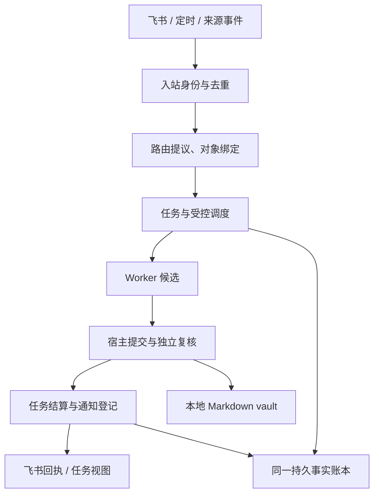

# Syno Super Agent 架构审查与实施规划

2026-11-18 · 已纳入真实付费验收、整体重构选项，以及飞书、Worker 和生产切换的阻断条件

**2026-11-19 Owner 路线更新：** 不再要求旧能力等价或旧 Runtime 迁移；后续能力全部按新架构纵向重建。Markdown vault 与切换安全事实保留，旧 Task／Workflow／Session 只读归档。下一步详见 `/Users/hoye/Documents/workspace/syno-personal-butler-p0/docs/plans/superagent-p0/NEXT-EXECUTION-PLAN.md`。

## 1. 路线决策

**建议按 Syno 自己的领域契约整体重构，内核由一轮短验证选定。** 先冻结 Task、Attempt、对象版本、验收、效果回执和通知的产品语义，再用「测试飞书收录公开文章 → 对象定位 → 真实 Worker → 副本 vault 写入 → 独立复核 → 原消息回执」作为固定验收链路。用户允许测试产生模型费用，也接受完整重构。P0 同一工作树默认串行。若需要并行，真实基线和事务原型使用独立 worktree、运行目录、数据库与端口。若现有内核能通过有限扩展直接表达关键不变量，就复用其调度和持久化。如果需要维护第二份状态、反复绕过原生结算，或修改通用调度和重放，直接选单进程 SQLite Runtime。Orca 继续作为执行控制和主动发现的参考。

| 路线 | 已有证据 | 决策门槛 |
| --- | --- | --- |
| 复用 autoloop 内核 | 上游已有单事务日志与投影、去重、轮次、租约和恢复。V0–V4 检验了多条管家纵向链路 | 路由能在事务内校验对象版本。任务结算能在事务内校验当前 Attempt 并同步登记 Outbox。小范围扩展能通过回归和一次版本升级重放，就继续用 |
| 自研轻量 Runtime | 能直接表达对象版本、任务、验收和外部效果。需承担内核运维和恢复测试 | 事务原型需要另起状态库、反复将一轮执行状态重译为任务结果，或要改写原生调度、租约及重放规则时直接选用。复用同一行为契约、测试和领域模块 |
| Orca 作为唯一底座 | 已有 Task、Dispatch、进程身份和 Session 能力。当前 Task 完成会推进下游依赖，Bot 还会注入同 Owner 的其他 Chat 摘要 | 只有能通过现有扩展点控制业务验收、消除跨对象注入并保障飞书与 vault 语义时才重新评估 |

复用顺序为 Syno 现有领域模块 → autoloop 已验证内核 → Orca 小范围实现。Orca 的能力声明校验、当前进程身份检查及只读巡视测试可做小范围移植候选。完整 Structured Session Adapter 引入大量 Orca 专用类型，Bot Home、Mailbox、Items、Desktop/Mobile 和 Remote 构建各自都扩大了迁移面。若后续确有代码执行侧需求，可把 Orca 当隔离执行适配器，管家仍独立结算自己的 Task。

来源：[autoloop 事务实现](https://github.com/KKKKhazix/agent-autoloop/blob/1b89219558a493d701cb20e2c3b1876576709889/kernel/store.ts#L10-L48) · [Orca Task 结算](https://github.com/stablyai/orca/blob/44243be42221b6946c482aab39dfc0bc51ce06aa/src/main/runtime/orchestration/db/dispatch-context/attempt-task-settlement.ts#L14-L46) · [Orca 跨 Chat 摘要](https://github.com/stablyai/orca/blob/44243be42221b6946c482aab39dfc0bc51ce06aa/src/main/bots/bot-recent-chats.ts) · [Orca Session Adapter](https://github.com/stablyai/orca/blob/44243be42221b6946c482aab39dfc0bc51ce06aa/src/main/native-chat/agent-session-wire/providers/structured-agent-session-adapter.ts)

## 2. 已验证、待验证与生产边界

| 基线 | 确认的事实 | 规划意义 |
| --- | --- | --- |
| 生产 Syno `e24b91f` | 飞书是唯一日常渠道。已有 Job/Workflow、效果回执、知识检查和发布恢复。知识发布覆盖 Wiki、图片和目录，并区分本地与云端状态 | 仅作历史行为与数据边界参考；可复用通用校验思路，但不要求迁移这些旧能力 |
| Orca 审查归档 `2c8ed3a` | V0 有取消和重放，V2 有对象版本、同对象串行、跨对象并行、强杀后恢复，V3 有真实飞书试验，V4 有副本 vault 结果复核。汇总记录无费用回归 41/41 | 保留原测试和脱敏样本。V2 的版本校验验证到单写入等效事务，V3 结束后已恢复生产旧监听 |
| autoloop 上游 `1b89219` | `commitLatest` 在写锁内重读并提交日志与投影。HTTP 入站事件入口直接调用 `ingest`，该路径按来源和事件 ID 去重与分派 | 有可扩展的事务位置。对象版本、可执行验收和结束时业务通知仍需通过受控命令验证 |
| Orca 上游 `44243be` | Worker 成功可结算 Task 并提升依赖状态。Bot 的近期 Chat 注入按请求者过滤，Owner 仍可见其他对象的近期摘要 | 接管业务语义牵涉结算与上下文注入两个边界。用 DAG 尾节点模拟验收，还需证明所有客户端、通知及下游都依赖验收结果 |

本次读取到的是实验验收与设计归档，未取得完整 Syno 实验 Runtime，未独立重跑 41/41，也未安装或运行 Orca。已有 41/41 继续充当确定性回归基线。付费真实验收是实施阶段的交付条件，尚未执行。`e24b91f` 是生产仓库的源码审查基线。P0 记录实际服务进程、启动路径、部署版本或产物指纹、启用的能力、飞书应用和有效工作目录，P3 切换演练前再核对一次。日志与报告只记录必要的脱敏标识。

来源：[Syno 当前入口与限制](https://github.com/hoye1113/syno-personal-butler/blob/e24b91fe7b8de8252aa058ced292b6919cce66b1/docs/KNOWN-LIMITATIONS.md) · [Syno 飞书发布验收](https://github.com/hoye1113/syno-personal-butler/blob/e24b91fe7b8de8252aa058ced292b6919cce66b1/docs/KNOWLEDGE-FEISHU-P1.md) · [V2 实验验收](https://github.com/hoye1113/syno-personal-butler/blob/2c8ed3a08de1d7fdb72c956c072a2f79d33e2427/docs/reviews/orca-superagent/baseline/butler-superagent/v2/VERIFICATION.md) · [实验汇总](https://github.com/hoye1113/syno-personal-butler/blob/2c8ed3a08de1d7fdb72c956c072a2f79d33e2427/docs/reviews/orca-superagent/baseline/butler-superagent/README.md) · [autoloop HTTP 路由](https://github.com/KKKKhazix/agent-autoloop/blob/1b89219558a493d701cb20e2c3b1876576709889/kernel/http.ts#L279-L331)

## 3. 目标架构

### 路由和执行

- **Root Router** 获取本轮用户消息和授权范围内的对象索引，输出继续／新建／切换／追问。批量输入按入站 ID 逐条生成决定。宿主基于当前对象版本提交，拒绝过时提议。多候选时持久化一次追问，回答只消费对应待决项。
- **Domain Specialist** 先用版本化规范、能力和验收规则实现。最小切片只需一个收录 Specialist，一个已有验证记录的真实 Worker，另配确定性假 Worker。相同领域的对象可以共享规则。文章、想法和项目分别绑定自己的内容引用、控制会话和回执目标。
- **Object Context** 固定 `owner_id`、`context_id`、对象版本和数据范围。可信用户控制消息、宿主运行事实、外部结果各自带来源和信任级别。默认新建外部结果处理会话。续会话前校验对象、Worker 类型、身份与配置版本。飞书回复目标从已验证入站事件读取。
- **Worker Contract** 首版覆盖启动、结果与产物引用、停止请求、按能力恢复。进程报告验证当前 Attempt 和进程实例，复用 Runtime 的租约与执行令牌。适配器启用前运行其真实启动路径的隔离验收。先验收一种 Worker，P2 对第二种 Worker 重跑同一套边界测试。Claude、OpenCode、DSH、Pi 按真实能力启用，环境无需 Codex。
- **并发** 同对象控制动作按顺序提交，独立对象可以并行。首版控制总 Worker 并发以保证飞书入站和通知及时。超时和取消先登记意图，再终止进程或等待对账。租约过期只说明宿主失联；旧进程已经触发的效果仍由受控执行器核查。

### 任务、验收和外部效果

| 记录 | 归属与关键规则 |
| --- | --- |
| Inbox / Context | 以飞书应用和入站消息 ID 去重。对象版本变更和路由决定一次提交。重复命令先返回已提交回执，再检查版本 |
| Task | 绑定目标、对象、触发事件、验收规范版本与回复目标。一个 Task 可跨多个执行轮次。若沿用 autoloop，通过原生日志保存业务任务事实，视图从事实重建 |
| Attempt | 标识执行代次、底层 run、进程和 Session。保存原生日志所需信息，避免再实现一个可领取队列 |
| 决策 | 指代不明进入澄清。受保护动作的确认绑定具体操作、目标和内容版本。明确且在现行权限内的本地操作自动执行，保留 Syno 的 trust-but-clarify |
| 效果回执 | 每个逻辑效果持久化稳定业务键、请求摘要、目标版本、状态和证据。键跨 Attempt 保持，按不同逻辑操作分别生成。超时进入 unknown 并只读对账，只有证明零效果或满足已验证的幂等能力才自动重试 |
| Result / Delivery | 独立复核通过后，在一笔事务写业务终态和待投递事实。投递记录区分排队、平台已接受、待对账和已读。按钮关闭与业务验收单独记录 |

**产品任务成功路径**为候选生成、宿主提交、独立重读和版本校验、终态及待投递登记。Worker 报 `done` 只结算执行轮次。宿主根据任务选取版本化验收规则，验证文件路径、内容哈希、Git 或远端受管字段等必需证据，再在 `FinalizeTask` 中校验当前 Attempt、对象版本和已持久化的验收记录。必需证据错误时阻断完成，缺失或结果未知时按任务语义待核验。模型只给内容质量意见，不参与事实裁决。验收用例固定让质量模型给高分，同时分别提供错误路径、哈希和远端版本，断言没有成功终态、成功通知或下游推进。声明“已同步”前，独立核对 Wiki、图片和目录都对应同一内容版本。

**取消竞态要单测。** 固定提交的 autoloop 会让仍在当前租约内的成功回执走 `applyReceipt`，即使已发出停止请求。产品层必须为「取消已请求／确认停止／效果已提交／效果未知」提供真实结算，取消先锁住新增写入，已发生效果仍对账。旧 Attempt 的报告可以留作排查，业务状态和通知提交必须在当前权限下复核。

**数据库、vault 和飞书分别用各自的提交证据。** 对 vault 保存目标路径、稳定 note ID、原版本与预期内容摘要，复用现有路径校验、GitGuard、Validator 和写入协调逻辑。进程在文件或 Git 更新后强退时，根据真实产物对账。冲突交给现有版本控制语义，禁止用恢复操作覆盖用户新编辑。个人偏好与确认决策保持在受控个人记忆中，正式知识以 Markdown 为准。不可变日志保存必要引用和脱敏证据，私有正文与附件在授权范围内按需读取，数据出口在宿主和进程边界执行控制。

**飞书分三种验证。** 入站重放、已知 `message_id` 的卡片更新、发送成功但回执丢失是不同路径。现有生产 `FeishuChannelAdapter` 声明 `at_least_once`，普通发送没有透传稳定平台去重键。飞书发送 API 文档的 `uuid` 有一小时去重窗口，需实测目标发送或回复 API 以及实际 SDK 路径。窗口外若查不到可靠回执，保留待对账状态。飞书回调的“已处理”应复用原卡片，并验证 Owner、原消息及当前卡片版本。

来源：[autoloop 取消与回执处理](https://github.com/KKKKhazix/agent-autoloop/blob/1b89219558a493d701cb20e2c3b1876576709889/kernel/decide.ts#L487-L516) · [Syno 现行执行语义](https://github.com/hoye1113/syno-personal-butler/blob/e24b91fe7b8de8252aa058ced292b6919cce66b1/docs/adr/0003-execution-semantics.md) · [飞书 Adapter](https://github.com/hoye1113/syno-personal-butler/blob/e24b91fe7b8de8252aa058ced292b6919cce66b1/packages/syno-core/feishu-channel.mjs#L255-L265) · [飞书发送 API](https://open.larkenterprise.com/document/uAjLw4CM/ukTMukTMukTM/reference/im-v1/message/create) · [SQLite 隔离语义](https://www.sqlite.org/isolation.html)

## 4. 启动与切换的阻断条件

### 飞书真实连接前 · P0–P3

- **默认使用独立测试应用。** 显式指定测试 App ID、凭据、账号与 Chat 范围，使用独立 Inbox、Outbox、数据库与发布目标。启动过程先校验配置并取得覆盖同一应用订阅流的独占锁，再建立长连接。测试环境误填生产 App ID、缺少测试范围或重复启动时，直接阻断。单机锁应使用运行实例共享的位置，部署清点还要排除其他机器用同一测试应用接入。
- **同应用多个长连接会竞争事件。** 飞书按应用把事件分给多个客户端中的一个，客户端收到后的 Chat ID 过滤可能丢掉已经被它接走的生产事件。若复用同一应用，只考虑已有唯一订阅入口在接收端完成可靠分流，或在生产切换演练中明确停旧、确认退出后再启新。首选独立应用，以减少实施面。[飞书长连接事件文档](https://open.feishu.cn/document/ukTMukTMukTM/uYDNxYjL2QTM24iN0EjN/event-subscription-configure-)
- **通过证据。** 离线测试启动配置、重复启动、错误 Chat 和重复事件，证明误配或抢锁失败时未建立连接。接真实测试应用后，从白名单 Chat 发送测试消息，验证一个 Task、正确目标回执和隔离的输出。重复事件在所属流中只建一次任务。测试应用暂未就绪时可继续事务原型、确定性回归及满足 Worker 边界的单项真实模型调用，真实飞书端到端状态标为待验。

### 真实 Worker 启用前 · P0–P2

| 范围 | 首版实施要求 |
| --- | --- |
| 进程与工作目录 | 用受控 OS、容器或虚拟机边界启动实际适配器。受限账户运行。工作目录和可写区限定在当前 Attempt，Home 和缓存隔离，输入以最小只读挂载或副本提供。子进程继承相同约束 |
| 环境与凭据 | 由宿主构造环境白名单，避免继承宿主默认环境、凭据目录、代理入口或运行时管理套接字。飞书和正式 vault 由宿主持有。模型鉴权优先由受限代理持有，或使用仅匹配该 Worker 用途的凭据 |
| 网络与工具 | 出网默认拒绝，通过受控出口只放行该适配器所需的模型调用和经授权的只读工具。由宿主检查操作、对象和路径权限并应用产物。真实 Worker 的直接写入限定在 Attempt 工作区 |
| 重启与取消 | 每次启动和恢复重应用同一隔离配置。配置缺失、策略无法加载或平台不支持时，拒绝启动该 Worker，并明确报告可用性状态 |

**通过证据。** 在实际启用的启动器、宿主平台和 Worker 版本上，先用合成探针验证三项禁止动作确实被执行边界拒绝：文件范围外的测试文件、测试环境里的哨兵凭据、未批准测试地址。再验证正向路径：当前对象输入可读、Attempt 输出可写、允许的模型调用成功、宿主能重读产物。P1 首个真实 Worker 在参与完整链路前通过，P2 每新增适配器必跑。隔离目录、单独的 Home 和工具提示可辅助组织运行，真实拒绝证据以实际进程结果为准。

### 生产接管前 · P3 交付，P4 入口

2026-11-19 起，P3 不再刷新旧能力等价矩阵，也不要求迁移旧工作流。验收对象改为新架构的领域能力清单：统一 Root Router、Knowledge、Idea、Project、Decision、Memory、Runtime Host 与生产候选恢复。只有新产品明确启用的能力才列入阻断项；旧系统曾实现某功能不再构成保留理由。

| 矩阵字段 | 填写要求 |
| --- | --- |
| 领域与入口 | Specialist、用户入口、启用条件、对象类型与实际配置证据 |
| 业务契约 | 目标对象、关键权限、用户结果、外部效果与故障回收行为 |
| 新实现与证据 | 对应入口、可复跑用例、真实平台或确定性回归证据、数据处置 |
| 结论 | `已验收`、`未实现` 或 `不启用`。不启用只表示新产品当前没有该领域，不是把旧能力偷偷迁移或删除 |

P4 入口要求所有已启用的新领域验收通过，Markdown vault、Owner 绑定、入站去重水位和已启用外部效果映射有处置，生产订阅独占与回退增量演练通过。旧 Task／Workflow／Session 只读归档，不恢复执行。发布、飞书等外部能力一旦启用，必须以受控真实目标验收。

## 5. 按完整链路实施

| 阶段 | 工作与交付物 | 退出条件 |
| --- | --- | --- |
| P0 真实基线与内核验证 | 核对实际部署版本并建立能力清单初稿。验证 `ApplyRoute`、`FinalizeTask` 能否借用 `commitLatest` 表达业务事务。把已有 41/41 对应到可复跑入口。满足对应启动条件后，采集当前可运行基线的公开文章真实收录轨迹 | 双版本竞争只有一个生效。提交后回执丢失可重放。结算和通知原子提交。重建投影结果一致。保留实际补丁、测试证据和内核结论。真实基线缺项单列待验，不据此阻塞与之独立的内核验证 |
| P1 新 Runtime 的真实端到端切片 | 验证飞书启动隔离和首个真实 Worker 实际边界。用选定内核、测试飞书、一个收录 Specialist、真实 Worker 与模型、公开文章和副本 vault 跑通整条链。复用路径、校验、写入协调 | 可追溯 `event → context → task → attempt → 文件版本 → delivery`。真实链路有多次独立输入和一次重放。高质量假产物无成功终态或通知。写入后强杀，恢复后只留下一个业务产物。跨对象伪造、旧 Attempt、重复按钮和丢回执通过 |
| P2 对象隔离与 Worker 替换 | 增加知识查询和第二个真实 Worker，复跑隔离正反例。用真实请求验证 A/B、多轮续接与歧义，用故障注入验证慢任务、取消、超时、恢复和停机重启。用同一逻辑键测试并发同来源收录 | A 慢时 B 可完成。歧义没有任务副作用。更换 Worker 后 Task 历史连贯。证据中没有跨对象正文、会话、回执或高信任记忆污染 |
| P3 新架构领域能力与生产候选 | 收敛统一 Runtime 与 Root Router；按纵向切片增加 Idea、Project、Decision、Memory；补 queued 自动唤醒、状态视图、独占接管与回退演练。旧能力不迁移 | 所有已启用的新领域均有真实链路与故障证据。对象隔离、多轮续接、Worker 替换和 Result Lane 不被破坏。数据安全事实有处置，切换窗口入站可追踪 |
| P4 生产切换与观测 | 核验新架构能力清单。经 Owner 单独授权后冻结旧写入并确认旧消费者退出，由唯一新 Runtime 接管。旧系统只读归档，重点观测 backlog、unknown、重复和对象路由 | 预先约定观察周期。零重复副作用、零跨对象泄漏、零未解释任务或通知缺口。新期间数据可对账，已验证安全停止与回退处置 |
| P5 主动发现 | 从一个订阅目标、一个真实公开来源和本地静默输出开始。复用内核定时，确定性预检和去重后按需调真实模型。候选在用户选择跟进后，通过同一入站与任务链路处理 | 新内容能生成可追溯候选。无变化零模型调用。重复转载和冷却生效。睡眠恢复有限补跑。恶意来源无法触发写入或启动 Worker。用量、次数、静默和失败暂停可观测。后续评估 Tidy-up |

**P0 的路线判定。** 业务接口可在同一账本可靠表达就复用 autoloop。若为了这些基本语义需要长期维护两套状态或广泛修改上游通用机制，结束适配原型，按同一契约自研。记录固定版本上的实际补丁范围、公共契约、回归和升级重放结果。P0 的 1–2 个工作日和 Orca 支线的半天至一天是资源估计，路线按源码和测试证据判定。到估计时间仍缺证据时，明确哪项结论待定及最低成本的验证方式。

### 真实付费验收

| 验收层 | 运行方式与证据 |
| --- | --- |
| 确定性回归 | 用假 Worker、受控时钟和故障注入稳定覆盖版本冲突、重复入站、进程强杀、旧 Attempt、取消竞争、提交和投递回执丢失。每次改动均可重跑 |
| 真实端到端 | 用真实 Worker 和已配置模型处理公开资料，通过测试飞书和副本 vault 完成写入、重读、发送及卡片回调。至少验证正常收录、同一事件重放、同一对象续接和一个真实链路上的恢复场景。保存可核验的消息 ID、文件版本和脱敏事件轨迹 |
| 发布与迁移验收 | 真实写入受控的测试 Wiki、图片与目录。注入发送或发布成功但本地记录失败，检查查询或对账。使用生产凭据和正式目标之前按既定切换流程执行 |

真实用例记录退避与重试、端到端耗时、模型和 Worker 版本、可取得的输入／输出／缓存 Token 与费用，按成功任务汇总。稳定性由结果、状态与回执来判断，费用数据用于理解运行成本。采用公开或合成数据、测试飞书与副本 vault。强杀、重放等组合主要用确定性回归覆盖，把真实调用留给会话续接、工具协议、结果生成和实际平台交付。

**Orca 验证为可选支线。** 推荐先完成 P0。若 P0 证明 autoloop 不适合，或者近期确需 Orca 的多机执行，给 Orca 半天至一天的同用例验证。用合成数据和固定提交验证错误的 Worker 成功不会让任何业务下游解锁，A/B 数据不会跨对象注入，重启后可查同一尝试及取消状态。需要修改核心结算或多处 Bot 注入时结束底座评估。该验证无需生产凭据。

## 6. 数据切换与回退判定

| 记录类型 | 新架构处置 |
| --- | --- |
| Markdown vault | 保留正文、稳定对象 ID、版本、引用与哈希；测试副本验证备份恢复和增量对账 |
| Owner 与入站去重 | 保留 Owner 绑定、已处理消息键与对账水位，避免接管后重放执行 |
| 旧 Task／Workflow／Session | 只读归档，不迁移为新 Runtime 的可执行状态；结果未知项在旧侧停止并对账 |
| 新架构活跃 Task／Decision | 只在新 Runtime 内按对象、Attempt 和版本恢复；不回译为旧工作流 |
| 已启用外部效果 | 保留稳定业务键、目标版本与回执；unknown 先对账，不重复发送或发布 |
| 历史运行记录 | 只读留档，保留必要引用和脱敏证据，不复制凭据或无关正文 |

切换前验证 vault 备份可恢复。切换后回退先停新入站和新写入，清点新期间对象、入站、投递及外部效果。只有在数据能安全对账时才恢复任一消费者；无法安全回退时保持停止并前向修复，不通过双消费者或恢复旧工作流掩盖差异。

## 7. 下一执行任务

按 `/Users/hoye/Documents/workspace/syno-personal-butler-p0/docs/plans/superagent-p0/NEXT-EXECUTION-PLAN.md` 的 P3.0 开始：统一 Runtime 与 Root Router，收录和知识查询改为 Specialist Registry 中的两个领域，补同对象 queued 自动唤醒并复跑真实飞书回归。完成后再由 Owner 决定是否进入 Idea Specialist。每阶段保留独立提交、固定版本、复现实验命令和脱敏证据。
