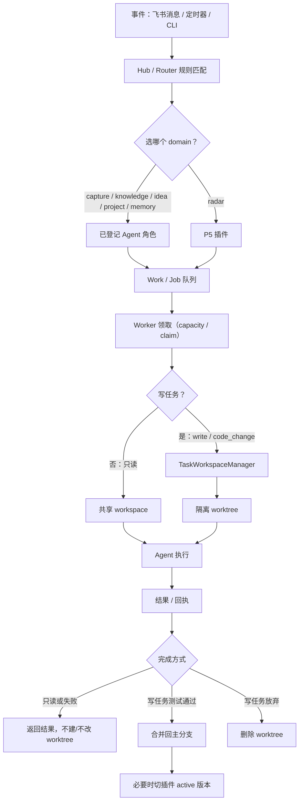

# Work 模型：Agent / Worker / Work / Task / Worktree

> 适用范围：Syno P3 生产 Host、AutoLoop 协议、P5 插件与 TaskWorkspaceManager。
> 目标：避免 `work`、`job`、`task`、`worker`、`agent` 在代码和对话里混用。

## 1. 一句话区分

- **Agent**：岗位和技能，负责“做什么”
- **Worker**：接单的机器或进程，负责“在哪里跑、同时接几单”
- **Work / Job**：一张工单，负责“这次具体做什么”
- **Task / Run / Attempt**：Syno 内部的任务、运行与尝试记录
- **Worktree**：写任务的隔离文件目录，负责“不要互相踩文件”

## 2. 流程图



## 3. ASCII 版

```text
事件
  │
  ▼
Hub / Router ──► 固定 Agent 角色（capture / knowledge / idea / project / memory / radar）
  │
  ▼
Work / Job 队列
  │
  ▼
Worker 领取（claim + capacity）
  │
  ├── 只读任务 ──► 共享 workspace ──► Agent ──► 结果
  │
  └── 写任务 ────► TaskWorkspaceManager ──► 隔离 worktree
                                              │
                                              ▼
                                            Agent
                                              │
                                   ┌──────────┴──────────┐
                                   ▼                     ▼
                              测试通过合并           失败/放弃删除
```

## 4. 四个核心对象

| 对象 | 本质 | 谁创建 | 生命周期 | 是否复用 |
|---|---|---|---|---|
| **Agent** | 角色/执行配置：模型、权限、提示词、技能 | 主人或开发者在规则中登记 | 长期角色，按 Job 启动 | 复用 |
| **Worker** | 进程/机器/接单器：claim、心跳、容量、恢复 | 主人安装并启动 | 长期运行 | 复用 |
| **Work / Job** | 一张工单：run、token、attempt、rule、agent、context | Hub / 规则引擎按事件创建 | 一次执行 | 不复用 |
| **Worktree** | Git 独立目录：分支、base、commit、diff | TaskWorkspaceManager / GitGuard | 一个写任务 | 完成后合并或删除 |

补充：

- **Task**：Syno 的业务任务记录，通常 `task-<messageId>`。
- **Run / Attempt**：一次实际执行；失败重试会产生新的 attempt/run。
- **Job** 在 AutoLoop 里就是 Work 返回的工单；在旧 P0 ops 里 Job 是另一套业务操作记录，阅读代码时要看上下文。

## 5. 谁决定什么

### 角色

`rules.agents` 是固定注册表。Agent 不能自己创建新角色；新增角色必须改配置或走开发流程。

### 派单

Hub / Router 根据 source、event type、规则决定：

```text
rule.to -> agent
agent.worker -> worker
```

Worker 只负责领取，不决定业务路由。

### 沿用还是新建

| 情况 | 行为 |
|---|---|
| 新消息 | 新 Task / 新 Work |
| 同一 idea/project | 复用对象 Context，但产生新的 Task/Attempt |
| 已回答/已取消 | 不重复执行 |
| 多候选 | 创建 Decision，等待主人选择 |
| 只读任务 | 共享 workspace，不建 worktree |
| 写任务 | `TaskWorkspaceManager` 建隔离 worktree |
| 插件升级 | 新版本目录 / active 指针，不是每个聊天一个 worktree |

## 6. 例子

### 只读查询

```text
“查一下 MCP 的资料”
→ knowledge Agent
→ Worker 领取
→ 共享 workspace
→ 返回结果
→ 不创建 worktree
```

### 代码/插件写任务

```text
P5 插件 v4
→ TaskWorkspaceManager 创建 .worktrees/syno-job-p5-plugin-v4
→ Agent 在隔离目录修改
→ 测试
→ 合并回主分支
→ 删除 worktree
→ 切 active 插件版本
```

### P5 日报

```text
07:30 collect
→ P5 插件采集
08:00 renderDailyDoc
→ 返回中性 AST
→ Host 创建飞书文档
→ 发送短链接
```

这是一次全局 worker 任务，不按聊天创建 worktree。

## 7. 关键结论

- **Worker 和 Agent 是固定角色/运行设施。**
- **Work / Job 是事件动态产生的工单。**
- **Task / Run / Attempt 是 Syno 的业务与执行记录。**
- **Worktree 只在写任务时出现，不是聊天目录。**
- 不能让 Agent 自由创建角色；角色变更必须走配置/开发流程。
- 不能让所有 Task 共用一个可变 workspace；写任务必须隔离。
