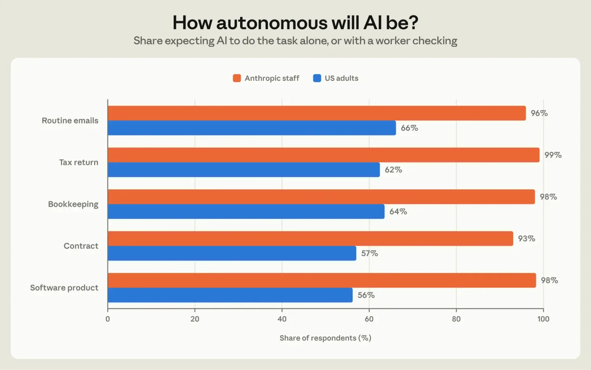
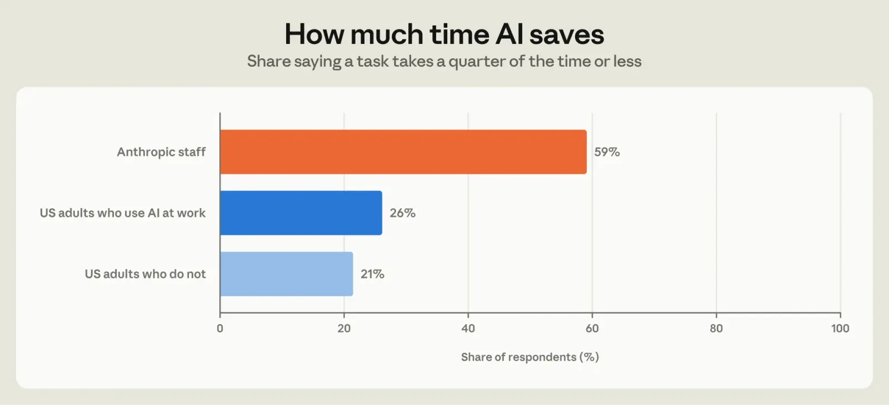
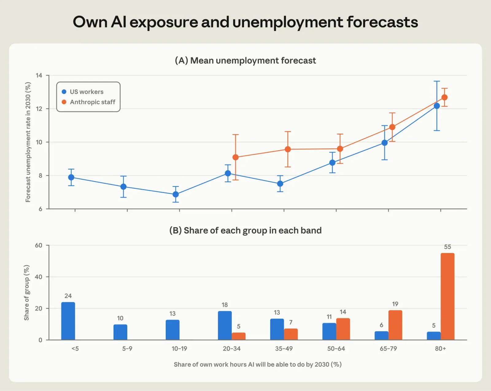
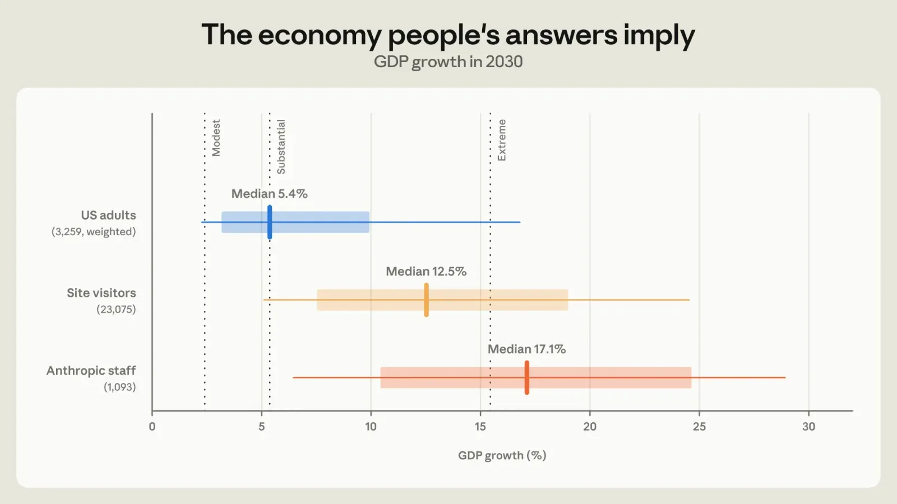
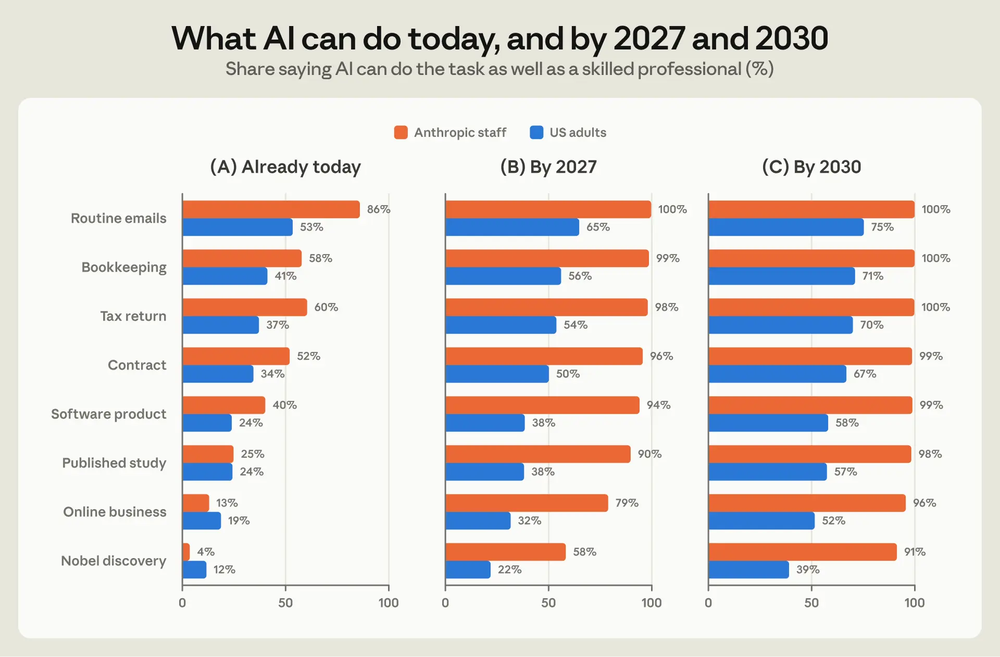
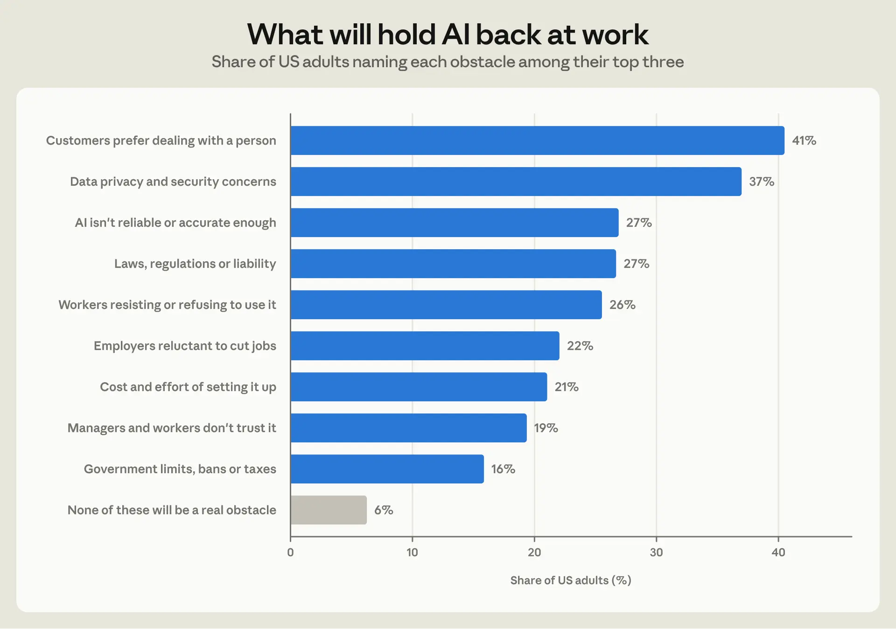
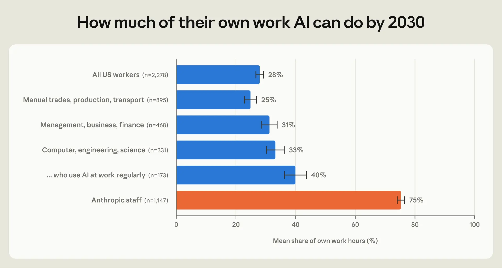
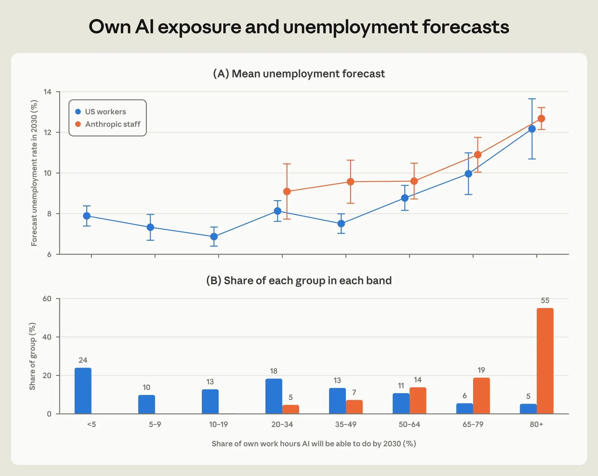
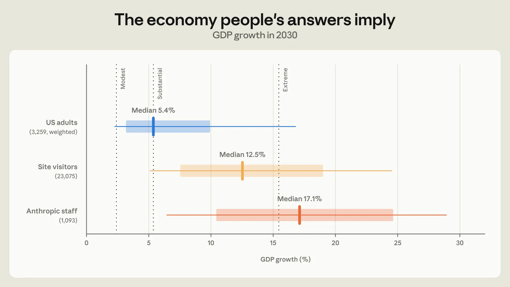
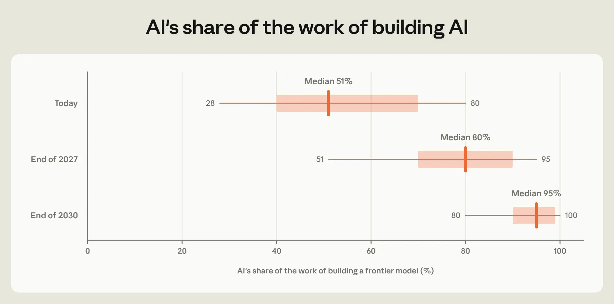

# Anthropic 调查揭示公众与员工对 AI 影响的预期鸿沟

## 导读

Anthropic 研究所 2026 年 10 月技术报告（AIHOT 聚合页转载，含 AI 翻译全文）：2026 年 8 月对全美代表性成人样本（N=10,980）与 Anthropic 员工的对比调查。核心发现：两组人对 AI 现有能力判断相近，但对进展速度分歧巨大——91% 员工预期 2030 年前 AI 能做出诺贝尔级发现（公众 39%）；员工平均预期 AI 能完成其当前 75% 的工作（美国劳动者 28%）；两组人预期自身工作暴露度越高则预测失业率越高，劳动力市场推断框架一致。报告将回答映射到《变革性 AI 的经济情景》模型，公众中位隐含 2030 年 GDP 增长 5.4%，员工中位隐含 17.1%；员工估计构建前沿模型的工作如今 51% 由 AI 完成，2030 年底达 95%。数据可用于校准个人对 AI 能力与经济影响的判断。

## 来源正文

Anthropic 调查揭示公众与员工对 AI 影响的预期鸿沟 · AIHOT

 跳到正文

 返回

 Anthropic：Research · 2026-10-16 00:00 · 3 天前 精选 AI 评分 60

Anthropic 调查揭示公众与员工对 AI 影响的预期鸿沟

The AI expectations gap

AI 导读

Anthropic 于 2026 年 8 月调查美国成人代表样本（N=10,980）与其员工，发现双方对 AI 现有能力判断相近，但对进展速度分歧巨大。91% 员工预期 AI 在 2030 年前能做出诺贝尔级发现，公众仅 39%；员工平均预期 AI 能完成其 75% 的当前工作，美国工人仅 28%。

推荐理由

调查用同一框架量化公众与前沿实验室员工对 AI 能力、生产率和失业预期的差距，数据可用于校准自己的判断。

 另外 3 家也报道了

 另外 3 家也报道了

 正文 · AI 翻译

 Szymon Sacher、Tess Cotter、Charles I. Jones、Anton Korinek、Peter McCrory

 主要发现

美国成年人预计 AI 能力将在未来几年迅速提升；Anthropic 员工预计进展会更快；39% 的美国成年人和 91% 的员工预计到 2030 年 AI 将能够做出诺贝尔奖级别的发现。

Anthropic 员工预计，在 AI 擅长的任务上，AI 带来的生产力提升要大得多。在工作中使用 AI 的美国成年人中，26% 表示一项任务使用 AI 后耗时缩短至四分之一或更少，而 Anthropic 员工中这一比例为 59%。

当涉及自己的工作时，超过半数的 Anthropic 员工预计到 2030 年 AI 将能够完成他们当前至少 80% 的工作，相比之下美国劳动者中这一比例仅为 5%。

在美国劳动者和 Anthropic 员工中，那些预计 AI 能完成自己更多工作的人都预期失业率会更高。尽管对 AI 未来能力的看法存在差异，但两组人对于 AI 可能如何改变自己工作与更广泛失业之间关联的认知非常相似。

 引言

AI 将如何在未来几年重塑经济？AI 能力正在迅速提升，而未来 AI 模型可能能够构建自己的后继者（递归自我改进），这可能进一步加快进步的速度。这一前景多快会实现、在多大程度上实现，尚不清楚。各种预测差异巨大，争论激烈。

关于 AI 对未来经济影响的核心分歧来源是什么？主要源于对 AI 能力提升速度的看法不同？还是反映了对能力以多快速度、以何种形式转化为现实应用的看法不同？哪些关于 AI 未来路径的观点与快速经济增长相一致？

本报告就这些问题提供了新的调查证据。2026 年 8 月，我们调查了两组人群：一个具有全国代表性的美国成年人样本和 Anthropic 员工。 1 问题涵盖 AI 的能力、其使用范围将有多广、能节省多少时间、自主性将有多高，以及被替代的劳动者在其他职业中找到工作的难度有多大等。 2 Anthropic 员工每天都在构建和使用前沿 AI。因此，第二项调查展示了最接近这项技术的人如何预判其未来，包括能力和更广泛的经济影响。

我们报告以下主要发现。第一，两组人对 AI 今天能做什么大体一致，但对未来进步的速度存在分歧。Anthropic 员工预计能力提升更快、AI 将被更广泛地使用且人类参与更少、在任务上节省的时间要多得多。例如，91% 的员工预计到 2030 年 AI 将能够做出诺贝尔奖级别的发现，而美国成年人中这一比例为 39%。

第二，在人们自己的工作方面存在显著差异。平均而言，员工预计到 2030 年 AI 将能够完成他们当前 75% 的工作，而美国劳动者总体这一比例为 28%。

第三，两组人似乎以相似的方式思考劳动力市场：那些预计 AI 未来能完成自己更多工作的人预测失业率会更高。而且，在预期 AI 自动化自己工作的相同水平上，两组人预测的失业率大致相同。

 人们期望 AI 做什么

 能力

我们首先调查了人们对 AI 能力的预期。我们询问 AI 何时能像熟练专业人士一样完成八项任务，从撰写日常邮件到做出诺贝尔奖级别的科学发现。美国成年人和 Anthropic 员工对 AI 今天能做什么大体上看法一致，尤其是在更复杂的任务上。两个群体对任务难度的排序几乎相同（图 1，A 组）。

两个群体对未来 AI 进展的路径存在分歧。例如，大约四分之一的美国成年人和 Anthropic 员工认为，AI 今天就能设计、开展并发表科学研究。但到明年，每 10 名员工中就有 9 人预期 AI 能做到这一点，而普通公众中这一比例仅为 38%。到 2030 年，39% 的美国成年人预期 AI 能够做出诺贝尔奖级别的发现（C 组），而员工中这一比例为 91%。也许最显著的差异在于，视任务而定，19% 到 40% 的美国成年人表示 AI 永远 无法完成某项任务，而员工中这一比例最多为 2%。

这些观点差异部分反映了 AI 使用频率的差异。在经常在工作中使用 AI 的人（约占受访者的五分之一）中，56% 预期到 2030 年 AI 能够完成八项指定任务中的至少七项。这远高于所有美国成年人（41%）以及从未使用过 AI 工具的人（28%），但仍远低于员工的看法（96%）。

 图 1：预期 AI 能够像熟练专业人士一样完成所列任务的受访者比例。 受访者被问及 AI 何时能完成这些任务，无论公司是否真的会使用它。各图分别显示回答（A）已经可以、（B）到 2027 年、以及（C）到 2030 年的比例。美国成年人的回答（N=10,980）经过加权以具有全国代表性，Anthropic 员工的回答未加权。
 采用及其障碍

AI 对经济的影响并不完全取决于其原始能力。人们和企业需要真正使用 AI，而这需要时间和试验。在 AI 将能够完成的工作任务中，美国成年人预期到 2030 年其中 42% 将由 AI 完成。Anthropic 员工预期未来几年扩散速度明显更快，AI 将用于所有可被其使用的任务中的 65%。

为了解什么可能阻碍 AI 在工作中的采用，我们让美国成年人从九项障碍中最多选择三项，认为它们将是最大的障碍。普通公众预期，人们的偏好和规则，而非技术限制，可能才是阻碍采用的因素（图 2）。“客户更愿意与人打交道”是被选择最多的障碍，其次是“数据隐私和安全担忧”、“AI 不够可靠”以及“法律、法规或责任”。

 图 2：美国成年人指出的 2030 年工作中使用 AI 的障碍。 受访者被告知，即使 AI 在技术上能够完成某项任务，企业也并不总是使用它，并被问及在九项障碍中，哪一项将是 2030 年工作中使用 AI 的最大障碍。每人最多可选择三项，因此比例之和超过 100%。我们没有向 Anthropic 员工询问这个问题。

值得注意的是，经常在工作中使用 AI 的美国成年人将数据隐私和安全担忧排在首位（42% 认为它是前三大障碍之一，而其余人群中这一比例为 37%），并认为客户更愿意与人打交道这一点略不那么重要（37% 对 42%）。

 AI 将有多自主

AI 对劳动力市场的影响，部分取决于 AI 是自主完成复杂任务，还是与人类协作完成。前者往往会取代人类劳动者。反之，当 AI 补充人类能力时，劳动者的生产率会提高。为了解 Anthropic 员工和公众对 2030 年自动化与增强的预期，我们询问了到 2030 年 AI 和人类将如何在从起草邮件到法律合同等各种任务上协同工作。在 Anthropic，绝大多数员工表示，到 2030 年，AI 将要么独自完成任务，要么由一名员工评估其工作（图 3）。相比之下，4 成美国成年人反而预期，大部分工作将由人类自己完成，或仅借助一些 AI 帮助。

 图 3：预期 AI 独自完成任务或由员工检查完成任务的受访者比例。 受访者被要求设想 AI 对五项任务中的每一项都有用，并回答将由谁来完成这些任务：仅 AI；AI 完成大部分，员工检查；员工完成大部分，AI 协助；或仅员工。柱状图显示选择前两项的比例。
时间节省

AI 能在多大程度上提高产出，不仅取决于它能完成哪些任务、使用范围有多广，还取决于它完成任务的速度快多少、质量好多少。一项仅好到足以取代劳动者的技术——Acemoglu 和 Restrepo（2019）称之为“平庸”技术——会在 GDP 没有多少增长的情况下取代工作。相比之下，一项能以很小一部分成本或一小部分时间完成的技术，则能显著提高 GDP。

为衡量人们对 AI 带来生产率提升的看法，我们询问公众和 Anthropic 员工：对于一项 AI 很适合的任务，使用 AI 需要多长时间，与不使用 AI 相比如何。一项任务若用时减半，就相当于每小时产出翻倍。 3

Anthropic 员工报告的预期节省要大得多，85% 的人表示用时为一半或更少。在工作中使用 AI 的美国成年人中，典型答案是时间减半，29% 的人表示任务用时相同或更长，而员工中只有 5% 这么说。在美国成年人中，工作中使用 AI 的人有 26% 表示任务用时为四分之一或更少，工作中不使用 AI 的人有 21% 这么说。对于员工，这一比例为 59%（图 4）。

员工可能是在描述他们在工作中的实际体验。正如 Anthropic 的就业正在如何变化 中进一步讨论的那样，Anthropic 员工在采用智能体工具后，在某些维度上提高了生产率：工程师在采用编码智能体后的一个月内新增代码行数增至三倍，销售代表在采用 AI 智能体后与客户达成了更多交易。法律和招聘等其他业务职能的人均产出也有所上升。

 图 4：表示使用 AI 时任务用时为四分之一或更少的受访者比例。 受访者被要求想一项当今 AI 很适合的任务，例如总结文档或起草邮件，并考虑使用 AI 完成它需要多长时间——包括检查和修正其工作所花的时间——与不使用 AI 相比。柱状图显示回答“大约四分之一的时间”或“大约十分之一的时间或更少”的比例。图 A2 显示所有回答。
 自身工作与岗位

 AI 将能完成其自身工作的多少

也许并不令人意外的是，我们发现，在AI对自身工作的影响这一问题上，公众与Anthropic员工的看法存在巨大差距（图5）。平均而言，Anthropic员工表示，到2030年，AI将能够完成他们当前工作时间的75%。美国劳动者（报告自己有工作的受访者）平均认为这一比例为28%，且仅有二十分之一的人表示，到2030年AI能够完成其80%或更多的工作时间。

在美国劳动者中，预期因职业而异：体力行业、生产与运输行业的劳动者预计AI能够完成25%的工作时间，而计算机、工程与科学类职业的劳动者预计为33%。对于后一组人群，那些经常使用AI的人预计仅为40%，这一看法更接近美国劳动者的平均水平，而非Anthropic员工的平均水平（75%）。

 图5：受访者预计到2030年AI能够完成其自身工作时间的比例。 受访者预计到2030年AI能够完成其当前工作时间的比例。美国成年人样本仅限有工作的受访者。员工通过滑块作答，而美国成年人选择区间，我们取区间中点。柱状图显示95%置信区间。
 自身工作暴露度与失业预测

人们预计AI能完成自己多少工作，在很大程度上解释了他们对劳动力市场的预期。我们告知受访者当前失业率约为4.2%，并要求他们预测2030年的失业率。图6按受访者预计到2030年AI能够完成其自身工作时间的比例对其进行分组，并显示各组的平均失业率预测。

预计AI能够完成自己不到一半工作的美国劳动者，预测失业率为7%至8%。超过一半后，预测值随AI暴露工作比例上升而增加。那些预计AI能完成自己80%或更多工作的人，平均预计2030年失业率为12.2%，高于大金融危机期间的峰值。在美国劳动者中，受影响工作比例每增加十个百分点，预测失业率就上升0.4个百分点。对AI的总体乐观态度并不能解释这一点。在自身工作暴露度固定的情况下，劳动者预计AI能掌握的八项任务所占比例与预测无关。

尽管Anthropic员工自报的暴露度高得多，但同样的梯度也出现在他们之中，其预测与普通人群的预测高度一致。因此，这两个群体似乎并不持有关于AI将如何同时影响自身工作和更广泛劳动力市场的不同理论。他们对AI能力是什么有着不同的体验，进而有着不同的预期。

 图6：按受访者预计到2030年AI能够完成其自身工作时间的比例，对2030年失业率的平均预测。 受访者被告知美国当前失业率为4.2%，并被问及他们预计2030年失业率会是多少。面板（A）按有工作的受访者预计到2030年AI能够完成其当前工作时间的比例对其进行分组，并显示各组的平均预测值和95%置信区间。受访者少于20人的组被省略。面板（B）显示各组中美国劳动者和Anthropic员工所占比例。
 招聘与再就业

尽管 Anthropic 员工预计 AI 能够完成他们的大部分工作，但他们也预计 Anthropic 会继续招聘。95% 的 Anthropic 员工预计未来 12 个月员工人数将增长，员工预期的中位数为增长 66%，27% 的人预计至少会翻倍。这些是员工在内部民意调查中的个人预期，并不代表 Anthropic 的计划或其对员工人数的看法。即便如此，它们表明，至少在一家前沿 AI 实验室，自动化任务和裁减工作岗位是不同的预测。

然而，对于被 AI 取代的工人能多快找到新工作，Anthropic 员工比美国成年人略微更悲观。我们询问，一个在 2030 年被 AI 自动化夺去工作、并且需要转换职业的人，需要多长时间才能找到新工作。 4 Anthropic 员工的中位预期是，被 AI 取代的工人需要 12 个月才能在新职业中找到职位。相比之下，美国成年人的中位回答在 7-12 个月范围内。

 对 AI 的预期及其经济影响

 将调查回答映射到模型隐含的经济情景

在 《变革性 AI 的经济情景》 中，我们引入了一个结构化框架，用于评估 AI 能力和扩散的不同未来路径可能如何转化为经济结果的差异。该模型使我们能够将每位受访者在五个维度——能力、扩散、自动化、生产率和工人转型摩擦——上的回答转化为模型隐含的经济结果。 5 在美国成年人和 Anthropic 员工两个样本中，我们识别出所有回答了与关键模型输入相关的全部问题的受访者（3,259 名美国成年人和 1,093 名员工）。然后，我们评估每位受访者的回答所隐含的经济情景，下文重点关注对 2030 年 GDP 增长的影响。

根据该模型，美国成年人中位受访者的回答隐含 2030 年 GDP 增长 5.4%。员工中位受访者的回答隐含 GDP 增长到 2030 年加速至 17.1%。每个群体内部都存在显著差异，因此分布广泛重叠（图 7）。附录中的图 A1 显示了每种信念对这一差距的贡献程度。

 来自在线情景探索器测验的回答

图 7 还显示了网站访客提供的输入所隐含的经济情景，这些访客使用了一个基于该经济模型的交互式情景探索器，该探索器于 2026 年 9 月 9 日发布在 www.anthropic.com/institute/econ-scenarios 。

该交互式探索器询问的是我们在 2026 年 8 月向美国成年人和 Anthropic 员工提出的问题的简短版本。23,075 名访客在发布后的前 48 小时内完成了调查，他们来自全球 140 多个国家。这些访客选择来到 Anthropic 网站上的一个页面并参加测验，因此他们可能比普通公众对 AI 更感兴趣。事实上，他们的回答使他们介于美国成年人和 Anthropic 员工之间：访客中位受访者的回答隐含 12.5% 的增长。

 图 7：基于美国成年人、网站访客和 Anthropic 员工预期得出的 2030 年模型隐含 GDP 增长。 每位受访者对能力、采用、自主性、节省时间和再就业这五个问题的回答，都会输入《变革性 AI 的经济情景》中的模型；详见该文附录 B。粗条表示第 25 至第 75 百分位，细线表示第 10 至第 90 百分位。虚线标出论文中提出的三种情景：温和（年 GDP 增长 2.4%）、显著（GDP 增长 5.4%）和极端（GDP 增长 15.4%）。该图包含回答了全部五个问题的受访者：3,259 名美国成年人（仅 2030 年部分）、1,093 名 Anthropic 员工，以及在 2026 年 9 月 9 日发布后 48 小时内完成 anthropic.com/institute/econ-scenarios 测验的 23,075 名网站访客。
 实验室内部

员工对 AI 能力更乐观的一个原因，可能是他们对开发过程有更高的可见度。Anthropic Institute 最近发布了一份关于递归自我改进（RSI）进展的报告，RSI 是指 AI 系统日益提升自身能力的过程（Favaro and Clark, 2026）。

为了了解员工自己是否预期这会发生，我们询问了 Anthropic 员工：如今构建一个 2026 年初的前沿模型，有多大比例的工作由 AI 完成，以及他们预期未来这一比例会是多少（图 8）。 6 在接受调查的 Anthropic 员工中，如今的中位数答案是 51%，到 2027 年底为 80%，到 2030 年底为 95%。

对 AI 在 AI 开发中所完成工作比例的估计，在团队内部的差异远大于团队之间。尽管如此，最接近模型构建工作的研究团队员工，对 AI 如今所占比例的估计略高：平均为 60%，而其他所有调查受访者为 53%。这与信息发挥一定作用的说法一致，不过研究人员——由于其工作性质——也可能比其他员工在自己的工作中更多地使用 AI。

与招聘预测一样，这些回答是员工在 2026 年 8 月面向 Anthropic 员工开展的一项内部调查中的个人观点。

 图 8：Anthropic 员工对构建前沿模型的工作中由 AI 完成比例的估计。 Anthropic 员工被问及：如今构建一个 2026 年初的前沿模型，有多大比例的工作由 AI 完成，以及他们预期到 2027 年底和 2030 年底这一比例会是多少。刻度线表示中位数答案，方框表示第 25 至第 75 百分位，线条表示第 10 至第 90 百分位。这些回答是员工在一项内部调查中的个人估计，并非 Anthropic 的测量结果或公司预测。
 结论

美国成年人和 Anthropic 员工对 AI 今天能做什么的看法大体一致。然而，他们对 AI 进步的速度、普及的广度，以及以节省时间衡量的生产率提升幅度存在分歧。通过 Economic Scenarios for Transformative AI 中模型的视角来看，美国成年人回答的中位数意味着一种美国经济增速超过其典型速度两倍以上的情景。在处于 AI 开发和使用前沿的 Anthropic 员工中，对 AI 进步、采用以及知识工作自动化的预期意味着一种变革性的、史无前例的经济变化：到 2030 年，GDP 规模大约每四年半翻一番。

那些预期 AI 在未来几年会承担更多自身工作的人，也预期更高的失业率。这在美国公众和 Anthropic 员工中都成立；平均而言，Anthropic 员工预期自身工作会更快被自动化，进而预期更高的失业率。我们发现，这种预期上的分歧与 Anthropic 员工和公众之间在未来几年自身工作将被自动化多少这一问题上的看法差异密切相关。

两个群体对 AI 的日常体验差异很大。大多数 Anthropic 员工已经在与承担其大部分工作的 AI 共事，而美国劳动者中这样的人很少。那些已经这样做的人，其预期更接近 Anthropic 员工的预期，这表明随着 AI 使用的普及，公众预期可能会发生变化。它们会变化多少，将取决于 AI 在其他地方承担的工作是否会像在前沿实验室一样多。

建议引用
 @techreport{sacher2026expectations,
 author = {Sacher, Szymon and Cotter, Tess and Jones, Charles I. and Korinek, Anton and McCrory, Peter},
 title = {The {AI} Expectations Gap: Public and Frontier Lab Views on {AI}'s Impact on Work},
 institution = {The Anthropic Institute},
 type = {Technical Report},
 year = {2026},
 month = oct,
 url = {https://www.anthropic.com/research/ai-expectations-gap}
}
致谢

Scott Booth、Meredith Callan、Yena Cho、Adam Farina、Ben Fowler、Ryan Heller、Aisling Keenan、Eva Lyubich、Maxim Massenkoff、Matt Mohn（Morning Consult）、Matt Monday（Morning Consult）、Kerry Persen、Sarah Pollack、Santi Ruiz、Monika Tuchowska、Heather Whitney、Nathan Wilmers、Kim Withee、Charles Yang、Jack Clark、Dario Amodei

参考文献

Acemoglu, D. and P. Restrepo (2019). "Automation and New Tasks: How Technology Displaces and Reinstates Labor." Journal of Economic Perspectives 33(2), 3–30.

Favaro, M. and J. Clark (2026). “When AI Builds Itself.” The Anthropic Institute. https://www.anthropic.com/institute/recursive-self-improvement .

Korinek, A., C. I. Jones, S. Sacher, T. Cotter and P. McCrory (2026). "Economic Scenarios for Transformative AI." The Anthropic Institute Working Paper No. 2026-02.

Massenkoff, M., E. Lyubich, S. Sacher, Z. Hitzig, S. Zhang, R. Heller and P. McCrory (2026). “Anthropic Economic Index report: Cadences.” The Anthropic Institute. https://www.anthropic.com/research/economic-index-june-2026-report .

Wilmers, N., R. Catipon, M. Massenkoff and P. McCrory (2026). “How Employment is Changing at Anthropic.” The Anthropic Institute. https://www.anthropic.com/research/employment-at-anthropic .

附录

见 此处 。

来源： Anthropic：Research · anthropic.com

 Anthropic / Claude 论文研究 现象与趋势 # 论文/研究 # 现象/趋势 # Anthropic

## 关系状态

当前标记为 orphan，等待后续渐进关联。

## 收录补充 · The AI Expectations Gap — Anthropic

The AI expectations gap \ Anthropic

 Economics

The AI expectations gap

 Oct 16, 2026

 Read in PDF

 Szymon Sacher, Tess Cotter, Charles I. Jones, Anton Korinek, Peter McCrory

Key findings

US adults expect AI capabilities to advance rapidly in the coming years; Anthropic staff expect even faster progress; 39% of US adults and 91% of staff expect that AI will be able to make a Nobel-level discovery by 2030.

Anthropic staff expect much larger productivity gains from AI on the tasks it is well-suited for. Among US adults who use AI at work, 26% say a task takes a quarter of the time or less with AI, compared to 59% of Anthropic staff.

When it comes to their own job, over half of Anthropic staff expect AI to be able to do at least 80% of their current work by 2030, compared with 5% of US workers.

Among both US workers and Anthropic staff, people who expect AI to do more of their own work anticipate higher unemployment. While there are differences in beliefs about future capabilities, the perceived link between how AI might change one’s own job and broader unemployment is very similar for both groups.

Introduction

How will AI reshape the economy in the years ahead? AI capabilities are advancing rapidly, and the possibility that future AI models may be able to build their own successors (recursive self-improvement) could further accelerate the rate of progress. How quickly this might materialize and to what extent is unclear. Forecasts vary widely and are fiercely debated.

What is the core source of disagreement about AI's future impact on the economy? Is it principally due to differences in beliefs about how quickly AI capabilities will improve? Or does it reflect disagreement about how quickly and in what form those capabilities translate to real-world adoption? Which views on the future path of AI are consistent with rapid economic growth?

This note presents new survey evidence on these questions. In August 2026, we surveyed two groups: a sample of US adults that was nationally representative and Anthropic staff. 1 The questions covered, among other things, AI’s capabilities, how widely it will be used, how much time it saves, how autonomous it will be, and how difficult it will be for a displaced worker to find a job in a different occupation. 2 Anthropic staff build and use frontier AI every day. The second survey therefore shows how people closest to the technology anticipate its future, both in capabilities and in broader economic impact.

We report the following main findings. First, the two groups largely agree about what AI can do today but disagree about the pace of future progress. Anthropic staff expect capabilities to advance faster, AI to be used more widely and with less human involvement, and the time it saves on a task to be much larger. For example, 91% of staff expect AI to be able to make a Nobel-level discovery by 2030, compared to 39% of US adults.

Second, there are sharp differences concerning people's own jobs. On average, staff members expect AI to be able to do 75% of their current work by 2030, compared to 28% for US workers overall.

Third, the two groups seem to reason about the labor market in a similar way: people who expect AI to do more of their own work in the future forecast higher unemployment. And, at the same level of expected AI automation of their own work, both groups forecast about the same unemployment rate.

What people expect AI to do

Capabilities

We first investigate expectations about AI capabilities. We asked when AI will be able to do each of eight tasks as well as a skilled professional, from writing routine emails to making a Nobel-level scientific discovery. US adults and Anthropic staff largely agree on what AI can do today, particularly when it comes to more complex tasks. Both groups rank tasks in nearly the same order of difficulty (Figure 1, panel A).

The groups disagree on the path of future AI progress. For example, around a quarter of US adults and Anthropic staff think that AI can design, conduct, and publish scientific studies today. But by next year, 9 in 10 staff expect this to be feasible for AI as compared to just 38% for the general public. By 2030, 39% of US adults expect AI to be able to make a Nobel-level discovery (panel C), compared with 91% of staff. What is perhaps the most striking difference, depending on the task, between 19 and 40% of US adults say AI will never be able to do a given task, compared with at most 2% of staff.

In part, differences in views reflect differences in frequency of AI use. Among those who use AI at work regularly (about a fifth of respondents), 56% expect AI to be able to do at least seven of the eight named tasks by 2030. This is substantially higher than among all US adults (41%) and among those who have never used an AI tool (28%), but still well short of the staff view (96%).

 Figure 1: Share of respondents who expect AI to be able to complete the listed tasks as well as a skilled professional. Respondents were asked when AI will be able to complete these tasks, regardless of whether companies will actually use it. Panels show the share answering (A) already, (B) by 2027, and (C) by 2030. US adults’ responses (N=10,980) are weighted to be nationally representative, Anthropic staff responses are unweighted.

Adoption and its obstacles

The impact of AI on the economy is not solely determined by raw capabilities. People and businesses need to actually use AI, which takes time and experimentation. Of the work tasks AI will be able to do, US adults expect that 42% will be done with AI by 2030. Anthropic staff expect noticeably faster diffusion over the next few years, with AI used for 65% of all tasks for which it could be used.

To understand what might hold back AI adoption at work, we asked US adults to choose up to three obstacles from a list of nine that they expect to be the biggest. The general public expects that people's preferences and rules, more than the technological constraints, may be what holds adoption back (Figure 2). “Customers preferring to deal with a person” was the obstacle selected most often, followed by “data privacy and security concerns,” “AI not being reliable enough,” and “laws, regulations or liability.”

 Figure 2: Obstacles to AI use at work in 2030 named by US adults. Respondents were told that businesses do not always use AI even when it is technically capable of doing a task, and were asked which of nine obstacles will be the biggest to AI being used at work in 2030. Each could choose up to three, so shares sum to more than 100%. We did not ask this question to Anthropic staff.

Notably, US adults who use AI regularly at work rank data privacy and security concerns first (42% consider it among the top three obstacles, compared with 37% among the rest) and see customer preferences to deal with humans as slightly less important (37% vs. 42%).

How autonomous AI will be

The impact of AI on the labor market will in part depend on whether AI completes complex tasks autonomously or in collaboration with a human. The former tends to displace human workers. Alternatively, when AI complements human capabilities, workers become more productive. To get a sense for anticipated automation versus augmentation in 2030 among Anthropic staff and the general public, we asked how AI and humans will work together on various tasks ranging from email drafting to legal contracting by 2030. At Anthropic, the vast majority of staff say that by 2030 AI will either complete tasks alone or with a worker evaluating the work (Figure 3). By contrast, 4 in 10 US adults instead expect that humans will do most of the work themselves or with some AI help.

 Figure 3: Share of respondents who expect AI to do each task alone or with a worker checking. Respondents were asked to imagine that AI is useful for each of the five tasks and asked who will be doing them: AI alone; AI does most of it, with workers checking; workers do most of it, with AI helping; or workers alone. Bars show the share choosing either of the first two.

Time savings

How much AI raises output depends not only on which tasks it can do and how widely it is used, but also on how much faster and better it does them. A technology that is just good enough to replace workers—what Acemoglu and Restrepo (2019) call a "so-so" technology—displaces work without much increase in GDP. By contrast, a technology that completes tasks at a small fraction of cost or in a fraction of time can meaningfully raise GDP.

To measure perceptions about the productivity lift from AI, we asked the general public and Anthropic staff how long a task for which AI is well suited takes with AI, compared with doing it without AI. A task done in half the time corresponds to a doubling of output per hour. 3

Anthropic staff report much larger expected savings, with 85% saying that it takes half the time or less. Among US adults who use AI at work, the typical answer is half the time, and 29% say the task takes just as long or longer, while only 5% of staff say so. Among US adults, 26% of those who use AI at work say a task takes a quarter of the time or less, and 21% of those who do not use AI at work say the same. For staff, that share is 59% (Figure 4).

Staff may be describing what they experience at work. As discussed further in How Employment is Changing at Anthropic , Anthropic employees increased productivity on some dimensions after adopting agentic tools: the lines of code engineers added tripled in the month after adopting coding agents and sales representatives closed more deals with clients after adopting AI agents. Output per person also rose in other business functions, like legal and recruiting.

 Figure 4: Share of respondents who say a task takes a quarter of the time or less with AI. Respondents were asked to think of a task that today's AI is well suited for, such as summarizing a document or drafting an email, and how long it takes to finish using AI, counting the time spent checking and fixing its work, compared with not using AI. Bars show the share answering "about a quarter of the time" or "about a tenth of the time or less." Figure A2 shows all answers.

Own work and jobs

How much of their own work AI will be able to do

Perhaps unsurprisingly, we find a large gap in perceptions between the general public and Anthropic staff when it comes to AI’s impact on their own jobs (Figure 5). On average, Anthropic staff members say AI will be able to do 75% of their current work hours by 2030. US workers (respondents who report having a job) put the share at 28% on average, and only 1 in 20 say that AI could do 80% or more of their work hours by 2030.

Across US workers, expectations vary by occupation: AI is expected to be able to do 25% of work hours among manual trades, production and transport workers and 33% for workers in computer, engineering, and science occupations. For this latter group, those who use AI regularly expect only 40%, a belief that is closer to the average US worker than to the average Anthropic staff member (75%).

 Figure 5: Share of their own work hours that respondents expect AI to be able to do by 2030. Share of the respondent's current work hours that AI will be able to do by 2030. The US adults sample is restricted to employed respondents only. Staff answered on a slider while US adults choose a range and we use range midpoints. Bars show 95% confidence intervals.

Own-job exposure and unemployment forecasts

How much of their own work people expect AI to do goes a long way toward explaining what they expect for the labor market. We told respondents that the current unemployment rate was about 4.2% and asked them to forecast the rate in 2030. Figure 6 groups respondents by the share of their own hours they expect AI to be able to do by 2030, and shows each group's average unemployment rate forecast.

US workers who expect AI to be able to do less than half of their work forecast unemployment of 7 to 8%. Above half, the forecast increases with the share of AI-exposed work. Those who expect AI to do 80% or more of their work expect, on average, an unemployment rate of 12.2% in 2030, above its peak during the Great Financial Crisis. Across US workers, ten more percentage points of work affected is associated with 0.4 points more forecasted unemployment. General optimism about AI does not explain this. Holding their own work exposure fixed, the share of the eight tasks a worker expects AI to master is unrelated to the forecast.

Even though their own reported exposure is much higher, the same gradient appears among Anthropic staff, with forecasts closely mirroring those of the general population. Therefore, these two groups do not seem to hold different theories of how AI will simultaneously affect their own jobs and the broader labor market. They have different experiences of what AI capabilities are and, in turn, expectations.

 Figure 6: Mean forecast of the 2030 unemployment rate, by the share of their own work hours that respondents expect AI to be able to do. Respondents were told that the US unemployment rate is 4.2% today and asked what they expect it to be in 2030. Panel (A) groups employed respondents by the share of their current work hours they expect AI to be able to do by 2030, and shows each group's mean forecast and 95% confidence interval. Groups with fewer than 20 respondents are omitted. Panel (B) shows the share of US workers and of Anthropic staff in each group.

Hiring and re-employment

Even though Anthropic staff expect AI to be able to do most of their work, they also expect Anthropic to keep hiring. 95% of Anthropic staff expect headcount to grow over the next 12 months, the median staff member expects it to grow by 66%, and 27% expect it at least to double. These are the personal expectations of staff members in an internal poll and do not represent Anthropic's plans or its view of its headcount. Even so, they show that automating tasks and shedding jobs are different forecasts, at least at a frontier AI lab.

Anthropic staff, however, are slightly more pessimistic than US adults about how quickly workers displaced by AI can find new work. We asked how long it would take a person who loses their job to AI automation in 2030—and who needs to switch occupations—to find a new one. 4 The median Anthropic staff member expects that a worker displaced by AI would take 12 months to find a role in a new occupation. This compares to the median US adult response in the range of 7-12 months.

Expectations about AI and their economic implications

Mapping survey responses to model-implied economic scenarios

In Economic Scenarios for Transformative AI we introduced a structured framework for assessing how different future paths for AI capabilities and diffusion might translate into differences in economic outcomes. The model allows us to translate each respondent’s answers across five dimensions — capabilities, diffusion, automation, productivity, and worker transition frictions — into model-implied economic outcomes. 5 Across both our US adult and Anthropic staff samples, we identify every respondent who answered all questions related to the key model inputs (3,259 US adults and 1,093 staff). We then evaluate the economic scenario implied by those answers for each respondent, focusing below on implications for GDP growth in 2030.

The median US adult's answers imply GDP growth of 5.4% in 2030, according to the model. The median staff member's answers imply GDP growth accelerating to 17.1% by 2030. There is significant variation within each group, so the distributions overlap widely (Figure 7). Figure A1 in the appendix shows how much each belief contributes to this gap.

Responses from online scenario explorer quiz

Figure 7 also shows the economic scenarios implied by inputs provided by site visitors to an interactive scenario explorer based on this economic model that was published at www.anthropic.com/institute/econ-scenarios on September 9, 2026.

The interactive explorer asked shorter form versions of the questions we fielded to US adults and Anthropic staff in August 2026. 23,075 visitors completed the survey in the first 48 hours after publication, connecting from more than 140 countries worldwide. These visitors chose to come to a page on Anthropic's website and to take the quiz, so they are likely to be more interested in AI than the general public. Indeed, their answers place them between those of US adults and Anthropic staff: the median visitor's answers imply 12.5% growth.

 Figure 7: Model-implied GDP growth in 2030, based on the expectations of US adults, website visitors and Anthropic staff. Each respondent's answers to the five questions on capabilities, adoption, autonomy, time savings, and re-employment are run through the model from Economic Scenarios for Transformative AI; see Appendix B therein for details. The thick bar spans the 25th to 75th percentile and the thin line the 10th to 90th percentile. Dotted lines mark three scenarios laid out in the paper: Modest (annual GDP growth of 2.4%), Substantial (5.4% GDP growth), and Extreme (15.4% GDP growth). The figure includes respondents who answered all five questions: 3,259 US adults (2030 half only), 1,093 Anthropic staff, and the 23,075 website visitors who completed the quiz available at anthropic.com/institute/econ-scenarios in the 48 hours after its launch on September 9, 2026.

Inside the lab

One reason staff are more optimistic about AI capabilities may be that they have greater visibility into the development process. The Anthropic Institute recently published a report on progress toward recursive self-improvement (RSI), a process where AI systems increasingly improve their own capabilities (Favaro and Clark, 2026).

To shed light on whether staff themselves expect this to happen, we asked Anthropic staff what share of the work of building an early-2026 frontier model is done by AI today, and what they expect it to be in the future (Figure 8). Among surveyed Anthropic staff, the median answer today is 51%, 80% by the end of 2027 and 95% by the end of 2030.

Estimates of the share of work that AI does in AI development vary far more within teams than between them. Still, staff on research teams, who are closest to the work of building models, put AI's share today somewhat higher: 60% on average, against 53% for all other survey respondents. This is consistent with information playing some role, although researchers—by virtue of the nature of their work—may also use AI more in their own work than other employees.

As with the hiring forecasts, these responses are the personal views of staff members in an internal poll fielded to Anthropic staff in August 2026.

 Figure 8: Anthropic staff's estimates of the share of the work of building a frontier model that is done by AI. Anthropic staff were asked what share of the work of building an early-2026 frontier model is done by AI today, and what they expect that share to be at the end of 2027 and 2030. The tick marks the median answer, the boxes span 25th to 75th percentile, and the lines span 10th to 90th percentile. Answers are the personal estimates of staff members in an internal poll and are not a measurement by Anthropic or a company forecast.

Conclusion

US adults and Anthropic staff largely agree about what AI can do today. However, they disagree about how quickly it will improve, how widely it will be used, and how large the productivity gains measured by time saved will be. Through the lens of the model in Economic Scenarios for Transformative AI , the median US adult's answers imply a scenario in which the US economy grows at more than twice its typical rate. Among Anthropic staff working at the frontier of AI development and usage, expectations about AI progress, adoption, and automation of knowledge work imply a transformative and historically unprecedented change to the economy: by 2030, GDP is doubling in size roughly every four and a half years.

Those who expect AI to do more of their own work in the years ahead expect higher unemployment as well. This is true for the general public in the US and among Anthropic employees; on average, Anthropic staff expect faster automation of their own work and, in turn, higher unemployment. We find that this disagreement in expectations is closely tied to differing views between Anthropic staff and the general public about how much of their own work will be automated in the years ahead.

The day-to-day experience with AI varies widely between the two groups. Most Anthropic staff already work alongside AI that does much of their job, whereas few US workers do. Those who do already hold expectations closer to those of Anthropic staff, which suggests that public expectations may shift as AI use spreads. How far they shift will depend on whether AI comes to do as much of the work elsewhere as it does at a frontier lab.

Suggested citation

 @techreport{sacher2026expectations,
 author = {Sacher, Szymon and Cotter, Tess and Jones, Charles I. and Korinek, Anton and McCrory, Peter},
 title = {The {AI} Expectations Gap: Public and Frontier Lab Views on {AI}'s Impact on Work},
 institution = {The Anthropic Institute},
 type = {Technical Report},
 year = {2026},
 month = oct,
 url = {https://www.anthropic.com/research/ai-expectations-gap}
}
 Copy

Acknowledgments

Scott Booth, Meredith Callan, Yena Cho, Adam Farina, Ben Fowler, Ryan Heller, Aisling Keenan, Eva Lyubich, Maxim Massenkoff, Matt Mohn (Morning Consult), Matt Monday (Morning Consult), Kerry Persen, Sarah Pollack, Santi Ruiz, Monika Tuchowska, Heather Whitney, Nathan Wilmers, Kim Withee, Charles Yang, Jack Clark, Dario Amodei

References

Acemoglu, D. and P. Restrepo (2019). "Automation and New Tasks: How Technology Displaces and Reinstates Labor." Journal of Economic Perspectives 33(2), 3–30.

Favaro, M. and J. Clark (2026). “When AI Builds Itself.” The Anthropic Institute. https://www.anthropic.com/institute/recursive-self-improvement .

Korinek, A., C. I. Jones, S. Sacher, T. Cotter and P. McCrory (2026). "Economic Scenarios for Transformative AI." The Anthropic Institute Working Paper No. 2026-02.

Massenkoff, M., E. Lyubich, S. Sacher, Z. Hitzig, S. Zhang, R. Heller and P. McCrory (2026). “Anthropic Economic Index report: Cadences.” The Anthropic Institute. https://www.anthropic.com/research/economic-index-june-2026-report .

Wilmers, N., R. Catipon, M. Massenkoff and P. McCrory (2026). “How Employment is Changing at Anthropic.” The Anthropic Institute. https://www.anthropic.com/research/employment-at-anthropic .

Appendix

Available here .

Footnotes

Morning Consult fielded the survey of US adults between August 11 and 23 and reached 10,980 US adults. Its responses are weighted to be representative of the adult population. Questions about the future were asked about 2027 for one half of respondents and about 2030 for the other half. We report the 2030 responses unless we say otherwise. The survey was administered online to opt-in panelists, so it excludes adults without internet access and may differ from the population in ways weighting on demographics cannot correct. The staff survey was an internal poll that ran from August 9 to 12 and drew 1,334 respondents from every part of the company. It is unweighted, and everyone was asked about 2030.

Morning Consult fielded the same questions again between September 17 and 24, with two new questions added at the end, and reached 7,613 US adults. The main results changed little: the median US adult's answers in this sample imply GDP growth of 5.6% in 2030. The largest change was a rise in the share of US adults expecting a Nobel-level discovery by 2030 to 44%, up from 39%. We report the August results throughout.

This is analogous to the classifier we use in the Anthropic Economic Index to assess time savings among the tasks that people and businesses bring to Claude. See, for example, Estimating AI productivity gains from Claude conversations .

Both groups were asked the following: In normal times, someone who loses a job typically takes about 3 months to find a new one. Now think about a person who loses their job in 2030 due to AI automation and needs to switch into a different occupation. How long do you think it would take them to find a new job? For the general public the answer options ranged from "less than 1 month" to "more than 3 years, or would never find a new job”. Anthropic staff answered in months on a slider.

We follow the procedure outlined in Economic Scenarios for Transformative AI for mapping raw survey answers into implied paths for key inputs into the model. See Appendix B therein. For this exercise, we hold all other parameters in the model at their values in the “Substantial” scenario.

This is a broader question than how much code AI writes. Favaro and Clark (2026) report that more than 80% of the code merged into Anthropic's codebase is now written by Claude, but building a frontier model also involves research direction, experiment design and evaluation, and more.

Related content

Designing more efficient quantum circuits with Claude

We gave Claude plain-language specifications for eight quantum circuits, along with an automated evaluator to check and score its designs. Working largely on its own, Claude improved on the best published circuits, in some cases by an order of magnitude or more, which could bring practical quantum computers closer than previously anticipated.
 Read more

Claude reveals ECDSA curve origins

The decades-old mystery of the origins of one of the most popular cryptographic standards has been explained.
 Read more

How employment is changing at Anthropic

How has AI restructured work and employment at Anthropic? As a company at the frontier of AI adoption, Anthropic could be a leading indicator of how AI will shift work organization, hiring, and labor demand across the economy.
 Read more
