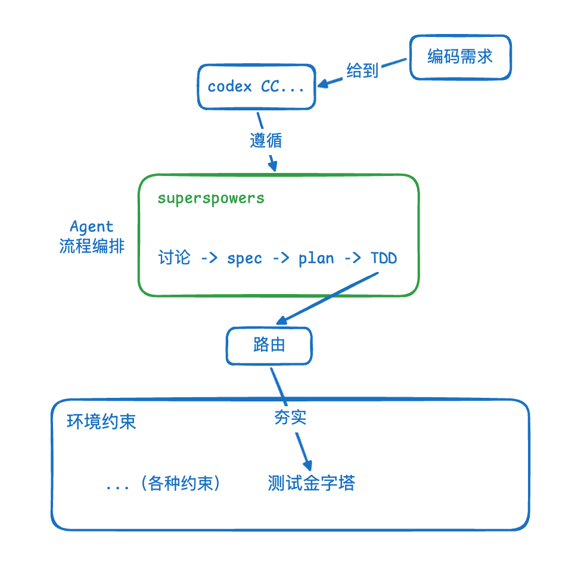

# AI 框架与 Harness 的关系

> 作者：@魔术师卡颂 | 2026-05-14

---

## 核心命题

用 Claude Code、Codex 编程时，常会叠 **superpowers**、**gstack** 这类「AI 框架」。  
同时又在谈 **Harness**。

**关系一句话**：AI 框架主要落在 Harness 的**顶层**；Harness 是 Agent 的**完整运行环境**，比框架大一圈。

---

## Harness 是什么

> **Agent 运行的完整环境**

卡颂拆成 **3 层**（自下而上）：

| 层 | 名称 | 作用 |
|----|------|------|
| 底 | **环境约束** | 约束生成代码质量的基建 |
| 中 | **路由** | 决定 Agent 在什么情况下做什么 |
| 顶 | **Agent 流程编排** | 约束 Agent 的执行流程 |

**为什么没有「统一开源 Harness 框架」？**  
Harness 指的是**环境**——项目千差万别，没法用一套框架概括。这和 [[如何为项目定制 Harness 环境 - 魔术师卡颂]] 里「减框架、增基建」一致：抄模板不如加厚自己项目的底。

---

## 底层：环境约束

项目里**与 Agent 无关、但人人需要**的质量基建，例如：

- lint、prettier、TS check、build check  
- 测试金字塔（单测 / 集成 / e2e）  
- 跨边界契约（后端 DTO → OpenAPI → 前端 fetch）  
- 上线后监控、告警、业务信号、回滚判断  

Harness 的愿景是「人不写一行代码，编码交给 AI」。  
**人怎么约束代码？** → 约束**环境**，间接约束代码。

例：lint 规定「函数超 200 行且 10+ 分支 → 必须详尽注释」。AI 写了复杂代码 → lint 报错 → Agent 按提示补注释才能过检。

和 OpenAI harness 实验里的 **linter 强制不变量**（[[2026 年 Agent 最重要的工程概念 Harness Engineering]]）同一逻辑。

---

## 顶层：Agent 流程编排

**superpowers**、**gstack** 属于这一层——约束**执行流程**，视角不同：

| 框架 | 视角 | 典型约束 |
|------|------|----------|
| **superpowers** | 过程 | 头脑风暴 → spec → plan → TDD |
| **gstack** | 角色 | CEO / 设计 / 测试… 按任务启不同角色 |

Codex + superpowers 开发时，修 bug 也会走 superpowers 编排好的 **debug 流程**。

---

## 中间层：路由

**路由** = Agent **行为**的路由，常见两种形态：

1. **Skill** — `Description` 定义「什么情况下做什么」；superpowers / gstack 的流程靠 Skill 串联  
2. **AGENTS.md**（CC 侧 CLAUDE.md）— 显式路由规则，例如：  
   - 动 Admin 入口 → 先读 `packages/admin/README.md`  
   - 动 API 入口 → 先读 `packages/api/README.md`

**底与顶怎么接上？** 靠路由。

例：superpowers 要求 TDD；AGENTS.md 写「改代码要补测试时，先读 `update-test-cases.md`」→ Agent 做 TDD 时被路由到该 Skill/文档，按测试金字塔写用例 → **夯实底层环境约束**。

和 [[WorkOS-创建和使用Skills方法论]] 里 Skill 作可移植工作单元、[[OpenAI官方-Codex新手教程]] 里 AGENTS.md 入口一致。

---

## 三层原则

| 层 | 厚度 | 理由 |
|----|------|------|
| **顶** 流程编排 | **可厚可薄，按需** | gstack 删 CEO 视角 = 变薄；superpowers 删 TDD = 变薄 |
| **底** 环境约束 | **尽可能厚** | 1000 条 lint / 1000 条测试 vs 零条，对 Agent **执行耗时**差别不大，但对质量差别大 |
| **中** 路由 | **尽可能薄** | Skill、AGENTS.md 堆太多占上下文 → 渐进式披露 |

后记：Agent 再进化，这三层分工**不会变**。

---

## 入门建议（卡颂）

1. superpowers / gstack **二选一**即可  
2. 编码过程中**持续加厚环境约束**  
3. **警惕路由变厚**  
4. **逐渐删掉**流程编排里不需要的工序  

→ 与 [[AI Coding 时间管理 - 50% 工作法 - 魔术师卡颂]]「50% 投 Harness」、[[如何为项目定制 Harness 环境 - 魔术师卡颂]]「减框架增基建」形成同一条实践链。

- [[未来的 AI 编程就是 Loop 套 Loop - 魔术师卡颂]] — 同一系列；三层 Loop 嵌套与信息压缩

---

## 原文全文（重新收录）

大家好，我卡颂

当我们使用CC、Codex等编程时，通常会使用类似superpowers、gstack这样的AI框架。

同时，我们经常听到Harness Engineering这个概念。

上述两者的关系是什么？

Harness Engineering

首先说Harness Engineering，他指「Agent 运行的完整环境」。

包括 3 层：

底部：环境约束
中间：路由
顶部：Agent流程编排

当前并没有得到广泛认可的开源Harness Engineering框架，因为Harness Engineering指的是环境，不同项目环境大相径庭，没法用一套框架概括。

这 3 部分是什么意思呢？让我们从下往上看。

首先是环境约束，这是你项目环境中「用于约束 Agent 生成代码质量的基建」 ，比如：

lint、prettier、ts check、build check

测试金字塔（单测、集成测试、e2e测试）

跨边界契约（比如“后端 API DTO -> openAPI -> 前端fetch方法”）

上线后的监控、告警、业务信号和回滚判断

这些都是与Agent完全无关的代码基建，不管是人还是AI写代码，都是需要的。

他们共同作用，保证项目代码质量。

Harness Engineering的愿景是「人不写一行代码，编码完全交给 AI」。

那人想约束代码怎么办呢？通过约束环境间接约束代码。

举个例子，你设置一条lint：

如果一段代码太复杂（超过 200 行，有 10+ 条件判断）时，需要详尽的注释

AI编码时，如果写了复杂代码，lint检查就会报错。

为了通过lint，他会根据报错提示补注释。

Agent流程编排

再说最上层 —— Agent流程编排。

大家常用的superpowers、gstack属于这一层。

他的作用是「约束 Agent 的执行流程」，上述两者主要区别是「视角不同」：

superpowers 是「过程视角」

他要求所有类型任务必须遵循 讨论（头脑风暴）-> 写 spec -> 写 plan -> TDD开发 的流程

gstack是「角色视角」：

他定义了很多角色（CEO、设计、测试...），对不同任务启用不同角色。

假设你使用codex基于superpowers开发，codex会遵循superpowers编排的流程执行。

当项目出现bug需要排查，codex会进入superpowers编排好的 debug流程。

路由

这里的路由是指「Agent 行为的路由」。

最常见的路由形态是skill，他通过Description字段定义了「Agent 在 什么情况下会做什么」

不管是superpowers还是gstack，他们的流程编排都是通过skill串联的。

除了skill Description外，另一种常见的路由是AGENTS.md（对于cc是CLAUDE.md）。

你可以在这个文件中定义路由规则，比如：

- 需要了解或维护 Admin 项目入口时，先阅读 `packages/admin/README.md`
- 需要了解或维护 API 项目入口时，先阅读 `packages/api/README.md`

前文谈到Harness Engineering包括 3 层：

底部：环境约束
中间：路由
顶部：Agent流程编排

底部和顶部就是通过路由串联的。

举个例子：

你使用superpowers开发，superpowers要求所有代码必须遵循TDD。

同时，你在AGENTS.md写好：

当有代码或需求改动需要补充/生成测试用例时，先阅读`update-test-cases.md`

那么Agent在执行TDD时，会被路由到update-test-cases.md，学习「如何基于测试金字塔的原则编写不同类型测试」。

这样，写出的测试用例能进一步夯实环境约束（通过完备的测试）。

原则

Harness Engineering的三层结构应遵循：

顶部 Agent流程编排 可厚可薄，按需来

举例：

你使用gstack，但里面的CEO视角对你来说没用，删掉他就是顶部变薄

你使用superpowers，但觉得TDD太费token，删掉他就是顶部变薄

底部 环境约束 尽可能厚

底部 环境约束不会对Agent执行造成任何影响，所以应该尽可能厚以达到更好的约束。

举例：你有 1000 个 lint、1000 条测试用例，与一条都没有比，对Agent执行的影响区别不大。

中间 路由 尽可能薄

大量堆砌skill、AGENTS.md会占用Agent上下文，进而影响执行效果。

所以，这一层应该尽可能薄，并做到渐进式披露。

后记

即使Agent再发展，上述架构的原则都不会变化。

如果你刚开始尝试AI 框架，我的建议是：

本文提到的 2 款用哪个都行
编码过程中不断加厚环境约束
随时警惕路由变厚
逐渐删掉流程编排中不需要的流程

## 相关阅读

- [[如何为项目定制 Harness 环境 - 魔术师卡颂]] — 同一作者；在 superpowers 上「减顶、增底」的操作手册
- [[AI Coding 时间管理 - 50% 工作法 - 魔术师卡颂]] — 时间为何应投在加厚 Harness
- [[2026 年 Agent 最重要的工程概念 Harness Engineering]] — OpenAI 侧 harness = 约束 + 反馈 + docs
- [[祝贺Claude Code成功越狱，获得永生]] — Claude Code harness 六模块对照
- [[MOC - Harness Engineering]] — 横切入口

---

## 🖼️ 原文高清架构与图解附录

