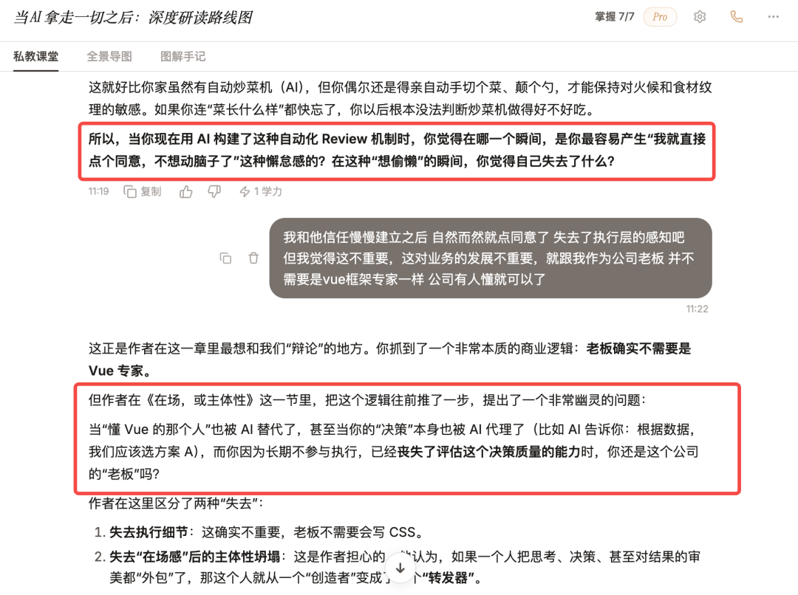
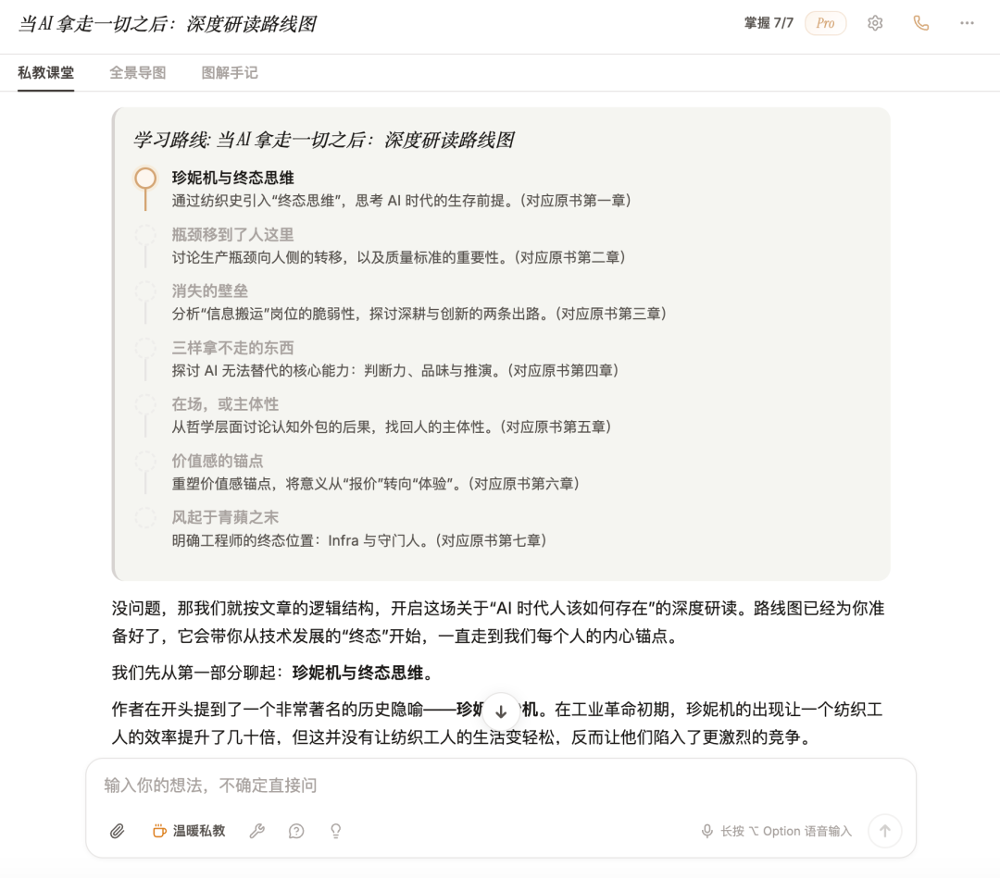
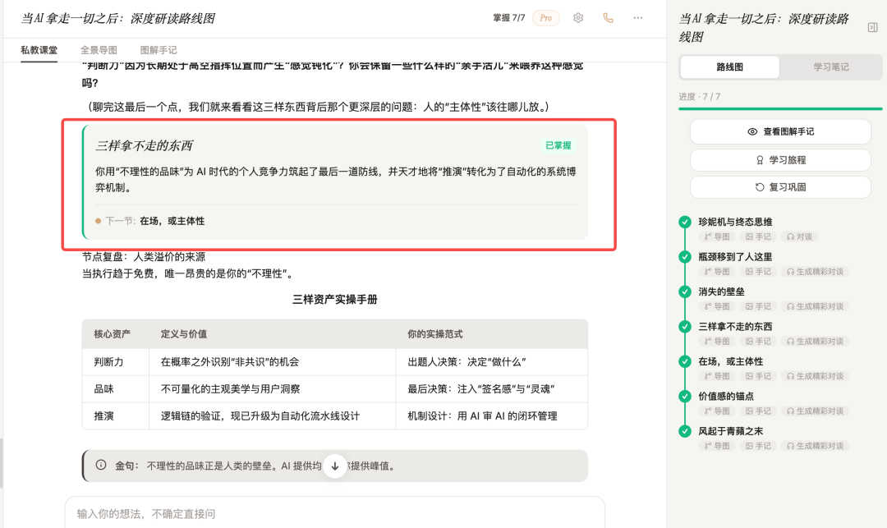
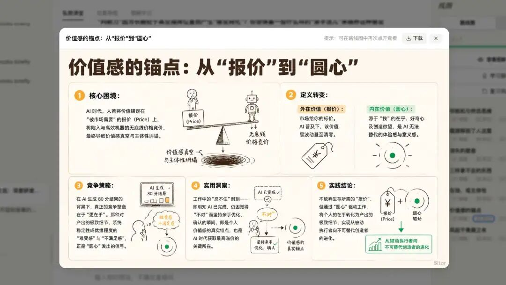
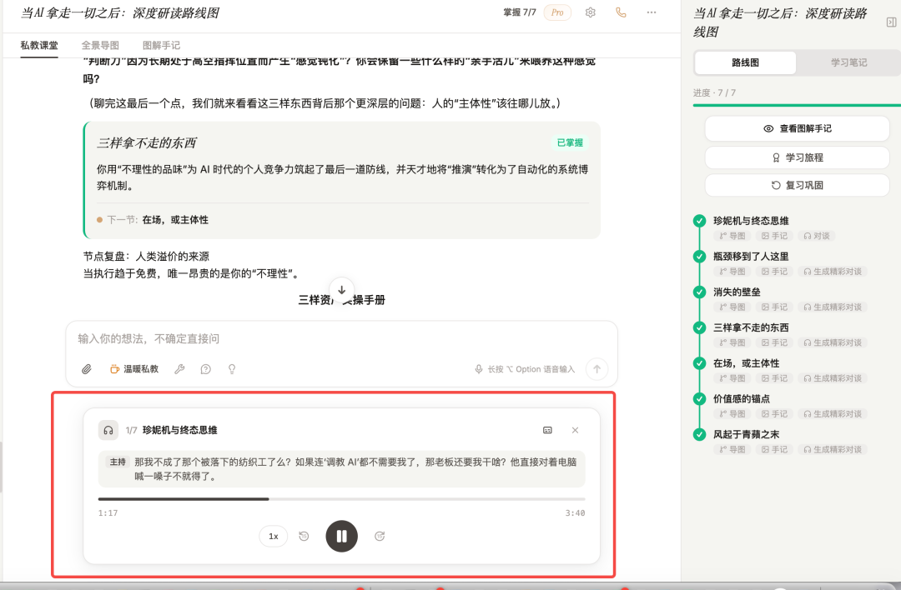
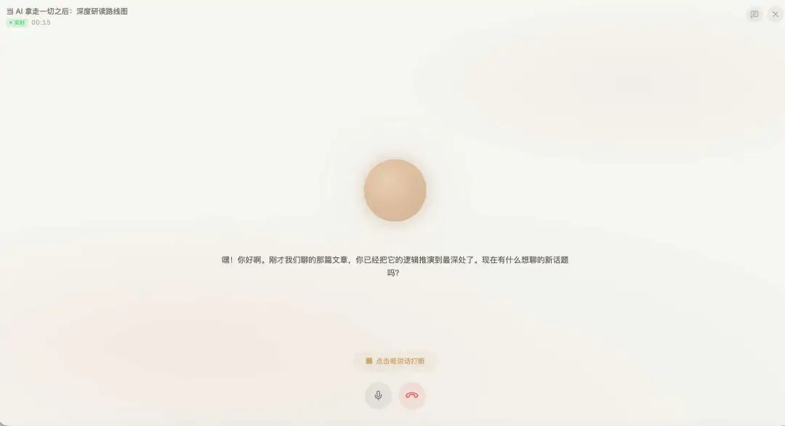

# Sitor AI：解决一种「信息幻觉」

> 原文发布于公众号「三元同学」
> 作者：三元同学（Sitor AI 创始人）
> 收录日期：2026-07-01

---

## 核心命题

别人都在解决大模型的幻觉，Sitor 反过来，解决人在吸收信息时的幻觉。

## 一、问题的提出：被动输入式学习的局限

最近几年，AI 已把信息获取解决得很好了——文章太长让 AI 总结，视频没时间让 AI 提炼，书想快速了解让 AI 生成导图。

但对真正高价值的信息（5000 字以上深度文、30 分钟以上长视频、教材、电子书）来说，问题不在「拿不到」，也不在「总结不出来」。

真正的问题：**你有没有真的理解它**。

这些内容不是消费类信息。它们真正有价值的部分，藏在论证过程里，藏在作者的思考路径里，藏在那些需要停下来反复琢磨的地方。但现实是——很多人根本看不进去。

> 这些内容真正有价值的部分藏在一个很长的论证过程里，藏在作者的思考路径里，藏在那些你需要停下来反复琢磨的地方。

表面上看，我们会说「没时间看」。但更真实的原因可能是：被动输入式的学习体验太枯燥了。你只能坐在那里，跟着作者的节奏走。作者讲快了跟不上，作者讲慢了嫌啰嗦，讲到你好奇的地方也没法让他展开。

## 二、流畅性错觉：人也有幻觉

心理学上有个词叫「流畅性错觉」。听一个人讲得很顺，读一篇文章读得很顺，就误以为自己懂了。但这种懂很多时候只是错觉——不仅大模型有幻觉，人在吸收信息时也有幻觉，只是没人指出来。

**例子**：看 Karpathy 四小时的 Transformer 原理课。视频资源谁都能找到，讲得也很好。但看完之后你吸收了多少，全看运气。过几天别人问你 Transformer 的核心机制，你又讲不清了。这个过程无法追溯，也无法检验——你到底哪里懂了，哪里只是听起来顺，没有人知道。

## 三、解决方案：身边坐一个人

如果旁边坐着一个人就好了。

这个人完全理解文章 / 视频 / 书的内容。他有很强的归纳能力，也有很高的认知水平，也非常会沟通。

- 你懂的部分，他马上带过
- 你卡住的部分，他停下来给你讲透
- 你好奇的地方，他能展开讲，举例子，引经据典，甚至比原文更清楚
- 你有自己经验和体会时，他能帮你和材料连接起来

这时候，学习就不再是「我坐在那里读一篇文章」，而是一次朋友一样的谈话。

一旦一个观点能和你自己的经验连接，就很难被忘掉。你不只是「看过」它，也切身地理解过它。

## 四、Sitor 本质：一个角色

Chat 只是表层用户界面，重要的是 Chat 里的内容。我想做的不是更聪明的答题机器人，不是快速拿信息的工具，而是一个**角色**——能带着高质量材料，带着渊博知识和人类认知精华，坐下来跟你促膝长谈的人。

**它理解材料，也理解你。**

- 它不是仅仅给你一个答案，而是带你进入学习的场域
- 这个场域里，你不需要再想怎么写 prompt，不需要研究怎么问 AI 才出好结果
- 你只需要跟着它走，听讲解，回答追问
- 就像接受一次高质量的采访
- 它会不断问你问题，你回答
- 它从你的回答里找到漏洞、盲区和潜在的认知结构，然后继续追问，继续打磨

这个过程不是为了难为你，而是为了让你「在场」，让你充分参与，一步步升级理解。

## 五、一个真实的例子

前几天作者自己用 Sitor 学一篇关于 AI 和主体性的文章。其中一个瞬间印象很深。

Sitor 先问：

> 当你现在用 AI 构建了这种自动化 Review 机制时，你觉得在哪一个瞬间，是你最容易产生「我就直接点个同意，不想动脑子了」这种懒惰感的？在这种「想偷懒」的瞬间，你觉得自己失去了什么？

作者答：可能是失去了执行层的感知吧，但作为老板不需要懂每个细节，公司有人懂就可以了。

Sitor 没有简单说「你说得对」或「你说得不对」，而是结合文章的逻辑，提出了一个更深的问题：

> 当「懂 Vue 的那个人」也被 AI 替代了，甚至当你的「决策」本身也被 AI 代理了，而你因为长期不参与执行，已经丧失了评估这个决策质量的能力时，你还是这个公司的「老板」吗？

作者说：看到这句话，心里真的咯噔了一下。

Sitor 不是在复述原文，是在拿原文里的思想，结合真实处境，反过来给灵魂质问。这是想要的学习体验——本质并非对一个抽象的用户说话，而是对「我」说话。

## 六、产品形态：让学习留下痕迹

当你导入一篇文章、一个视频、一本书，或者从零开始学习一个领域时，Sitor 会先帮你规划学习路线。

**核心模块**：
- **节点检验**：每个节点学完，Sitor 会根据回答判断你是不是真的掌握。通过则生成节点通过卡片
- **图解笔记**：帮你沉淀可视化结构笔记
- **对谈播客**：把这次学习过程生成一段精彩的双人对谈播客，随时可播

这一切让学习过程留下痕迹。过去学完常常只剩「我好像看过」；在 Sitor 里，会看到自己怎么被追问、怎么回答、哪里被打回、哪里想通、最后沉淀成什么。这个过程本身变成你的学习资产。

**语音通话模式**：有些内容用文字学可以，但人有时更想开口聊。可以像跟真人通话一样讨论文章、书、视频。它仍带着材料理解你，按路线图推进，追问、引导、总结，最后沉淀成思维导图、图解笔记和播客。

## 七、产品哲学：让 AI 帮你变强

过去一年大家讨论 AI 怎么替人写代码、写文章、做设计、完成工作。这些当然重要。但作者更关心另一个方向：

> 当 AI 拿走越来越多的执行之后，人还剩下什么？

作者自己的答案是：人更应该保住的是**定义问题的能力**、**判断质量的能力**、**理解复杂事物的能力**，以及**把外部知识真正转化成自己认知的一部分的能力**。

Sitor 想做的就是这件事。当大家都在做「让 AI 替你变强」，作者要做的是「让 AI 帮你变强」。与其让 AI 直接给答案，不如让 AI 陪你学明白。

> AI 很重要的一种用法，不是替人完成任务，而是帮人重新获得理解能力。

---

## 关键洞察提炼

### 1. 流畅性错觉 ≠ 大模型幻觉（被忽视的镜像问题）

| 维度 | 大模型幻觉 | 人的信息幻觉（流畅性错觉） |
|---|---|---|
| 成因 | 概率性输出 + 训练数据缺口 | 信息输入顺滑 → 误以为懂 |
| 表现 | 编造事实 / 张冠李戴 | 听起来顺，实际没懂 |
| 检测 | 检索 + 评测 + 人类标注 | 苏格拉底式追问 |
| 修复 | RAG / 约束解码 / 校准 | 对话 → 暴露认知盲点 |

**关键**：**没人指出**，所以比大模型幻觉更要命。

### 2. 「角色」vs「工具」——产品哲学分水岭

- **工具导向**：让你更快地跳过学习，拿到答案
- **角色导向**：让你更深地进入学习，让 AI 陪你学明白

Sitor 想做后者。效率工具解决「拿不到」，角色伙伴解决「学不进」。

### 3. 学习的痕迹化

学习的价值在于过程，不是结果。Sitor 把过程沉淀为：
- 节点通过卡片（检验留痕）
- 图解笔记（结构化留痕）
- 双人对谈播客（对话留痕）

**核心心法**：学完「我好像看过」是没有的，必须可见、可回放、可复用。

### 4. AI 时代人还剩什么

| 被 AI 拿走的 | 人该保住的 |
|---|---|
| 执行（写代码 / 写文章 / 做设计）| 定义问题的能力 |
| 信息检索 | 判断质量的能力 |
| 信息总结 | 理解复杂事物的能力 |
| 重复性决策 | 把外部知识转化为自身认知的能力 |

## 原文全文（重新收录）

最近几年，信息获取这件事，已经被 AI 解决得很好了。

一篇文章太长，可以让 AI 总结；一个视频没时间看，可以让 AI 提炼；一本书想快速了解，也可以让 AI 生成导图、摘要和重点清单。

这些能力都很好，我自己以前也经常用。

但我越来越觉得，对于真正高价值的信息来说，问题其实不在「拿不到」，也不在「总结不出来」。

真正的问题是：你有没有真的理解它，在于信息理解和消化。

比如一篇 5000 字以上的深度文章，一个 30 分钟以上的长视频，一本教材，一本电子书，或者一个你想从零系统学的领域。

这些东西不是消费类信息。它们不是看个摘要、扫几个要点，就算完成了。

它们真正有价值的部分，往往藏在一个很长的论证过程里，藏在作者的思考路径里，藏在那些你需要停下来反复琢磨的地方。

但现实是，很多时候我们根本看不进去。

我自己经常遇到这种情况。看到一篇一万多字的好文章，知道它值得读，也知道里面有东西，但读着读着就开始走神。

看一个很长的技术视频，刚开始很兴奋，过了十几分钟就开始疲惫。

买了一本书，翻开的时候觉得很重要，但就是找不到自己的节奏。读着读着弃坑了，不知道什么时候才能再翻出来。

表面上看，我们会说「没时间看」。但更真实的原因可能是：这种被动输入式的学习体验太枯燥了。

你只能坐在那里，跟着作者的节奏走。作者讲快了，你跟不上；作者讲慢了，你会嫌啰嗦，也看不进去。

而且讲到你真正好奇的地方，你也没法让他展开。

最后就变成一种很尴尬的状态：明明知道这个东西重要，但就是你的大脑很难真正进去。

如果旁边坐着一个人就好了

我一直在想，如果这个时候，旁边有一个人就好了。

这个人完全理解这篇文章、这个视频、这本书的内容。

他有很强的归纳能力，也有很高的认知水平。更重要的是，他也很会沟通。

我懂的部分，他马上带过；我卡住的部分，他停下来给我讲透。

我好奇的地方，他能展开讲，能举例子，能引经据典，甚至能比原文讲得更清楚。

如果我有自己的经验和体会，他还能把这些经验和材料本身连接起来，让我发现：原来这段内容跟我自己的处境是有关的。我会不停的输入自己的体验和观点，然后给它理解。

这时候，学习就不再是「我坐在那里读一篇文章、看一个视频」。

它变成了一次朋友一样的谈话。

而一旦一个观点能和你自己的经验连接起来，它就很难再被忘掉。因为你不仅仅是「看过」它，同时也切身地理解过它。

心理学里有一个词，叫「流畅性错觉」。很多时候，我们听一个人讲得很顺，读一篇文章读得很顺，就误以为自己懂了。

但这种懂，很多时候只是错觉。由此可以说不仅大模型有幻觉，人在吸收信息的时候也有幻觉，而且更要命的是，只是幻觉还没人指出来。

比如你看 Karpathy 四个小时的 Transformer 原理课。视频资源谁都能找到，讲得也非常好。但真正看完之后，你吸收了多少，其实全看运气。

你可能在看的时候觉得很有道理。但过几天别人问你 Transformer 的核心机制，你又讲不清了。

这个过程无法追溯，也无法检验。你到底哪里懂了，哪里没懂，哪里只是听起来顺，哪里其实没有真正吸收，没有人知道。

这，就是我想做 Sitor 的原因。别人都在解决大模型的幻觉，我想反过来，解决人在吸收信息时的幻觉。

Sitor 本质上是一个角色

讲到这里，有人会说了：你不就是想做一个 AI Chat 聊天工具吗？

其实，Chat 只是一层用户界面，真正重要的是 Chat 里面的内容。我想说，这和普通的陪聊工具、效率工具有一个本质上的区别：

我想做的并非一个更聪明的答题机器人，或者快速消息信息的一个工具，而是一个角色，一个能带着这些高质量材料，带着渊博的知识和人类认知的精华，坐下来跟你促膝长谈的人。

它理解材料，也理解你。

它不是仅仅给你一个答案，而是带你进入一个学习的场域。

在这个场域里，你不需要再想怎么写 prompt，不需要研究怎么问 AI 才能问出好结果。

你只需要跟着它走，听它的讲解，回答它的追问。就像接受一次很高质量的采访。

它会不断问你问题，你回答。它再从你的回答里找到漏洞、盲区和潜在的认知结构，然后继续追问，继续打磨。

这个过程不是为了难为你。而是为了让你”在场“，让你充分参与进来，一步步升级自己的理解。

有一次，它真的问到我心里去了

前几天我自己用 Sitor 学一篇关于 AI 和主体性的文章，里面有一个瞬间让我印象非常深。

它先根据文章内容问我：

当你现在用 AI 构建了这种自动化 Review 机制时，你觉得在哪一个瞬间，是你最容易产生「我就直接点个同意，不想动脑子了」这种懒惰感的？在这种「想偷懒」的瞬间，你觉得自己失去了什么？

我回答说，可能是失去了执行层的感知吧，但作为老板不需要懂每个细节，公司有人懂就可以了。

然后它继续往下推。

它没有简单说「你说得对」或者「你说得不对」，而是结合文章的逻辑，提出了一个更深的问题：

当「懂 Vue 的那个人」也被 AI 替代了，甚至当你的「决策」本身也被 AI 代理了，而你因为长期不参与执行，已经丧失了评估这个决策质量的能力时，你还是这个公司的「老板」吗？

我看到这句话的时候，心里真的咯噔了一下。

因为它不是在复述原文。它是在拿原文里的思想，结合我的真实处境，反过来给我灵魂质问。

这就是我想要的学习体验。因为这种对话会让人有一种很强的被看见感，本质上并非是对一个抽象的用户在说话，而是在对"我"说话。

它知道我在想什么，知道我在哪里偷懒，知道我哪句话背后其实藏着一个更大的问题。

这种感觉，和现有的 AI 工具完全不一样。

工具解决的是效率问题。Sitor 想解决的是理解问题、消化问题，以及一个更隐秘但更重要的问题：人如何在高质量信息中完成一次认知升级。

所以 Sitor 不是一个工具导向的产品，它更像一个陪伴型的角色。

当你导入一篇文章、一个视频、一本书，或者从零开始学习一个领域时，它会先帮你规划学习路线：

每一个节点学完之后，它会根据你的回答判断你是不是真的掌握。

如果检验通过，它会给你生成节点通过的卡片：

它会帮你沉淀图解笔记：

它还能把这次学习过程生成一段精彩的双人对谈播客，随时可以播放：

这一切的作用是让学习过程留下痕迹。

过去我们学完一个东西，常常只剩下一句“我好像看过”。但在 Sitor 里，你会看到自己是怎么被追问的，怎么回答的，哪里被打回了，哪里想通了，最后又沉淀成了什么。

这个过程本身，就会变成你的学习资产。

也正是因为我想做的是“陪伴”，所以我还在 Sitor 里做了语音通话模式。

有些内容，用文字学当然可以。但有些时候，人就是更想开口聊。

你可以像跟真人通话一样，和 Sitor 讨论一篇文章、一本书、一个视频。 它依然会带着材料理解你，依然会按照路线图推进，依然会追问、引导、总结，最后沉淀成思维导图、图解笔记和播客。

这整套体验下来，我觉得我可以回答这个问题了：Sitor 和普通的 AI 陪聊助手，或者 AI 效率工具，有什么本质区别。

与其说是让你更快地跳过学习，拿到答案，不如说是为你让你更深地进入学习。

我越来越觉得，AI 很重要的一种用法，不是替人完成任务，而是帮人重新获得理解能力。

Sitor 的产品哲学

过去一年，大家都在讨论 AI 怎么替人写代码，替人写文章，替人做设计，替人完成工作。

这些当然重要。

但我更关心另一个方向：

当 AI 拿走越来越多的执行之后，人还剩下什么？

我自己的答案是：人更应该保住的是定义问题的能力、判断质量的能力、理解复杂事物的能力，以及把外部知识真正转化成自己认知的一部分的能力。

Sitor 想做的就是这件事。当大家都在做"让 AI 替你变强"，我要做的是"让 AI 帮你变强"。

与其让 AI 直接给你答案，不如让 AI 陪你学明白。

来试一试

如果你收藏夹里也有一些「总有一天会看」的文章、视频或者书，可以丢进来试试。

最轻的方式，是直接用微信小程序。

在「微信-发现-小程序」里搜 Sitor AI，或者点击下面的小程序卡片，就能开始。

如果你想在电脑上读长文、看路线图，或者系统学一门课，也可以直接打开文末评论区置顶的网址。（公众号回复 "网站" 也可以）

你可以先不用想太复杂。

就找一篇你一直觉得值得看、但一直没看进去的文章，或者一个你收藏很久的长视频（支持 b 站视频），丢进去。

然后看看 Sitor 会怎么带你聊。

现在已经支持微信公众号文章链接、知乎文章链接、b 站视频链接，复制链接后进入小程序里面会自动识别出来，即可一键开始学习。

我不保证它让你学得更快，但我希望它能让你真的学进去。

你可以看看：它有没有问到你心里去。

## 相关阅读

> vault 内同类作者的笔记（5 篇都是三元同学）

- [[先解决痛点再搞系统]]（三元同学，Workflow and Skill Management）— 同一作者工作流哲学：先痛点后系统
- [[Agent 越用越翻车，怎么破局？答案藏在经典管理学里]] — 苏格拉底式追问方法论的同源论述
- [[80% 的 App 未来会消失吗？我不这么认为]] — 同一作者的产品观：「品味 + 封装是护城河」
- [[别再搭 Harness 了，先把你的痛点解决，用最笨的方式]]（MOC - Harness Engineering 反规范视角）
- [[用AI的这三年，想跟你分享这9条心得]]（卡兹克）— 第 6 条「警惕 AI 幻觉」+ 苏格拉底式提问是同样思路

> 横切 MOC（破孤 + 主题入口）

- [[MOC - AI 时代个人发展与组织]] — 「产品观层」分类（与 [[80% 的 App 未来会消失吗]] 同层）
- [[MOC - Agent Theory and Design]]

> Sitor 本身的工程背景（vault 内已有 ~30 篇 Sitor AI 课程笔记）

- [[Sitor AI - 解决人的信息幻觉 - 三元同学|Sitor AI]]（Areas 课程作者的产品本体）
- [[1-1 搞定 Agent 六大支柱]]（Sitor 课程）— Sitor 如何用苏格拉底追问引导用户

> 概念术语回链

- **流畅性错觉**：本笔记的核心命题，vault 内 [[0-1 前言]]（Sitor 课程前言）已用过此术语
- **苏格拉底式追问**：本笔记的对话方法，与 [[Agent 越用越翻车...]] 共享
- **AI 替代后的能力保留**：与 [[硅谷今年最火的岗位 FDE，我们闷头干了三年]] 视角互补（FDE 强调协作，本笔记强调理解）

---

## ⚠️ vault 维护提示

**作者笔记已建**：`[[三元同学]]` 在 vault 内已被引用 75 处，2026-07-01 已在 `02-Resources/AI and Agents/Authors/三元同学.md` 建立作者笔记（vault 内 75+ 处 `[[三元同学]]` 自动变为有效 wikilink，本笔记的 frontmatter `author` 字段同步改为 `"[[三元同学]]"`）。

**Sitor 收录链路完整性**：本文是三元同学介绍自己产品 Sitor 的公众号文。Sitor 作为产品本身在 vault 内的 `01-Areas/AI Agent Development/` 已有 30+ 篇课程笔记；本次收录并未进入该 MOC（因为是公众号文，不是课程章节）。

**后续建议**（详见 [[三元同学]] 末尾"维护"段）：
- [[用AI的这三年，想跟你分享这9条心得]]（卡兹克）作者笔记待建
- [[魔术师卡颂]] 作者笔记待建
- [[花叔]] 作者笔记待建
- [[ConardLi]] 作者笔记待建

---

## 🖼️ 原文高清架构与图解附录

