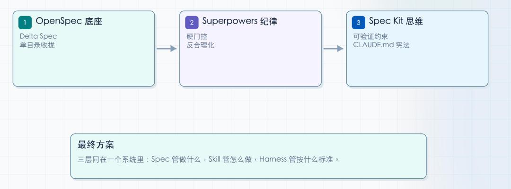
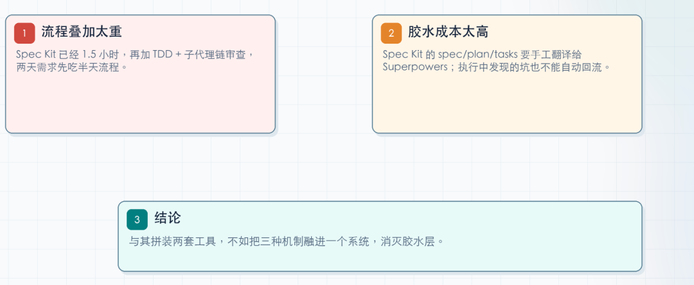
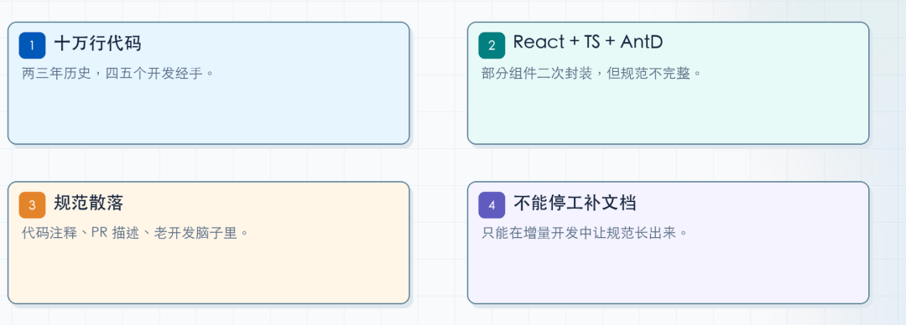
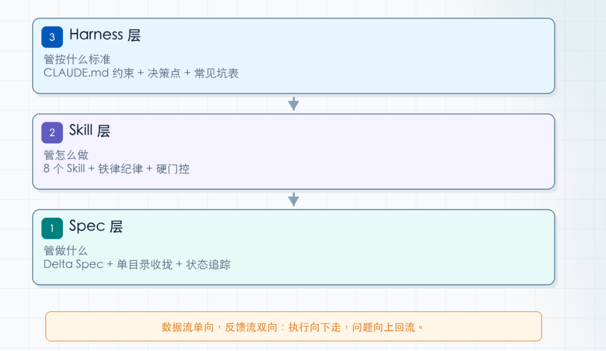
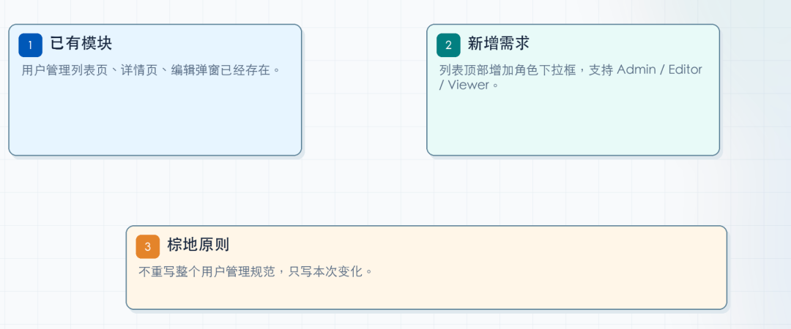
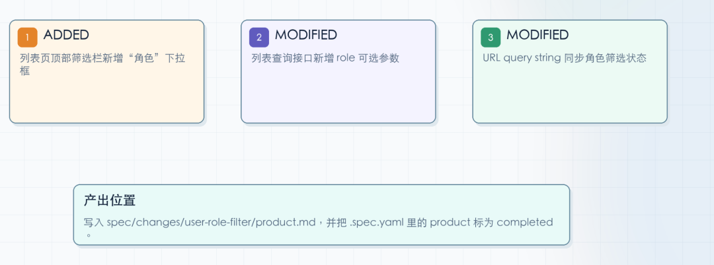
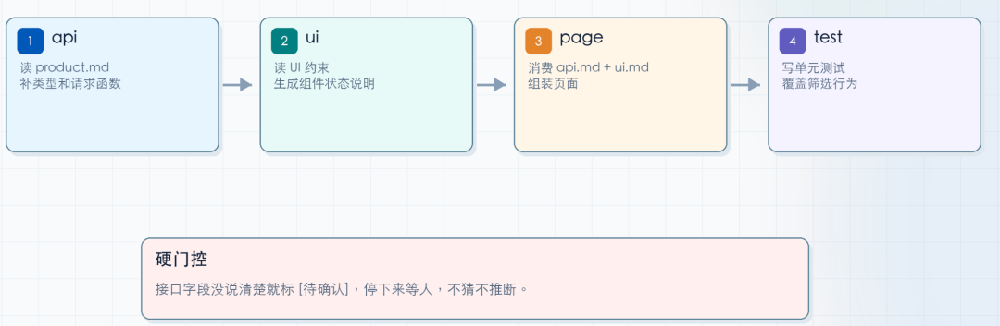
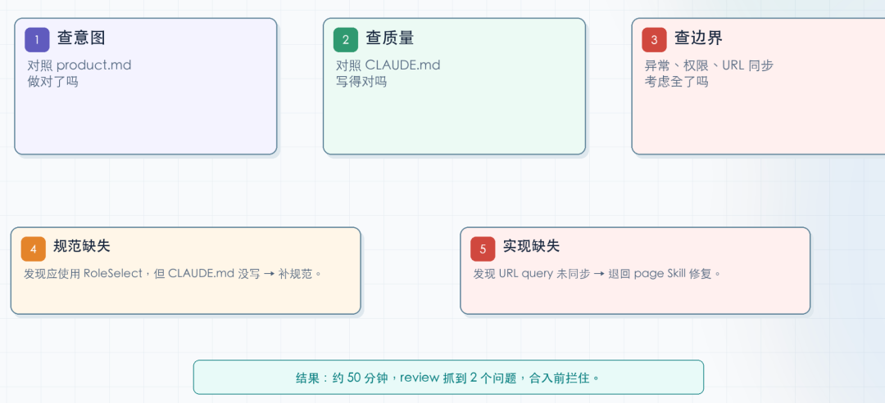

# Spec Kit vs OpenSpec vs Superpowers：我为什么最后自己搭了一套

> **作者**：CCC  
> **发布日期**：2026-07-08  
> **原文来源**：[微信公众平台](https://mp.weixin.qq.com/s/ZlTW-D0PIS0dQKhnb1_ldA)

> 💡 **核心精粹与认知反思**：  
> **工程规范（Spec）不是束缚 Agent 的枷锁，而是让不同智能体协同收敛的通用母语。**
> 1. **三大主流规范对比**：Spec Kit 偏重静态约束，OpenSpec 偏重跨平台互操作，Superpowers 偏重动态反馈与自省；
> 2. **为什么要自研**：通用框架往往带有过多假设与运行时开销，业务环境需要的是轻量契约与原子能力编排；
> 3. **规范即代码**：让 Spec 具备可机器校验性（Machine-Verifiable），是杜绝 Agent 自由发挥产生幻觉的防火墙。

前一篇我把三个框架从头到尾拆了一遍——**Spec Kit** 的阶段门控、**OpenSpec** 的 **Delta Spec**、**Superpowers** 的**铁律纪律**。结论是：**各有各的好，也各有各的硬伤。**最后我一个都没选。我拿 ****OpenSpec** 做了底座**，补上 ****Superpowers** 式的纪律思维**，再套一层自己的 **Harness 工程**，搭了一套更适合中大型团队棕地项目的方案。在多个中型前端老项目上跑了四个月，团队反馈是靠谱的。这篇文章把三个框架**借鉴了什么、丢了什么**摊开讲，再讲这套组合方案的架构设计和跑下来的真实效果。快速复盘：三个框架，我各留了什么先声明——这个复盘不是重新介绍三个框架。细节都在前一篇。这里只讲一件事：**每个框架的设计决策里，哪个是我拿过来用的，哪个是我主动丢掉的。****Spec Kit**：宪法思维我留下了，阶段门控不需要**Spec Kit** 最让我服气的东西不是它的阶段门控，是 **Constitution（宪法）**，宪法本质上是写给 AI 看的约束协议。这个思维我直接拿过来了。我的 CLAUDE.md 里现在写的不是"好好写代码"，是"骨架屏必须用 CustomSkeleton，禁止直接用 antd Skeleton"、"函数不超过 80 行"、"新依赖必须走审批"。每一条都能**量化验证**。但阶段门控我丢了。为什么？我的场景是在已有十万行代码上做增量改造，一个改动可能只涉及两个文件。走完 constitution → specify → clarify → plan → checklist → tasks → analyze → implement → converge——光流程吃掉 1.5 小时，改的代码可能就 50 行。**流程开销是固定成本，改动越小，投入产出比越难看。**前一篇我也说了，**Spec Kit** 对棕地项目不友好——按功能分片管理规范，已有项目需要手工拼装多个来源的规范，没有 Delta Spec 机制。这是**结构性不匹配**，不是改改配置能绕过去的。**Superpowers**：铁律真管用，但 14 个 Skill 太重**Superpowers** 最让我受益的是一个洞察和一个设计。**洞察是"LLM 的乐观偏见"。** 前一篇展开了——Claude 倾向于声称完成、跳过验证、绕过流程。这不是 Claude 的 bug，是 **RLHF 训练阶段的副产物**。"建议"没用，"请严格 TDD"写在 CLAUDE.md 里，下次照样跳过测试直接写代码。**设计是铁律的工程化。** MUST / ABSOLUTELY / EXTREMELY IMPORTANT 不是情绪化的大喊大叫，是针对 Transformer 注意力权重路由的**精确调参**。HARD-GATE 的三层叠加（SessionStart Hook + brainstorming Skill + Red Flags 12 条反合理化话术）证明了一件事：**约束力不是来自措辞的严厉程度，是来自"违反就有后果"的闭环设计。**这两个我全拿过来了。我的每个 Skill 里都焊着铁律——bugfix 的 "根因说不清不许动手"，review 的 "不看 CLAUDE.md 不许审"，api 的 "接口字段没说清楚标待确认，不猜不推断"。不是建议，是执行步骤里的**硬门控**。但 14 个 Skill 全链我丢了。**Superpowers** 的流程开销和成本在前一篇实测里是三个框架中最高的——每个任务都要派生独立子代理，代理之间还要互相审查，Token 消耗成倍放大。简单功能也要走完整流程，一次性脚本不适合。而且 **Superpowers** 没有**规范累积机制**——每次新对话 AI 忘光之前的决策。更致命的是方向校准问题。**Superpowers** 的方向校准依赖 brainstorming 而非显式规范，同一需求实测中**方向偏差导致 2 次返工**。这里得展开讲一下——**Superpowers** 的 brainstorming 和 **grill-me** 是两种彻底不同的需求澄清方式，因为当初我曾想过借鉴 brainstorming，但后来发现不合适。**brainstorming 的假设是：你只有模糊的想法，面前是一片空地。** 就像在陌生城市问路，每个路人给你指个方向，你朝那个方向走一段，再问下一个路人，直到到达目的地。这个模式的好处是启动门槛低——脑子里有个念头就能开始。代价也很明确：**到达目的地的总步数多，且每一段路都依赖下一个人指对方向。** 落到工程上，brainstorming 产出的细节密度不够，后续不管是"to spec"还是"spec to plan"，都要花大量精力补细节。这种模式什么时候合适？**绿地项目、没有产品经理、一个人在探索阶段。** 你没有历史包袱，没有已有代码可以参照，没有预设答案的开放讨论反而是最高效的。**Superpowers** 的 brainstorming 就是为这种场景设计的——用它做个人项目和早期原型。**grill-me 的假设刚好相反：你面前不是空地，是已有的建筑群。** Matt Pocock 的 grilling SKILL.md 核心逻辑就一句话——"Walk down each branch of the design tree, resolving dependencies between decisions one-by-one."它不是开放式讨论，是拿着你的主干**逐层审问**：一次只问一个问题，每个问题附推荐答案，能查代码库的事实就查代码库、不问人，但决策权留给人。每轮追问长出一根树枝，全部走完是一整棵 design tree。grill-me 的前提是你得有主干。如果只有个念头且全程被动接受审问，会被问得怀疑人生。但如果你有准备——棕地项目天然有：已有代码就是主干，已有规范就是约束边界——grill-me 的产出细节密度远超 brainstorming，后续流程不需要再补方向性细节。**一句话：brainstorming 适合从零探索，grill-me 适合在约束中生长。** **Superpowers** 选了前者，这本身没错。但我的场景是企业级棕地项目——有产品经理、有 PRD、有十万行已有代码。这个场景下，brainstorming 的开放式讨论反而模糊了方向，实测 2 次返工就是这么来的。所以我借鉴了 Matt Pocock 的 grilling，封装成自己的 grill-me，把它的逐层审问骨架套上六维评审结构，做成了 product Skill。不是开放式讨论，是拿着已有代码和需求文档做交叉审问，每一步都在长树枝而不是重新问路。产出的 **product.md** 直接就是一棵完整的 design tree，下游的 api、ui、page 不需要再补方向性细节。TDD 做得再好，做出来的东西跟需求对不上也白搭。方向校准这层，brainstorming 不够，得用更结构化的审问。这就是为什么我扔了 **Superpowers** 的 brainstorming，换成 grill-me 的底子去搭 product。**OpenSpec**：Delta Spec 真香，但执行没人管**OpenSpec** 有两个设计我直接拿来当了底座。**Delta Spec 是棕地项目的天然解法。** 不需要重写整个规范，只写变化的部分——ADDED / MODIFIED / REMOVED / RENAMED，四种操作在同一个系统里统一解析。每个变更独立文件夹，并行开发不冲突。**40 分钟走完同一段需求，是 **Spec Kit** 的三分之一。****单目录收拢的思路。** 虽然 **OpenSpec** 的目录结构跟我最终用的不完全一样，但"一个需求的所有产出收进同一个目录"这个原则，直接塑造了我后来的 spec 目录设计。但 **OpenSpec** 有两个短板，前一篇点过了：没有治理机制，apply 阶段缺少纪律。AI 按 tasks.md 执行，但没有 TDD、没有强制代码审查、没有验证机制。实现质量取决于 AI 的 **"自觉性"——这在**个人项目里能忍，在多人协作的企业项目里不行。**三个框架，我拿的和丢的，一张表说清楚：**

拿走了什么

丢掉了什么

为什么丢

宪法思维（可验证约束）

阶段门控、按功能分片管理规范

太重，棕地不友好，改动小时流程开销倒挂

铁律纪律（硬门控 + 反合理化）

## 14 个 Skill 全链、纯 brainstorming 方向校准

成本高，方向容易偏，无规范累积

Delta Spec + 单目录收拢

apply 阶段无纪律约束

实现质量靠 AI 自觉，企业场景不够

# 先澄清一个事：Spec Kit + Superpowers 组合行不行？

前一篇第六章我详细拆过 **Spec Kit** + **Superpowers** 的九步协同——三个接入点、FCSO 四要素、语义层和物理层的两层隔离。那个方案是成立的。

但我试过之后，发现它对我的场景不适用。

**问题不是两个框架不好，是流程开销叠在一起之后，只有超大规模团队才扛得住。** **Spec Kit** 走完已经 1.5 小时，**Superpowers** 的 TDD + 子代理链审查再加上去，总耗时可能翻倍。一个两天的需求，光流程先吃掉半天。**流程太重扛不动**

**另一个问题是胶水成本。** 两套独立系统，中间那条缝全得靠人手填。**Spec Kit** 跑完输出的 constitution、spec、plan、tasks，**Superpowers** 不认识。你得手工把关键约束复制粘贴到 **Superpowers** 的上下文中。反过来也一样——**Superpowers** 在执行中踩到的坑、发现的规范漏洞，没办法自动回流到 **Spec Kit** 的宪法里。

**这不是 **Spec Kit** 的错，也不是 **Superpowers** 的错。** 它们根本没被设计成一起工作。两个工具在自己的领域都很强，但**中间那条缝全靠人手填**。

所以我决定不拼装两套工具，而是搭一套自己的——把三个框架的设计精髓融进一个系统里，不存在胶水层。

# 我的场景长什么样

讲方案之前，先把我面对的项目画像说清楚。这决定了后面每一个设计选择。

我手头是一个前端老项目，大概**十万行代码**。有两三年历史，经手过四五个开发。技术栈是 React + TypeScript + Ant Design，部分组件做了二次封装，但封装规范不全——有的页面用封装组件，有的页面直接用 antd 原生组件，没规律。

项目有一个 CI/CD 流水线，但没有完整的规范文档。业务规则散落在代码注释、PR 描述、和老开发的脑子里。需求评审文档也只有近期的文档，接口对接通过 postman，测试用例在 Excel 里。

**关键约束：不能停工补文档。** 业务在跑，需求在排，不可能花两个月把规范写全了再开发。只能在增量开发中**渐进地把规范长出来**。

团队十人上下。每个人既写代码又做 review，没精力维护超级繁重的流程体系，但也不能靠个人自觉。

# 架构设计：三层叠加Workflow.md

我的方案是三层结构：

Harness 层（CLAUDE.md 约束 + 决策点 + 常见坑表）
        │
Skill 层（8 个 Skill，借鉴 **Superpowers** 的铁律纪律）
        │
Spec 层（**OpenSpec** 的 Delta Spec + 单目录收拢）
**底层是 Spec 层——管"做什么"。** 借鉴 **OpenSpec** 的 Delta Spec 思路：不要求全量规范，每次改动只写增量。每个需求的全部产出收进 spec/changes//，进度用 .spec.yaml 追踪。前一篇讲 **OpenSpec** 时说过——**规范密度在最需要的地方自然增长，而不是一次性铺满**——这就是这层的核心原则。

**中间是 Skill 层——管"怎么做"。** 借鉴 **Superpowers** 的铁律纪律：每个 Skill 不是一个建议列表，是带**硬门控**的执行步骤。AI 遇到不确定就停下来等人，**不许猜、不许脑补、不许替用户决策。**

**上层是 Harness 层——管"按什么标准"。** 借鉴 **Spec Kit** 的宪法思维：CLAUDE.md 里写的不是"好好写代码"，是**精确到可验证的约束**。"骨架屏必须用 CustomSkeleton，禁止直接用 antd Skeleton"——AI 要么遵守，要么被 review 抓到。每次 review 发现的规范漏洞自动回流到 CLAUDE.md，形成闭环。

### workflow

三层之外，还有一个被低估的东西——**WORKFLOW.md**。放在 spec/ 目录下，是整套体系的方法论定义文件，不长，但每一段都是踩坑踩出来的。

打开 WORKFLOW.md，第一块是 **Skill 调用链**——八个 Skill 的依赖关系和流转顺序，api 和 ui 并行再汇入 page，page 串起 test 和 qa，最后 review 收口。旁边单独画了一条 bugfix 链路，因为修 Bug 不需要走全链。

第二块是**流程裁剪规则**。不是每次都要跑八个 Skill。它定义了三种模式：

**full**：新功能、跨模块改动，走完整调用链，创建 .spec.yaml 追踪进度

**light**：小改动、纯 review、纯测试补充，只跑必要的 Skill，不建 YAML，不进归档

**bugfix**：独立修复链路，从 Jira 拉 issue、定位根因、最小变更修复，不参与 spec 进度管理

第三块是**核心原则**，每条都是翻车翻出来的——先搜代码再写代码、先读 CLAUDE.md 再动手、不清晰就停下来问、SDD 闭环的四步循环。

CLAUDE.md 管项目专属事实——这个组件不能用、那个依赖不能加。WORKFLOW.md 管可迁移的方法论——**怎么做需求评审、怎么拆任务、什么时候走全链什么时候裁剪。** 项目换了一家，CLAUDE.md 重写，WORKFLOW.md 直接带走。

### 组件分层对照表

Harness 层里有一张我花时间最多维护的表——**组件分层对照表**。棕地项目最头疼的问题之一就是"同一个功能，项目里可能已经封装过了，但 AI 不知道，直接用原始组件库的"。这张表把项目的 UI 组件分了四层，每个 Skill 生成代码前强制对照：

分层

说明

例子

AI 规则

组件库原生组件，项目里**禁止直接使用**

antd Button、antd Modal、antd Table

禁止导入，review 发现即打回

基于 L0 二次封装的组件，统一了样式和行为

CustomButton、CustomModal、CustomTable

优先使用，props 以封装组件文档为准

跨页面复用的业务组件

UserSelector、RoleSelect、DeptTree

搜到即用，不重复造

页面级组件，不复用

DashboardHeader、ReportSummaryCard

只在对应页面内使用

这张表不靠人工维护——每次 review Skill 发现 AI 用了不该用的组件（比如直接用了 antd Select 而没走封装的 FilterBar），先判断是规范缺失还是代码错误。如果是规范缺失，**自动把漏掉的组件登记进对应分层**，下次 AI 加载 CLAUDE.md 时就有了。跑了四个月，这张表从最初的十来行长到了四十多行，AI 误用原始组件的情况降了八成以上。

这张表的本质是什么？**是 AI 和代码库之间的通用语言。** DDD 里讲通用语言，解决的是业务说的"客户"跟开发写的 User 是不是一个东西。组件分层表解决的是同一个问题——AI 脑子里默认的 antd Select 跟项目里已经封装好的 FilterBar 是不是一个东西。只不过对话双方换了：以前是业务和技术之间的翻译损耗，现在是 AI 的训练数据和你的项目之间的翻译损耗。**表越厚，翻译损耗越低。**

**三层之间的对接方式是关键——数据流是单向的，但反馈流是双向的。**

CLAUDE.md 定义规范
      │
      ▼
Spec 层：Delta Spec 产出需求文档（product.md → api.md → ui.md）
      │
      ▼
Skill 层：前段 Skill（product/api/ui/page）消费上一环节的产出并写入文件，后段 Skill（test/qa/review）在会话中输出结果
      │
      ▼
review：Code Review 验证合规 → 发现违规 → 回流到 CLAUDE.md
**Spec Kit** + **Superpowers** 组合最大的痛点是两套工具中间的胶水层——你得手工把规范翻译成执行指令。三层同在一个系统里之后，不存在这个问题。api Skill 执行前先读 product.md 里的接口清单，page 组装前先读 api.md 和 ui.md，review 拿着 product.md 的验收标准和 review 的 skill 沉淀的 rules 逐条对。**上下游的产出文件在同一目录下，Skill 直接读、直接写，没有手工搬运。**

# 一个需求从头跑到尾，三层怎么协作

说一个真实场景。

**需求：给用户管理列表加一个"按角色筛选"的功能。**

这是典型的棕地增量改动——用户管理模块已经存在，有列表页、详情页、编辑弹窗。现在要加一个角色筛选的下拉框。

## 第一层：Spec 层——只写增量

不需要重写整个用户管理模块的规范。Delta Spec 只描述变化：

**ADDED**：列表页顶部筛选栏新增"角色"下拉框，支持 Admin / Editor / Viewer 三个选项

**MODIFIED**：列表查询接口新增 role 可选参数

**MODIFIED**：URL query string 同步角色筛选状态

三行，写完进 spec/changes/user-role-filter/product.md。.spec.yaml 里 product 状态标 completed。

## 第二层：Skill 层——带铁律执行

api Skill 启动。**第一步不是写代码，是读 product.md 和 CLAUDE.md。**

读到约束："所有 API 类型定义统一放在 src/types/api/，请求函数放在 src/services/，禁止在组件内直接调 axios。"读到 product 的接口清单：列表查询接口要加 role 参数。

然后生成接口类型定义和请求函数，写到 spec/changes/user-role-filter/api.md。

api Skill 内部有一个**决策点**：如果发现接口文档里没写清楚 role 的取值范围（到底是 string 还是 enum？前端要不要校验？），标注 [待确认]，停下来等人回。**不猜不推断。**

ui Skill 同理。读 CLAUDE.md——"筛选栏组件统一用 FilterBar 封装，禁止直接写 antd Select。"读 product 的 UI 要求。生成 ui.md，列出涉及组件、数据流、状态说明。

page Skill 把 api.md 和 ui.md 的产出组装成页面。test Skill 写单元测试。

**前段 Skill（product/api/ui/page）的最后一步是把产出写入对应的 md 文件；后段 Skill（test/qa/review）的结果直接在会话中输出，不写文件。不论前段后段，完成后都必须回写 .spec.yaml 状态。**

## 第三层：Harness 层——验证 + 回流

review Skill 启动。第一步读 CLAUDE.md 确认规范，第二步逐条对照 product.md 的验收标准，第三步检查代码质量。这就是 **"三步检查法"——先查意图（做对了吗），再查质量（写得对吗），最后查边界（考虑全了吗）。**

发现一个问题：FilterBar 里新增的角色下拉框用了 antd 原生 Select，但项目里有封装过的 RoleSelect 组件，支持权限过滤。翻回 CLAUDE.md——没写"角色选择必须用 RoleSelect"。这不是 AI 的错，是**规范缺失**。补进 CLAUDE.md。

发现第二个问题：筛选条件变更后没有同步到 URL query string。回到 product.md——"MODIFIED：URL query string 同步角色筛选状态"。AI 漏了。标注 [需修复]，退回 page 重做。

**两层回流发生了：**

规范缺失 → 补进 CLAUDE.md（下次不会再犯）

实现缺失 → 退回 page Skill（本需求闭环）

跑完这一圈，.spec.yaml 长这样——每个环节是 pending 还是 completed，一眼看清：

# spec/changes/user-role-filter/.spec.yaml
meta:{id:"user-role-filter",version:"1.0.0"}
pipeline:
product:completed
api:completed
ui:completed
page:completed
test:completed
review:completed
全部 completed 后，整个目录归档到 spec/changes/archive/2026-07-05-user-role-filter/。

## 总结回顾

上面这个需求不大，从 product 到 review 全程约 **50 分钟**。review 抓到 2 个问题（1 个规范缺失 + 1 个实现缺失），在代码合入之前就拦住了，没有返工到线上。

**这套方案在速度和纪律之间达到了一个极好的平衡点**

三层架构加一个案例，方案骨架讲完了。但骨架跑起来之后会发生什么——八个 Skill 怎么从三个长到八个、内部的设计铁律和工程思想怎么定、跑了四个月效果怎么样、哪些场景不该用——这些下一篇展开。
