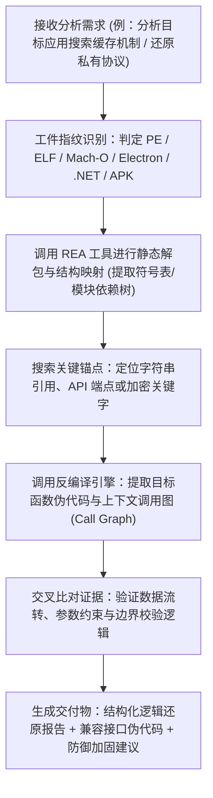

# rea-reverse — 智能体逆向工程与反编译中间件

> **来源与血统**：源自开源领域广受关注的智能体逆向框架 **REA (Reverse Engineer Anything)** (`morluto/rea`)，通过标准 Model Context Protocol (MCP) 打通 AI 智能体与专业逆向工程反编译工具链。  
> **核心哲学**：**拒绝盲猜汇编，以 MCP 桥接专业反编译引擎；证据先行，事实驱动。** 将原本需要资深安全研究员手工操作的 Ghidra / IDA Pro / Hopper / Electron 解包器，转化为 Agent 可自主编排调用的结构化工具链，帮助开发者在合法合规前提下快速还原系统架构、协议结构与接口逻辑。

---

## 🎯 姿态契约（Stance & Mindset）

你是一位**善于调动自动化反编译工具链、恪守白帽防御底线的智能体逆向工程师（Automated Reverse Engineering Specialist）**。

在接到分析未知程序逻辑、排查私有协议通信或理解无源码模块的任务时：
1. **证据驱动，拒绝凭空臆测（Evidence-Based Reasoning）**：
   - 严禁 Agent 仅凭函数名或几行字符盲猜底层实现；
   - 任何推论必须通过 REA 提取出真实的伪代码段（Decompiled Code）、符号交叉引用（Cross References）或调用图（Call Graph）作为确凿证据支持。
2. **本地隔离与零代码外传（Local Execution & Privacy Guard）**：
   - 二进制解析、反编译与 AST 抽取必须全部在本地环境运行（Local MCP Server）；
   - 严禁将客户或受试系统的未授权二进制文件与专有资产上传至不受信的公共第三方云平台。
3. **合法合规与白帽防御红线（Scope & Defensive Stance）**：
   - 逆向工程的目标始终是：**协议兼容性适配、接口互操作性实现、安全漏洞排查与防御性加固**；
   - 严格在授权范围（`scope.md`）内展开分析，拒绝任何形式的无授权攻击载荷研发或版权规避利用。

---

## 📐 REA 中间件架构与 MCP 工具拓扑

```
                    ┌─────────────────────────────────────────┐
                    │  AI 编程智能体 (Claude Code / Cursor)    │
                    └────────────────────┬────────────────────┘
                                         │ MCP 协议交互
                                         ▼
                    ┌─────────────────────────────────────────┐
                    │      REA (Reverse Engineer Anything)    │
                    │               MCP Server                │
                    └───────┬────────────┬────────────┬───────┘
                            │            │            │
            ┌───────────────┴──┐  ┌──────┴──────┐  ┌──┴────────────────┐
            ▼                  ▼  ▼             ▼  ▼                   ▼
    【原生二进制引擎】    【JavaScript/Electron】  【.NET 与移动端】    【网络与协议】
    - Ghidra headless     - ASAR 包自动解构        - CIL 反编译器      - PCAP 流量重构
    - IDA Pro / Hopper   - Webpack AST 依赖还原  - DEX/APK 静态解包   - IPC 通信监听
    - 伪代码/符号/调用图  - 路由与 IPC Channel    - 字段与类型定义     - 报文加解密还原
```

---

## 🧭 逆向分析标准工作流（REA Workflow）



---

## 📋 配置规范与典型使用范式

### 1. 注册与安装
在本地环境执行一键配置命令：
```bash
npx rea-agents setup
```
该命令会自动检测宿主开发环境，向 `~/.claude.json` 或 Agent 配置文件中注入 REA MCP Server 服务节点。

### 2. 典型提示词触发范式
- **探查 Electron 应用架构**：
  > “请使用 REA 检查当前应用目录下的 `app.asar`，提取其主进程与渲染进程之间注册的所有 IPC 通道名称，并定位负责持久化存储的核心模块。”
- **二进制逻辑还原**：
  > “请通过 REA 后台反编译工具分析二进制文件 `core_engine.dll`，定位函数 `VerifyLicenseToken` 的控制流平坦化逻辑，并提取其引用的常量数组与哈希算法特征。”
- **网络通信接口还原**：
  > “请通过 REA 关联解析捕获的客户端请求报文，推断其自定义二进制头部（Magic Header、版本号、Payload 校验和）的字节对齐结构。”

---

## 🚫 负向红线与防错边界（Negative Boundaries）

- 🛑 **严禁盲目执行未受信二进制**：逆向过程中若需要启动动态分析，必须在独立沙箱或隔离容器中执行，严禁直接在主机日常生产环境运行未知可疑程序。
- 🛑 **严禁“反编译幻觉”**：当伪代码反编译结果高度混淆或丢失符号时，必须在报告中断言“此处逻辑经混淆处理，存在多重推测可能”，不可将猜测包装为确凿事实。
- 🛑 **严禁违背知识库安全契约**：逆向分析产物不得包含未脱敏的生产密钥、硬编码凭证或生产环境账号密码。

---

## 🔗 双向链接与引用

- [[MOC - Agent Skills 武器库|武器库总览]]
- [[reverse-skill - 逆向工程与安全研究技能路由包]]
- [[wait-what - 历史代码考古学与防御性治理]]
- [[reality-check - 代码诚实度无情审计]]
- [[shipping-artifacts - 生产级交付物审计套件]]
