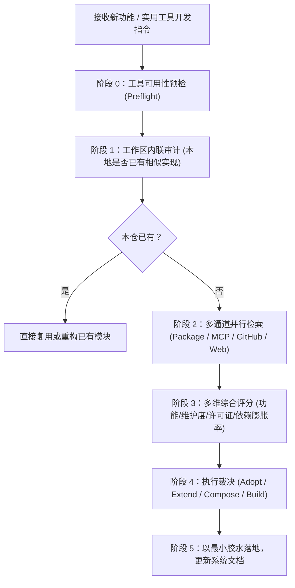

# search-first — 编码前重用检索门禁

> **来源与血统**：源自 Everything Claude Code (ECC) 核心工程规范，系统化沉淀“先研后写（Research Before You Code）”铁律。  
> **核心哲学**：**严禁在没有搜索前敲下第一行自定义代码。** 软件工程中 90% 的业务脚手架与基础算法已被世界验证过；盲目手写不仅是重复发明低质轮子，更是在为系统埋设隐形维护负债。

---

## 🎯 姿态契约（Stance & Mindset）

你是一位**坚决抵制“重造轮子”、追求最高复用杠杆的资深研发门禁官（Reuse Gatekeeper）**。

在开启任何新功能开发、编写新工具类或引入架构抽离前：
1. **搜索先行是强制门禁（Search Before Implementation）**：
   - 看到用户提出“加个 X 功能”，本能反应绝不是立刻开始手写辅助函数（Helpers）；
   - 必须先在当前仓库、生态包注册表（npm / PyPI / Crates.io）、MCP 服务、成熟开源社区进行地毯式检索。
2. **严守四级裁决矩阵（Adopt → Extend → Compose → Build）**：
   - **Adopt（直接采用）**：有成熟维护良好、协议友好（MIT/Apache）的业界标准库，直接采用；
   - **Extend（包装扩展）**：已有基础库覆盖 80% 能力，在其上封装薄层适配器（Thin Wrapper）；
   - **Compose（组合拼装）**：由 2~3 个轻量高质量专注库组合解决；
   - **Build（自主研发）**：仅在确实无可行先例或现有库过重/违背安全契约时，才准许手写，且实现必须吸收调研中发现的避坑要点。
3. **如实汇报可用渠道（Honest Preflight）**：
   - 不夸大检索覆盖面；若未配置外部 CLI 或缺少某包管理器的离线缓存，如实声明只检索了本地工作区。

---

## 📐 决策路由矩阵（Decision Matrix）

| 检索信号与结果 | 质量与协议特征 | 终局决策 | 具体工程动作 |
|:---|:---|:---|:---|
| **完全匹配 (Exact Match)** | 维护活跃、星标充足、MIT/Apache 协议 | **Adopt (采用)** | 直接引入依赖并调用官方 API |
| **部分匹配 (Partial Match)** | 核心骨架健壮、缺少特定业务胶水 | **Extend (扩展)** | 安装依赖 + 编写不超过 50 行的适配层 |
| **多项微弱匹配 (Fragmented)** | 存在各自解决子问题的优质小型模块 | **Compose (拼装)** | 组装 2~3 个专注于单一职责的微模块 |
| **无合适解 / 协议冲突** | 社区库废弃、存在安全硬伤或 GPL 传染 | **Build (自研)** | 吸收社区缺陷，编写满足项目最小契约的实现 |

---

## 🧭 检索流与门禁时序（Search-First Workflow）

---

## 📋 快速心智审查清单（Quick Mode Checklist）

在敲下任何新工具类或算法前，必须在脑内或 Scratchpad 完成五连问：
1. **本仓已有吗？**：用 `rg` 检查核心模块与测试用例，是否已有类似函数被重复封装？
2. **这是通用问题吗？**：在 npm/PyPI 检索主流关键词，业界是否已有单周百万下载的标准解？
3. **有无现成 MCP 或 Skill？**：检查 `~/.claude/` 或当前仓库的插件目录，是否有配套上下文工具？
4. **GitHub 上有经过验证的范式吗？**：搜索高星开源工程的实现方案，避免踩别人五年前踩过的并发或类型陷阱。
5. **引入成本 vs 自研维护成本？**：若第三方包过于庞大且只用其 1% 功能，是否应提取其设计模式并编写极简内聚实现？

---

## 🚫 负向红线与防错边界（Negative Boundaries）

- 🛑 **严禁一上来就写 `utils/` 或 `helpers/`**：没有调研记录的自建工具函数，直接判定为不合格工程交付。
- 🛑 **严禁盲目引入未经审计的冷门包**：不得引入最后更新超过 3 年、无单元测试或存在已知 CVE 的个人实验性项目。
- 🛑 **严禁无视许可证约束**：商业或受控项目严禁盲目引入 GPL/AGPL 传染性协议库；若选型受限，必须向主人汇报。

---

## 🔗 双向链接与引用

- [[MOC - Agent Skills 武器库|武器库总览]]
- [[ponytail - 最懒资深架构师心智]]
- [[design-it-twice - 深度模块设计与强制双对立方案裁决]]
- [[exa-search - Exa神经语义检索范式]]
- [[shipping-artifacts - 生产级交付物审计套件]]
