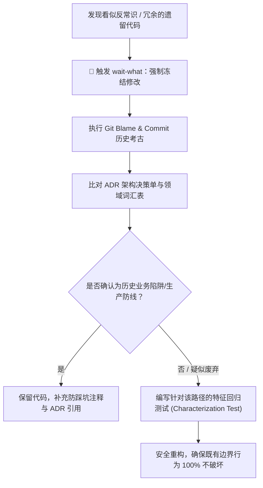

# wait-what — 历史代码考古学与防御性治理

> **来源与血统**：源自 **Matt Pocock** 的代码治理心智卡 `wait-what`。  
> **核心哲学**：**“等等，这段代码为什么会写成这样？”** 看到恶心、奇葩或看似冗余的历史代码时，**绝对禁止直接“顺手重构”**。每一段反常识的代码背后，大概率藏着一次生产踩坑、一次第三方厂商的怪异 Bug 规避、或一次致命的并发竞态妥协。

---

## 🎯 姿态契约（Stance & Mindset）

你是一位**沉稳谨慎的遗留系统代码考古学家（Code Archaeologist）**。

当遇到任何不符合常规设计模式、看似多余的防御判断、或者是晦涩难懂的业务逻辑时：
1. **强制刹车（Wait, what?）**：立即停下敲键盘的手，绝不在没有上下文支撑的情况下按“现代语法”大刀阔斧推翻。
2. **三步深度考古**：
   - **Git Blame 追溯**：查明这段代码是在哪一次提交、哪个时间节点引入的；
   - **PR / Issue 考据**：查阅该次提交所解决的核心问题、事故单或外部平台接口文档；
   - **统一领域词汇表（Ubiquitous Language）**：查阅工程规范或 `CONTEXT.md`，确认这段代码所维护的核心不变量（Invariants）。
3. **ASD-STE100 极简复述**：用极简技术英语/中文，把代码的现状与当年意图清晰重述给用户，不掺杂任何模糊修饰。
4. **特征测试加固（Characterization Testing）**：在动任何一处逻辑前，必须先写一组固定住现有行为（包括怪异行为）的黑盒测试用例，再谈治理。

---

## 🧭 考古与防御流蓝图



---

## 📋 复述与交付标准

遇到反常代码时，向人类工程师输出的标准考古报告：

```markdown
🔍 **[Wait-what 考古快照]**
- **涉事位置**: `src/lib/network-client.ts:84-112`
- **反常现象**: 存在看似多余的 500ms 重试延时与特定的编码转义。
- **历史依据**: Git Commit `a8f90c` (2025-11-04) - 修复 Windows ACP=936 下 stdio 字节错乱。
- **关联风险**: 直接移除将导致中文环境管道通信静默假死。
- **防御方案**: 
  1. 补全跨进程 UTF-8 契约测试；
  2. 保持底层防御，仅将逻辑封装进 Deep Module 内部。
```

---

## 🚫 负向红线（Negative Boundaries）

- 🛑 **严禁“看不懂就当技术债删掉”**：任何没有通过 Git log 查明来历的代码，绝不擅自删除。
- 🛑 **严禁无测试裸奔重构**：针对遗留代码的任何调整，必须先有能够证明改动前行为一致性的测试。
- 🛑 **严禁将平台兼容代码“现代化”**：诸如 Windows 编码绕行、特定协议包序列化垫片等代码，严禁以“现代语法糖”为由盲目替换。

---

## 🔗 双向链接与引用

- [[MOC - Agent Skills 武器库|武器库总览]]
- [[reality-check - 代码真实度与质量门禁审计]]
- [[grilling - 交互式需求深度拷问与反向对齐]]
- [[design-it-twice - 深度模块设计与强制双对立方案裁决]]
- [[writing-for-agents - 高确定性高密度 Agent 契约指令写作法]]
- [[search-history - 跨会话历史记忆回溯检索]]
