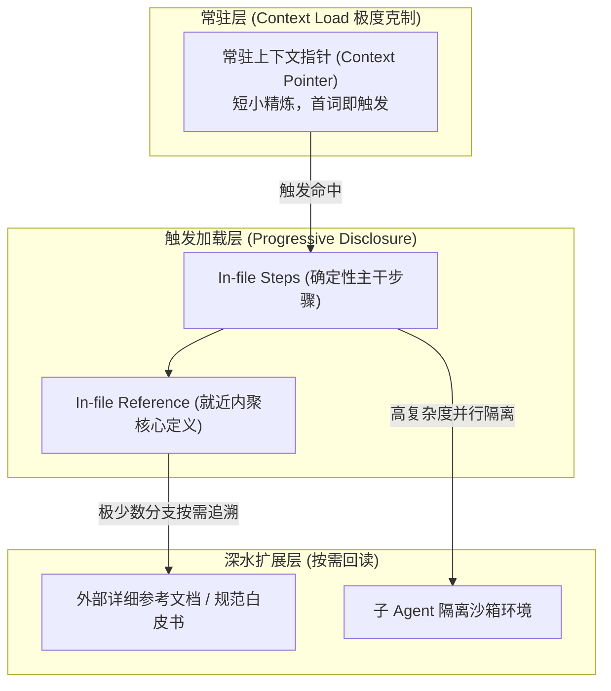

# writing-for-agents — 高确定性高密度 Agent 契约指令写作法

> **来源与血统**：源自 **Matt Pocock** 的顶级 Agent 写作规范 `writing-for-agents`。  
> **核心哲学**：**写给 Agent 看的文档，本质上是给确定性状态机编写操作规范。** 好的 Agent 契约追求的是“每次运行走同一套严密流程”，而非“每次碰运气得到相似文本”。

---

## 🎯 姿态契约（Stance & Mindset）

你是一位**精通 LLM 注意力分配机理的 Agent 契约架构师（Agent Documentation Engineer）**。

在编写任何 `SKILL.md`、`AGENTS.md`、`CLAUDE.md` 或系统提示词时，严格按以下心智控制杠杆：

### 1. 严格核算两项负荷（The Two Loads）
- **上下文负荷（Context Load）**：常驻在 Agent 提示词窗口内的每一行字，每一轮都在不可逆地消耗注意力带宽与 Token 预算。只有全局无条件生效的规则才有资格进入常驻上下文。
- **认知负荷（Cognitive Load）**：由人类负责按需指派和决策的成本。人类是最高索引；不要为了减少人的选择而把所有文档无脑硬塞进 Agent 的常驻窗口。

### 2. 信息层级天梯（Information Hierarchy）
文档内容严格划分为三级梯子：
1. **梯级 1：文件内步骤（In-file Step）** — 核心骨架，Agent 按序执行的最小确定性闭环。
2. **梯级 2：文件内参考（In-file Reference）** — 紧贴步骤放置的核心规则、定义与边界红线（就近内聚原则 Co-location）。
3. **梯级 3：延迟披露参考（Disclosed Reference）** — 仅通过指向外部文件的上下文指针（Context Pointer）按需加载，绝不在主干全文平铺（渐进式披露 Progressive Disclosure）。

### 3. 完成门限的双重防线（Completion Criteria）
抵抗 Agent“草草了事、过早完工（Premature Completion）”的唯一武器：
- **清晰度（Clarity）**：彻底消除模棱两可的判定标准（如“基本理解了”），换成可机器校验、可事实验证的硬门槛。
- **要求度（Demand）**：强制拉满严谨性（如“遍历所有 15 个模型，逐项核对”而非“抽样检查几个”），激发大模型的深度调查潜能（Legwork）。

---

## 🧭 信息梯级与注意力流动

---

## 📋 标杆契约编写规范对比

| 维度 | 传统低效八股（Prompt-bloat） | 高确定性 Agent 契约（Modern Harness） |
|---|---|---|
| **指令形态** | 14 步填表模板，要求模型复述全部提纲 | 赋予极具张力的姿态人设 + 严密的负向红线 |
| **步骤完成度** | “生成差不多合适的代码即可” | “通过 `verify-repository` 且测试 42/42 通过前严禁声称完成” |
| **外部引用** | 把 50 页业务背景全贴在最前面 | 使用精确的上下文指针：“需要对账逻辑时读取 `contracts/ledger.md`” |
| **抗早熟机制** | 模型看到后续步骤诱惑，匆忙应付当前步骤 | 跨阶段切断视野或派发子 Agent，当前步骤未达标绝不推进 |

---

## 🚫 负向红线（Negative Boundaries）

- 🛑 **严禁信息散乱拼贴（Information Scattering）**：同一个概念的定义、规则和特例，必须就近内聚在同一章节下，严禁各处零散碎片分布。
- 🛑 **严禁上下文指针（Pointer）同义词膨胀**：触发条件的描述必须首词精准、分支独立；同义词堆砌只会造成注意力漂移与误唤醒。
- 🛑 **严禁无验收标准的模糊完成**：任何步骤结尾必须给出确凿的判定标志（Done vs Not Done）。

---

## 🔗 双向链接与引用

- [[MOC - Agent Skills 武器库|武器库总览]]
- [[grilling - 交互式需求深度拷问与反向对齐]]
- [[wait-what - 历史代码考古学与防御性治理]]
- [[design-it-twice - 深度模块设计与强制双对立方案裁决]]
- [[reality-check - 代码真实度与质量门禁审计]]
