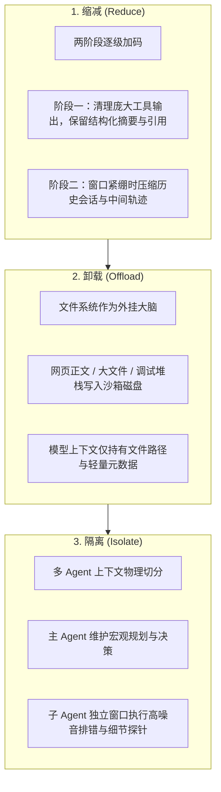

# AI 产品上下文压缩方法论与三板斧实践

> **核心哲学**：**上下文压缩的本质不是“尽量塞更多信息”，而是在有限注意力预算、延迟预算和成本预算下，持续把“当前决策最需要的信息”放到模型最容易利用的位置。**  
> 长上下文并不能自动解决 Agent 的记忆与成本问题；上下文工程不是锦上添花的优化，而是 Agent 系统“不做就跑不动”的基础设施。

---

## 🎯 核心结论与第一性原理

在真实的高阶 Agent 生产场景中（如 Coding Agent、研报综合 Agent），单次任务可能伴随 50~100 次工具调用。如果单次工具输出平均为 2,000 Token，仅中间工具产物就将膨胀至 10~20 万 Token：
- **注意力稀释（Attention Dilution）**：导致长程任务中模型遗忘最初目标或产生幻觉；
- **KV Cache 命中雪崩**：每次上下文微小震荡都会导致推理服务无法命中缓存，造成 5~10 倍的成本与延迟激增；
- **任务崩溃**：窗口逼近物理上限引发强制截断，关键历史状态丢失。

因此，现代成熟 Agent 体系（Manus、Claude Code、OpenClaw、Cursor）正在全面收敛至一套通用的上下文工程架构。

---

## 🧩 Manus 方法论：三板斧（Reduce, Offload, Isolate）

### 1. 缩减（Reduce）：所有压缩必须“可恢复”
真正优秀的压缩不是永久物理删除信息，而是把完整信息卸载到可回读的外部介质，**模型视野内只保留引用与状态**：
- 工具结果保留文件系统绝对路径；
- 抓取的网页保留源 URL 与本地离线快照；
- 历史压缩保留状态机 Schema（进度、已决事项、未决问题）。

### 2. 卸载（Offload）：把文件系统当成外挂大脑
相比将数万行代码和日志全部堆在 Prompt 中，现代 Agent 学会了利用文件系统进行分层记忆：
- 信息用完立刻持久化写盘；
- 需要深入分析时再精准按需读取（`view_file` 指定行范围）；
- 极大降低常驻窗口负担。

### 3. 隔离（Isolate）：多 Agent 的第一价值是隔离上下文
多 Agent 的核心收益并非“模拟人类公司的科层组织架构”，而是**为高噪音任务提供物理隔离的上下文沙箱**：
- 子 Agent 内部调用数十次编译报错、探索环境，其漫长冗余的报错堆栈绝不回流污染主 Agent 窗口；
- 任务结束仅向主 Agent 汇报精炼结论与交付物路径。

---

## ⚡ KV Cache 命中率：被低估的成本杠杆

在工业级 Agent 部署中，**KV Cache 命中率是衡量系统质量的单一最重要指标**：

| 反模式（破坏缓存命中） | 现代最佳实践（守护缓存命中） |
|---|---|
| 动态频繁向 System Prompt 头部注入时间戳或易变状态 | 易变内容后置，保持系统提示头部 100% 静态不变 |
| 动态按需增删工具列表定义 | **工具定义永远不变（Fixed Toolset）**，通过参数或指针分流 |
| 工具调用的 JSON 序列化键顺序随机漂移 | 严格按照确定性键排序序列化 JSON |
| 每次请求随意重组 Prompt 拼接顺序 | 遵循稳定前缀原则（Stable Prefixing） |

---

## 📊 各家 Agent 方案全景横向评测

| 产品 / 框架 | 核心压缩思路 | 核心借鉴价值 | 潜在工程代价 |
|---|---|---|---|
| **Manus** | **Reduce + Offload + Isolate** | 可恢复压缩、把文件系统作为持久记忆、稳定工具面 | 需完备的沙箱执行器与强劲的状态机 |
| **Claude Code** | **三层递进防线** | 1. 清理工具输出 → 2. 状态 Compaction → 3. 派遣子 Agent | 需要高密度的摘要 Schema 防止关键路径丢失 |
| **OpenClaw** | **ContextEngine 全生命周期管理** | Head + Tail 双向保留截断、分段结构化摘要、失败自愈 | 参数较多，工程调优与阈值设定门槛较高 |
| **Cursor** | **Dynamic Context Discovery** | 极致控制入口信息，仅凭当前光标语义按需检索注入 | 重度依赖本地索引与代码语义图谱召回精度 |
| **LangChain** | **自主触发压缩** | 让模型在决策循环中自主判断何时该触发压缩 | 触发时机缺乏可解释性，容易过早或过晚压缩 |

---

## 🛠️ 可直接落地的五大工程原则

1. **压缩不是删除，而是信息分层展示**：永远不要丢失检索源路径，确保任何历史上下文具备随时回溯的能力。
2. **递进式防线优先级**：**先减少无关输入 → 再压缩工具结果 → 再摘要历史会话 → 最后才派发子 Agent**。
3. **关键标识符（Opaque Identifiers）铁律**：在任何摘要阶段，UUID、哈希值、文件精确路径、变量名与行号必须原文保留，绝不概括模糊化。
4. **稳定前缀优先于动态灵活性**：不为细枝末节的动态性破坏大模型的 KV Cache 命中。
5. **预留安全缓冲边距（Safety Margin）**：在上下文消耗达到 75%~80% 时必须启动压缩，绝不能等到 95% 以上边缘窗口引发截断事故。

---

## 🔗 双向链接与引用

- [[为什么-harness-比模型更重要-3a8f81a0|为什么 Harness 比模型更重要]]
- [[deepseek-harness橙皮书-花叔-v260814-a00322c4|DeepSeek Harness 架构全景]]
- [[原位自演化智能体 In-situ Self-evolving Agent 架构|原位自演化智能体架构]]
- [[writing-for-agents - 高确定性高密度 Agent 契约指令写作法|面向 Agent 的契约写作法]]
- [[MOC - Agent Skills 武器库|武器库总览]]
