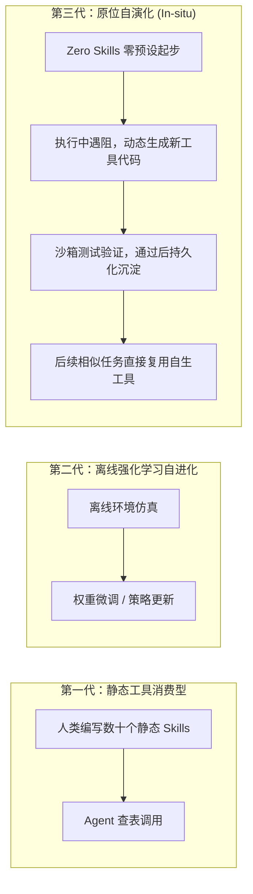
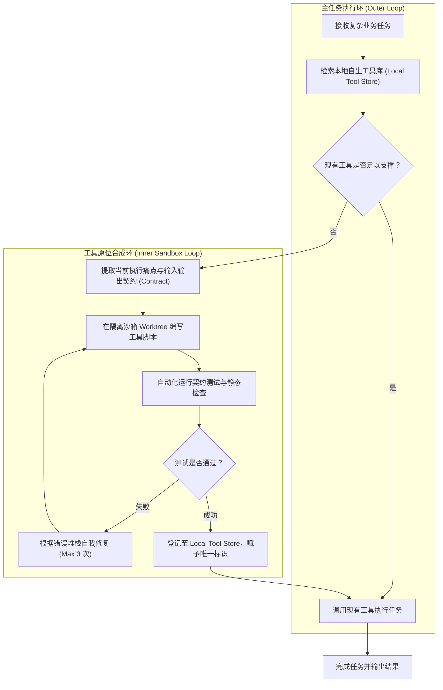

# 原位自演化智能体 In-situ Self-evolving Agent 架构

> **核心哲学**：**最强大的 Agent 不是拥有最多静态预设工具的 Agent，而是具备在执行任务中根据痛点“动态自造工具并沉淀复用”的智能体。**  
> 这标志着 Agent 架构正从“被动消费人类预设工具（Skills Consumer）”向“自主生产与迭代工具（Tools Creator）”进行范式跃迁。

---

## 🎯 核心概念与演化范式对比

传统的 Agent 自进化大多发生在**离线训练阶段（Post-training / RL）**，重度依赖人工标注的高质量监督信号与特定领域的合成数据。

而**原位自进化（In-situ Self-evolving）**则将自进化的发生场域直接前移至**在线推理与执行阶段（Runtime Inference）**：

---

## 📊 实验数据与工具收敛规律（The Convergence Law）

在 HLE（Humanity's Last Exam）、DeepSearchQA 等前沿高难度评测集上的实验表明：

1. **从 0 创造 128 个通用工具**：
   - 智能体在完全没有预设业务工具的情况下答题，在解决近 4,000 道复杂未知任务的过程中，自主编写并验证了 128 个微型工具模块；
2. **工具数量的马太效应与收敛性**：
   - 任务初期，新工具生成频率极高（快速补齐网页爬取、高精度计算、文本标准化等基础能力）；
   - 任务中后期，新增工具曲线迅速变平，模型开始以极高的频率复用前期自创工具，证明原位生成的工具具备**极强的泛化性与实用性**。
3. **评测基准超越**：
   - 基于 Gemini 3 Pro / Claude 3.7 构建的原位自进化 Agent，在长程复杂检索与推理任务中，表现大幅超出依赖人工预设固定工具的传统 Agent 十余个百分点。

---

## 🏗️ 工业级双环系统架构（Dual-Loop Harness）

在企业级生产环境中，允许 Agent 肆意动态造代码存在极高的安全风险（死循环、沙箱逃逸、资源耗尽）。因此，成熟的原位自演化架构必须采用**双环与沙箱隔离门禁**：

---

## ⚖️ 权衡与适用性批判（Critical Analysis）

### 1. 隐性成本（Hidden Costs）
- **延时暴增（Latency Spikes）**：首次遇到新需求时，因为需要经历“需求分析 → 编写脚本 → 运行测试 → 错误修复”的闭环，单轮响应耗时会从秒级上升到数分钟；
- **Token 消耗倍增**：编写代码与调试运行会消耗大量上下文 Token。

### 2. 适用与不适用场景矩阵

| 维度 | 适用场景 🟢 | 不适用场景 🔴 |
|---|---|---|
| **交互要求** | 离线长程研报、代码重构、大规模数据探索、学术论文综述 | 毫秒级实时人机对话、UI 即时渲染响应 |
| **任务形态** | 高度非标准化、长尾多样性强、充满未知的探索型任务 | 流程高度标准化、法规严格规范的固定业务管线 |
| **安全要求** | 具备受控隔离容器 / Worktree 的安全沙箱环境 | 直接触碰核心生产数据库、金融交易直接转账入口 |

---

## ⚠️ 核心反模式（Anti-Patterns）

- ❌ **误当银弹，废弃成熟工具链**：在具有明确规则与成熟生态的领域（如 Git 操作、SQL 查询），放任 Agent 每次从零重造轮子，是极大的资源浪费与风险引入。
- ❌ **缺乏持久化沉淀机制**：工具随着会话结束而销毁，导致下一次遇到相同问题又要重新造一遍，失去了自进化的核心收益。
- ❌ **无约束的执行权限**：未限制子进程超时时间（Timeout）与内存配额，导致 Agent 生成的死循环脚本耗尽主机资源。

---

## 🔗 双向链接与引用

- [[AI 产品上下文压缩方法论与三板斧实践|上下文压缩与外挂大脑]]
- [[为什么-harness-比模型更重要-3a8f81a0|为什么 Harness 比模型更重要]]
- [[deepseek-harness橙皮书-花叔-v260814-a00322c4|DeepSeek Harness 架构全景]]
- [[writing-for-agents - 高确定性高密度 Agent 契约指令写作法|面向 Agent 的契约写作法]]
- [[MOC - Agent Skills 武器库|武器库总览]]
