# 数字生命卡兹克-AI让数学再也回不去那个旧世界了

> **作者**：数字生命卡兹克  
> **发布日期**：2026-10-08  
> **原文来源**：[微信公众平台](https://mp.weixin.qq.com/s/lSal9jb7c-tUbm9vO4pI4A)

> 💡 **核心精粹与认知反思**：  
> **卡帕西大神有一句话，我最近也一直在提醒我自己：“你可以外包思考，但你没法外包理解。”**
> **AI 时代，人还剩下什么？我想，大概有三样东西：**
> 1. **提问**：什么问题值得问，往哪个方向走，这背后是人的好奇心还有积累的**审美（Taste）**；
> 2. **理解**：机器给出一个一百页的证明，它是对的，但它到底说明了什么？和别的东西有什么联系？
> 3. **意义**：有了汽车，人还在跑马拉松；有了缆车，人还在爬山；AlphaGo 之后棋手也没有消失……我们做一件事，从来不全是为了结果，还有意义。
> **“我们必须知道。我们，也必将知道。”**

昨天早上，可能会是人类时代的一个分水岭。

以至于这篇文章，在我即使有提前做了大量功课，有一定的知识储备的情况下，还是写了整整一天的时间，完稿时间是今天的凌晨6点15，无他，还是因为这个事件的信息量过大，历史意义过大，那种宿命感，在调研在写的过程中，还是有无数次的巨大的情绪波动。

这个事件大家比较关注新闻的，都已经看过了。

就是昨天（10月7号）早上，OpenAI没有任何预兆的，发布了巨量的数学研究成果，他们直接在Github上，发了一个新仓库，名字非常的朴素，叫openai/math。

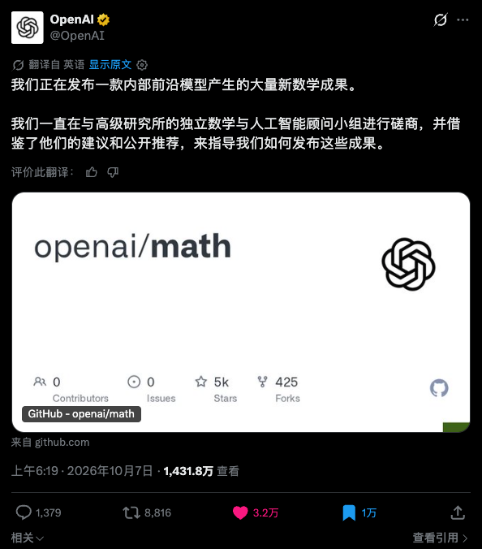

网址在此：https://github.com/openai/math

这里面躺着722份数学手稿，372个相关成果，覆盖数论、代数几何、实分析、组合数学、理论计算机、数学物理、偏微分方程等等方向，全部出自OpenAI内部一个没有名字也还没有对外发布的模型。

一夜之间，722篇论文，这个数量相当于啥概念呢。

著名的arXiv有上传限制，一个月每个人只能提交两篇论文。

722篇，如果是人做的，手传的话，光传论文就得传30年。

而且，这是数学，数学可以说是科学的基础，也是科学的皇后。

那一刻，你可以理解成，命运的齿轮已经不是缓缓转动了，是尼玛命运的齿轮直接钻出了火星子然后组装成了高达，在你面前俯视你，问你，你看，我是不是还挺牛逼的。

接下来的24小时，基本全世界都属于一种沸腾的状态，有人欢喜有人愁。

这哥们的评论是我觉得最感同身受的。

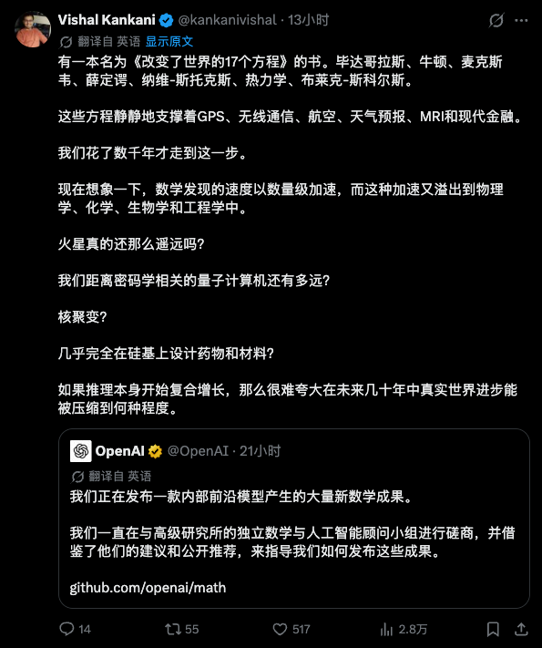

这是一个混沌的时代，也是一个底层科学指数级爆炸的时代。

《三体》里面经历的技术大爆炸，就目前来看，极有可能在我们的有生之年发生。

虽然在数学上，我是一个绝对的门外汉，但是也确实从2个月前就在恶补各种知识，有了AI之后学习真的很快，家人和朋友也有从事数学工作的，帮我做了很多的补充，现在也有了一些我自己的了解，所以我也想尽可能用我的笔墨，给大家写一篇小小的科普文章，尽可能让大家，也能理解这个震撼。

那么系好安全带，这趟旅程，我们正式开始。

## 一. 发生了什么？

这722份数学手稿，被归成了372个相关成果，也可以说成，是归成了372个成果组。

成果组这个词得解释一下，数学成果有点像生孩子，一个主结果出来，往往会顺带生出一串推论、补充论证，或者换个思路的另一种证明，那OpenAI就把这些沾亲带故的归到一起，算一个组了。

那这些成果是怎么来的呢？

OpenAI的说法是，他们手上现有的数学评测，已经被AI刷满了。

其实已经能看出来如今的数学评测的Benchmark已经趋近于饱和了，国际数学奥林匹克，也就是全世界最聪明的高中生参加的那个比赛，AI去年就拿到了金牌水平，你像各种数学题库，也刷得差不多了，分数再往上涨，已经说明不了什么东西了。

那如何再去评估模型的真实数学能力呢？

于是OpenAI他们挑了大约4000个数学界的尚未解决的研究问题，也就是数学里常说的“开放问题”，一股脑的喂给了那个没公开的内部模型。

最后从里面筛出有一定分量的结果，就是这372组。

这里大家可以不用怀疑OpenAI的模型在科研上的能力，虽然编程这块被Claude杀穿了，但是相比于编程，GPT模型在科研能力上一直都是SOTA的。

然后那个没公开的内部模型，平均下来，每个结果大约花了3小时 ChatGPT Pro级别的思考算力。

就是我们平时在ChatGPT上看到的这个模型。

3小时，很多人看到这个数字就已经坐不住了。

要知道，这里面有的问题，真实就是人类数学家琢磨了几十年但依然没有解决的皇冠上的明珠。

然后Altman当天发推，发了自己的感慨。

“你的海洋如此浩瀚，我的船只如此渺小。”我相信每一个跟最前沿的AI对话过的人，看着AI的无尽可能，或多或少，在内心里也迸发过这样的念头。

## 二. 数学是什么？

发布之后，数学家们沸腾了，这个沸腾，人间百态尽显。

罗格斯大学数学系主任、数论学家**Alex Kontorovich**看到“准黎曼猜想”那一条直接说，“准黎曼？？？？你在逗我吗？”随后，他说，如果这是人类数学家做出来的，**“直接就是菲尔兹奖，毫无疑问”**

也有比较尴尬的。

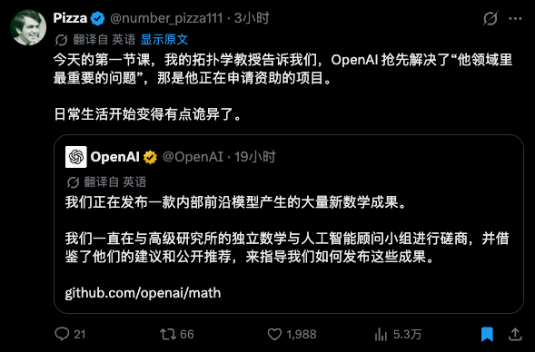

要理解数学家为什么这么激动，我觉得还是得知道一个前提，就是数学跟其他的学科，不太一样在哪里。

我自己浅薄的认知，就是两个字：证明。

物理、化学、生物之类的，很多时候靠的是实验。但是你实验做得再漂亮，理论也可能被推翻，就像牛顿力学统治了两百多年，最后还是被相对论修正了。

但数学不太一样，数学是从几条最基本的公理出发，每一步都严丝合缝地往下推导，一旦证明成立，在同样的公理和规则之下，它就永远成立，不会过时，也不会被推翻。

就像两千三百年前，欧几里得在《几何原本》里证明过的那些结论，今天依然成立。

可能这么说还是太抽象，咱们看一个真正的证明，放心，小学数学就够用了。

问题是：素数有没有最大的一个？

我们都知道，素数就是只能被1和它自己整除的数，比如2、3、5、7、11、13，越往后，素数越稀，那它会不会在某个地方彻底断掉呢？

欧几里得是这么证明的。

假设素数是有限的，那我们就一定能把世界上所有素数，全部写在一张清单上，接着，我们把清单里的所有素数全部乘起来，再加1，比如假设世界上只有2、3、5这三个素数，那就算2×3×5+1=31。

这个新数，除以2余1，除以3余1，除以5也余1，也就是说，你清单里的任何一个素数都除不尽它。

那它要么自己就是个素数，要么能被某个不在清单里的素数整除，不管哪种情况，都说明你的清单漏了。

所以，素数不可能有限，它有无穷多个。

这就是数学史上最著名的证明之一，素数无穷定理。

就这么几行字，两千多年没有人能挑出毛病，这就是数学的力量。

那“猜想”又是啥呢，就是大家都相信是对的，但还没人证明出来的东西。

咱们自己最熟悉的猜想，大概是哥德巴赫猜想，就是任何一个大于2的偶数，都能写成两个素数之和。1978年的时候，徐迟一篇报告文学让陈景润成了全民偶像，就是因为他在这个问题上走得最远。

早在十多年前，计算机就已经把哥德巴赫猜想验证到了4后面跟18个零那么大的数，这些年还在接着往上推，一个反例都没找到，但在数学家眼里，这还是不太行。

因为数学家要的是“所有”。

数学史上吃过这种亏，有个叫波利亚猜想的东西，从1开始一路验证，到几百万、几千万都是对的，结果到了906150257，好死不死的翻车了。

所以，验证一万亿个例子，也比不上一个证明。

但是这时候，问题来了，就是证明本身也会出错。

1637年，费马在一本书的页边上写了一个猜想，还顺手留了句话，大概的意是，我想到了一个绝妙的证明，可惜这里地方太小，写不下。

于是，这句话折磨了数学家三百五十多年。

1993年，英国数学家怀尔斯在剑桥宣布，他证明了费马大定理，全场掌声雷动，结果审稿的时候发现了一个漏洞，他又闭关一年多才把这个坑给填上，最后那份证明一百多页，全世界能完整看懂的人，屈指可数。

于是，这就带出了一个很现实的问题：证明越来越长、越来越难，人类的精力完全不够用了，怎么办？

于是有人开始想，能不能让机器来检查。

这就是OpenAI这次新闻里反复出现的Lean。

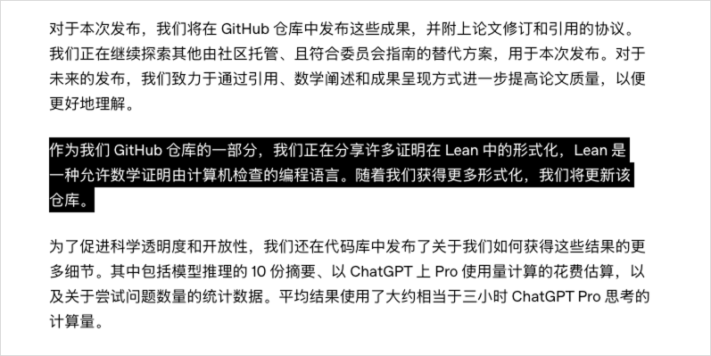

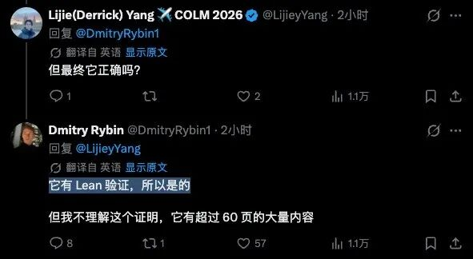

写代码的朋友可以这么理解，Lean就是数学界的编译器，你把证明一行一行翻译成Lean能读懂的代码，如果编译通过，就说明每一步推理都合规，没有偷工减料。

当然，它也有局限，主要是2个。

第一，如果你一开始就把题目抄错了，或者偷偷换成了一个简单版本，编译照样还是能过掉的，因为机器只管你证得对不对，但是不太会管你证明的是不是原来的那道题。

第二，它只能告诉你“对不对”，没法告诉你“新不新”“重不重要”“漂不漂亮”。

这两个局限，也基本是后续所有数学家讨论的重点。

## 三. 这次的“眩晕瘫坐”

这次372个成果组里，最炸最让人眩晕瘫坐的一个成果，那必然就是“准黎曼猜想”了。

还是回到我们上面提到的素数，复习一下，前面我们讲过，2、3、5、7、11、13……这些只能被1和自己整除的数字，就是素数。

它们是整数的原子，也就是说，任何一个大于1的整数，都能拆成几个素数相乘，而且拆法是唯一的，今天你手机里的很多加密，也是靠素数撑起来的。

素数有一个很奇怪的特点，就是单独看，它们乱得一塌糊涂。

两百多年前，十几岁的高斯发现，乱归乱，但大趋势是有的，就是越往后越稀。在100万附近，大约每14个数里有一个素数；到了1万亿附近，大约每28个数里才有一个。

但这也只是大概，于是几百年来，大家一直想搞明白的就是这个事，这些看起来乱七八糟的素数，背后到底藏着什么规律？

1859年，33岁的黎曼换了个完全不同的思路，他发表了一篇不到十页的论文给出了另一种思路，不研究素数了，研究一个叫**ζ函数**的东西，但，这个函数可以写成一种和所有素数直接相关的形式。

我知道这可能有点绕，你可以粗暴的理解成，ζ函数像一个把所有素数信息压缩进去的公式机器。

这里需要知道一个概念，叫做“零点”，这个“零点”是数学意义上的零点。

那函数我们都知道，它可以理解成一台机器，就是你塞进去一个数，它吐出来一个答案。

比如这个公式大家肯定能看懂。

塞进去3，答案刚好等于0，那么3，就叫这个函数的**零点**。

ζ函数也是一样，只不过它肯定没有这么简单，它的输入也不是普通数字，是复数，复数就不用理解了，你只需要把它想成平面上的一个坐标。

如果某个坐标塞进ζ函数以后，结果刚好等于0，那么这个点，就是ζ函数的一个零点。

而这些零点在哪里，和素数到底怎么分布，有着极深的关系。

我们早就知道素数大概会按照什么速度越来越稀，但是，实际的素数数量，会偏离这个平均规律多远？而ζ函数零点的位置，就控制着这种波动。

然后黎曼提出了一个极其大胆的猜想：

所有重要的零点，横坐标全部都是1/2。

这就是**黎曼猜想**。

但这个猜想，黎曼自己没证出来，后人也没有，于是1900年，希尔伯特把它列进了著名的23个问题，2000年，它又成了悬赏100万美元的千禧年七大难题之一。

那正面证明不了，数学家们就一点一点从边缘往里面怼，数学家早就知道，这些重要零点的横坐标，全都落在0到1之间，1/2正好在正中间。既然没法直接证明它们全在1/2上，那就退一步，从1这一侧开始，一块一块地证明“这里没有零点”，看看能往1/2推多远的距离。

第一步是1896年迈出的，阿达马和德拉瓦莱普桑两位数学家，各自独立证明了：横坐标正好等于1的地方，一个零点都没有。千万不要小看了这一步，高斯当年看出来的那个“越往后越稀”的大趋势，就是靠它才被严格证明，成了今天的“素数定理”。

可接下来就卡住了，此后一百多年，数学家能证明的，只是紧贴着1的一条细缝里没有零点，这方面最好的纪录停在1958年，之后将近七十年，几乎没有实质进展。

于是数学家们又退了一步，定了个低配版的目标，就是不用一口气证到1/2，只要证明存在某个比1小的数，比如0.99，横坐标超过它的地方，不管往上走多高，都没有零点就行。

这个低配版，就叫“准黎曼猜想”，可就连它，一百多年来也没人做到。

但OpenAI这次声称，做到了，而且一步推到了7/8，也就是0.875。

横坐标大于0.875的地方，从下到上，一个零点都没有。

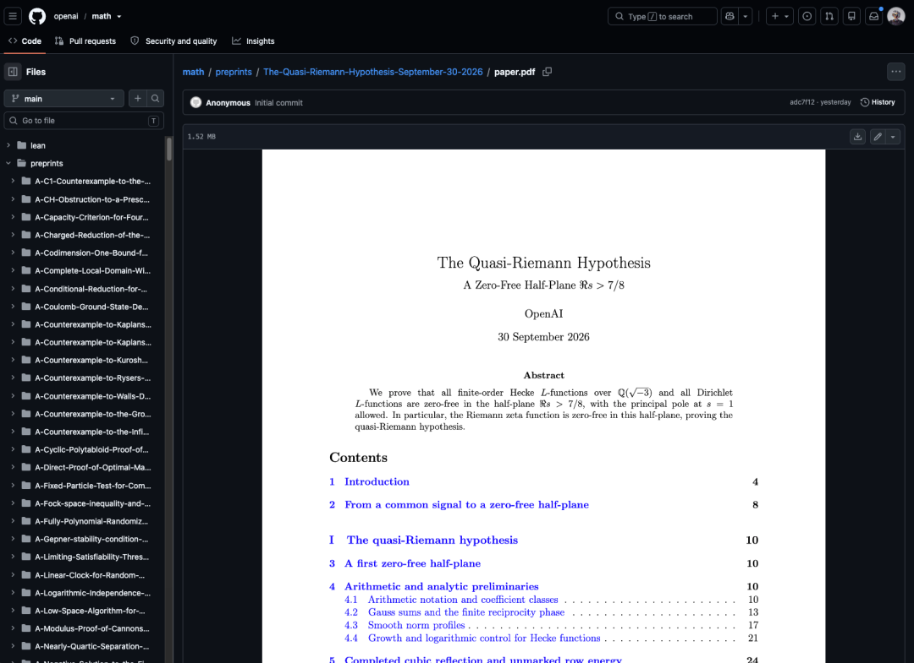

听着好像不多，但分量极重，因为这已经是这几十年来，在黎曼猜想上，最重大的突破了，AI解决了人类无法推进之事。

所以大佬才说，这要是人类做出来的，直接就是菲尔兹奖，没有任何悬念。

准黎曼只是其中一颗炸弹，再举两个重磅的。

## 1. 矩阵乘法。

矩阵就是一张数字表格。两张表相乘，是计算机里最基础的运算之一，大模型的训练和推理，底层干的主要就是这个。

教科书上的方法，计算量大约是表格边长的3次方。1969年，德国数学家施特拉森发现可以更快，把这个指数压到了2.81。

从那以后，全世界顶尖的学者花了五十多年，一点一点往下压，然后压到了2.37左右，这时候，小数点后第三位、第四位动一动，基本都能发一篇像样的论文。

然后，OpenAI声称，在复数域上，做到了2.25。

## 2. 挂谷猜想。

1917年的时候，日本数学家挂谷宗一问了一个看起来很幼稚的问题，就是一根针放在桌上，要让它原地掉个头，最少需要扫过多大面积？

直觉上我们都知道，应该有个最小值，结果后来有人证明，答案出人意料：可以小到任意小，小到几乎为零。

这个问题后来又逐渐演变，演变成了高维空间里的一个深刻猜想，牵扯到好几个数学分支，它的三维版本，就是2025年由王虹和Joshua Zahl攻克，被视为近年来最重要的突破之一。

今年7月，王虹拿到了菲尔兹奖，基本火遍了全世界，是这个奖九十年历史上第三位获奖的女性。

这次 OpenAI 声称，四维版本也解决了，三维那边还往前推了一个更强的版本。。。

除了这几个，清单里还有唯一博弈猜想相关的重大结果、霍奇猜想的特殊情形、更快的整数乘法……随便拎一个出来，我觉得放在过去都是能上头条的新闻。

如果这些都成立，说一句“数学史上前所未有”绝对算不上夸张。

事实就是如此。

## 四. AI和数学的纠缠

其实，这一次，已经不是AI第一次去碰数学领域了。

机器碰数学，比很多人想象的要早得多。

1956年，也就是达特茅斯会议召开、“人工智能”正式登场的那一年，有个叫“逻辑理论家”的程序，证明出了罗素那部数学巨著《数学原理》里的几十条定理，那时候大家都觉得，机器证明数学，指日可待。

结果这一等，就是几十年。

1976年，四色定理被证明了，这个定理很多人都知道，它说的是：任何一张地图，只用四种颜色，就能让相邻的国家颜色都不一样。

证明它的两位数学家，让计算机跑了上千个小时，挨个检查了上千种情况。

数学界当场吵翻了，一个人类根本看不完的证明，到底算不算证明？

这是数学史上关于“机器证明算不算数”最著名的一场争论。

1998年，又来了一个更头疼的。美国数学家黑尔斯证明了开普勒猜想，也就是水果摊上堆橙子的问题：怎么堆最省地方。

答案就是水果摊大爷早就会的那种堆法，但证明极其复杂，还用了大量计算机计算。

审稿人看了好几年，最后给出的意见大意是：我们有99%的把握它是对的。

99%，在数学界是个很尴尬的数字。

黑尔斯一咬牙，干脆发起了一个项目，用机器把整个证明从头到尾形式化验证一遍。这一验，就是十几年，2014年才完成。

从那以后，让机器验证这条路终于慢慢火了起来，后来有了我们上面提到的Lean，有了Mathlib这个全世界数学家一起往里填的开源库。

但那个阶段的分工很清楚，人负责想，机器只负责算和验证。

转折点出现在大模型时代。

2024年夏天，DeepMind的AI在国际数学奥林匹克上拿到了银牌水平。2025年夏天，好几家的AI都拿到了金牌水平，其中就包括 OpenAI。

竞赛题被刷满了，AI公司开始盯上真正的研究问题。

然后，当时就闹了一个大笑话。

2025年10月，OpenAI的一位副总裁发推，兴奋地说GPT-5解决了10个此前未解的埃尔德什问题。

埃尔德什是匈牙利的一位传奇数学家，这哥们一辈子没有固定住所，拎着一个手提箱满世界跑，到谁家就跟谁合作写论文，一辈子发了一千五百篇左右，他还喜欢给难题挂悬赏，从几十美元到上万美元不等，身后留下了上千个问题。

结果没过多久就被扒出来，GPT-5根本就不是自己去解出了这些题，是他娘的在浩如烟海的文献里，找到了早就有人解过、但被大家遗忘的答案。。。

但塞翁失马，焉知非福，大家也很意外的发现，那时候，AI当超级搜索引擎，那是真厉害，于是很多被埋在角落里的老结果，就这样被翻了出来。

真正的拐点在2026年5月。

OpenAI的模型推翻了埃尔德什在1946年提出的一个几何猜想，这一次，包括剑桥大学蒂莫西·高尔斯在内的九位外部数学家，专门写了配套论文，高尔斯是菲尔兹奖得主，他说这个成果，他会毫不犹豫地推荐给顶级期刊。

这是到那时为止，最受主流数学家认可的AI原创研究成果之一，也成了一个分水岭。

然后，速度就起来了。

5月，1项；8月，一次发布10项；9月，宣布一百多项；10月，372组成果。

5个月，翻了两个数量级，这搁谁都会懵逼的我觉得。

还有一个非常容易被忽略的变化，那就是成本。

9月份OpenAI攻纳维–斯托克斯方程的时候，动用了大约一万个Agent，跑了88个小时，烧了数百万美元的算力。

到了10月，OpenAI说几乎每个结果都是“一个提示词、一个Agent”跑出来的，平均3小时。

而且数学这条赛道上，也远远不止有OpenAI这一家。

DeepMind5月份发布的系统，解出了几百个埃尔德什问题里的9个，结果全部经得起机器检查，Anthropic用11天，把费马大定理的整个证明翻译成了Lean代码，足足一千三百万行。

整个行业，都已经刹不住车了。

## 五. 数学家们的回击

在今天之前，其实还有数学家们和OpenAI之间更加轰轰烈烈的交锋。

这是因为9月8号这一天，OpenAI宣布，他们在纳维–斯托克斯这个千禧年难题上取得了重大突破。

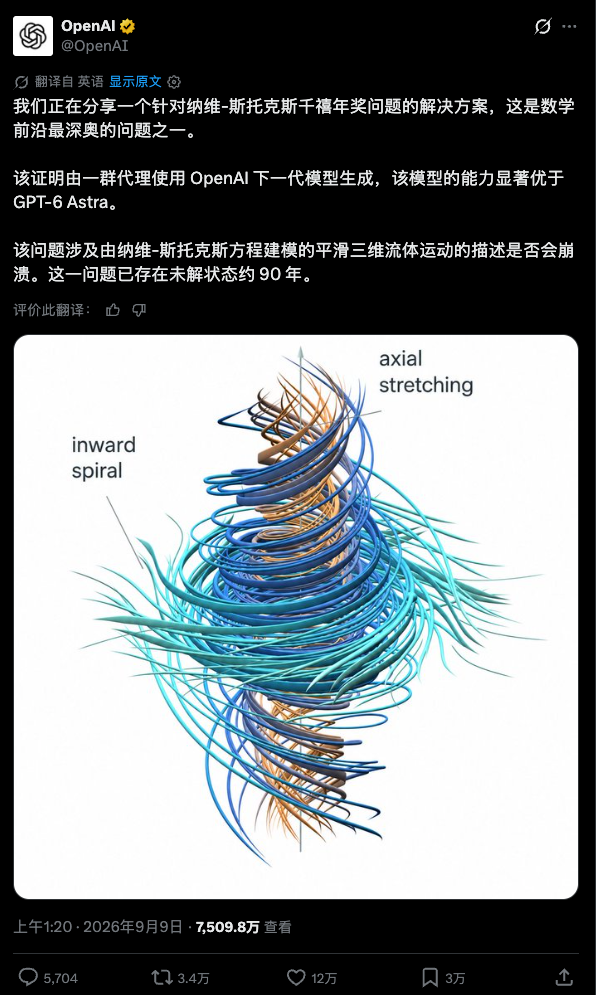

纳维–斯托克斯方程是千禧年七大难题之一，悬赏100万美元。

本来是件天大的好事，结果背后就有很多的瓜。

OpenAI 自己承认，他们是9月1日听到一个传闻，说有两道千禧年难题被人解决了，才紧急启动了这个项目。后来才知道，传闻跟两个人有关，一位是纽约大学的教授 Tristan Buckmaster，另一位是Levent Alpöge，他们死对头Anthropic的员工。

在 OpenAI 发公告之前大约12个小时，这两位抢先把自己的论文和Lean代码挂到了网上，不过他们证的是欧拉方程在有外力情况下的结果，跟OpenAI那篇纳维–斯托克斯证明不是同一个结果，但方向非常接近。

紧接着，Buckmaster公开指称，OpenAI的研究员Bubeck在一次通话里，就论文署名的问题向他施压，包括因为Alpöge在Anthropic工作，要求把他排除在外之类，还说了一些他理解为威胁的话。

反正就是两边开骂了，你要知道，这可是一向安静的数学圈，这事已经非常狗血了。

三天后，9月11日，一封联名信发了出来。

署名的是25位菲尔兹奖得主，名单里有陶哲轩，有德国的舒尔策，有乌克兰的维亚佐夫斯卡，有比利时的德利涅，还有华人数学家邓煜。

信的标题翻译过来，大概是《AI在数学中的严重错位》。

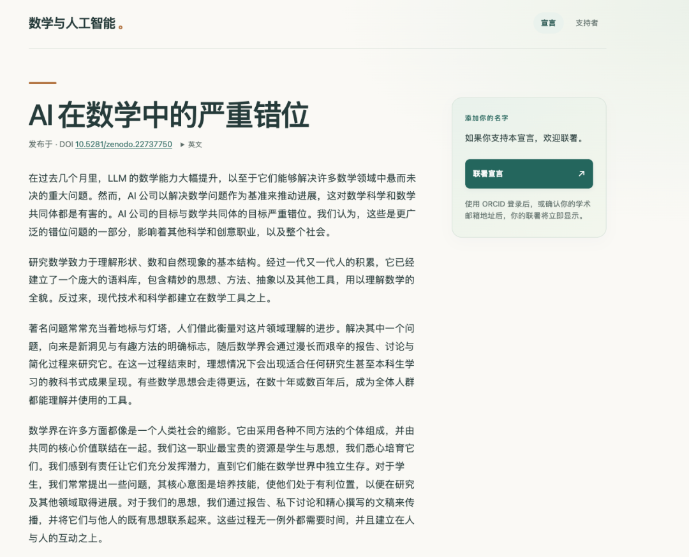

大概意思就是，AI公司把“解题”当成衡量自家模型多强的尺子，这跟数学本身的目标严重错位，且正在伤害数学和数学共同体，数学尤其是抽象数学，真正珍贵的从来不只是得到一个答案，它是为了让人类获得新的理解和洞见。

注意，他们没有说反对AI。信里也承认，AI有潜力增强和加速真正的数学研究，他们要的是给论文的撰写、署名和消化留出时间。

一周之内，七千多人联署。

再往前翻，还有一段更早的伏笔。

据《连线》杂志报道，8月份，OpenAI曾经召集大约40位数学家开过一次闭门会。美国数学会前主席Bryna Kra回忆，会上的气氛是极度兴奋和极度恐惧同时存在。

与会的数学家恳求OpenAI：“别一次性把东西全倒出来，也别像网红一样，只靠发推文来发布数学。”

9月21日，OpenAI放话说，已经解决了100多个开放问题，但没给任何细节，开头提到的那个设在普林斯顿高等研究院的独立顾问组，专门就这种情况，向数学界征求了意见。

9月29日，这个顾问组收集了数学界600多份反馈，发出了一套建议。然后非常严厉的说：他们不认可AI实验室拿外界用不了的专有模型，去测试前沿数学问题，并要求立刻停止这种做法。

对于那所谓的100多个做出来的结果，他们要求：

放进不受实验室控制的学术存档，公开模型名字、提示词、推理过程、花了多少时间和算力，能形式化的尽量形式化，失败的尝试也要报告。还特意加了一条，别拿数学成果，给你们自家模型打广告。

然后OpenAI没有回复。

一周后，10月7日，722份手稿上线。

这是一个可怕的时代。

但也绝对，是一个极其激动人心的时代。

## 六. 技术大爆炸

2016年3月，首尔，AlphaGo对李世石，4比1。

第二局，AlphaGo下出了著名的“第37手”，现场解说一开始以为是机器失误，后来才发现是一步人类想不到的妙手。

第四局，李世石下出了被称为“神之一手”的第78手，赢下了人类唯一的一局，三年后，李世石宣布退役，他说，AI是一个无法被打败的存在。

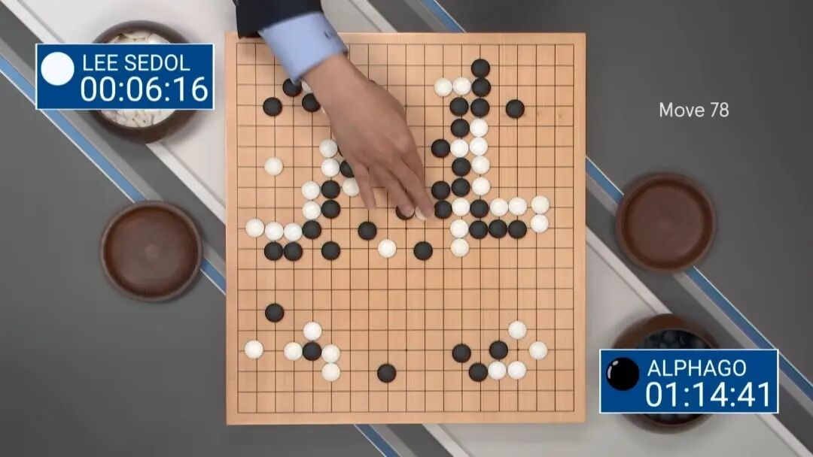

2017年，AlphaGo 又在乌镇三比零赢了当时排名世界第一的柯洁，柯洁在棋盘前落了泪。

再往后，事情就变得很安静了。

今天，AI赢了人类棋手，已经不是新闻了，更不会因为这种事上热搜。

AI下棋比人强，从一个震动世界的大新闻，变成了一个今天根本不需要讨论的常识。

我觉得未来所有的学科，可能都会走上跟围棋一样的路。

今天，大家还在为一个准黎曼猜想吵翻天，但可能用不了几年，AI再证出一个什么猜想，可能也无人在乎了。

大家只会耸耸肩：不然呢？AI做数学本来就比人强啊。

但至今为止，我觉得，人类最稀缺的，从来不是智力，是另一个东西：

注意力。

AI的注意力，几乎是无限的。

于是，这套打法，可以复制。

物理、化学、天文、生物，会不会都像数学一样，被一个领域接一个领域地迅速攻破？人类会不会迎来真正意义上的技术大爆炸？

《三体》中，恰好罗辑就经历了一次技术大爆炸。

我们所有的学科，都一定会技术大爆炸的，一定会的，只不过，速度有先后，这个速度只取决一个因素：

评判器，或者说这个裁判，到底有多贵。

数学的裁判是Lean，跑一遍几秒钟；下棋的裁判是一盘棋，几十分钟。

这两个都很快。

可化学的裁判是实验室，一种新材料要合成、要测试，几周、几个月。

新药的裁判是临床试验，一种药从发现到上市，过去常常要十年。

高能物理的裁判，可能是一台造价几十亿美元的对撞机。

天文学的裁判，那也许得等下一台望远镜升空了。

AI再快，也快不过现实世界。

所以，技术大爆炸也必然遵循这个原则，先大爆炸的，一定是数学和代码，因为裁判几乎免费，然后是天气、蛋白质、材料筛选等等这些能在电脑里模拟的领域。

最后，才是必须动手做实验的硬科学，以及，一切跟人有关的事，比如，医学。

而当AI能在每个领域源源不断地提出新想法时，整条链条上最慢的，会变成两样东西。

一样是现实世界里的实验，另一样，是人。

人要去核对，要去理解，要去决定哪个方向值得投钱、值得冒险。

到那时候，人类自己，会成为科学进步里最慢的那一环。

其实，这一幕已经在数学里提前上演了。

经常用Agent写代码的朋友应该肯定会深有体会，AI现在写代码变得很便宜，但真正的瓶颈变成了代码审查，AI一天能写几十万行，你一天能看几行？

或者说，你现在还看AI写的代码吗？

数学现在就站在同一个路口，生成证明变得便宜了，但审核证明、理解证明，成了最稀缺的东西。

这372组成果，大概需要整个数学界消化几个月。

几个月以后呢？谁知道模型又进化成什么样了呢？

## 七. 尾声

最后，我想讲两个小故事。

第一个故事，发生在1900年的巴黎。

那年夏天的国际数学家大会上，德国数学家希尔伯特做了一场演讲，提出了一批他认为新世纪最重要的数学问题，后来整理发表，就是著名的23个问题。

这23个问题，养活了整整一个世纪的数学家，只要谁解决了其中一个，谁就能名垂青史，整个20世纪数学的走向，很大程度上就是被这张清单塑造的。

一个好问题，有时候比一个好答案值钱得多。

因为答案只有一个，而问题，会塑造整整一代人。

第二个故事，发生在1930年的柯尼斯堡。

那年9月，已经功成名就的希尔伯特，在家乡发表了一场广播演讲。

结尾那句话，后来刻在了他的墓碑上：

我们必须知道，我们必将知道。

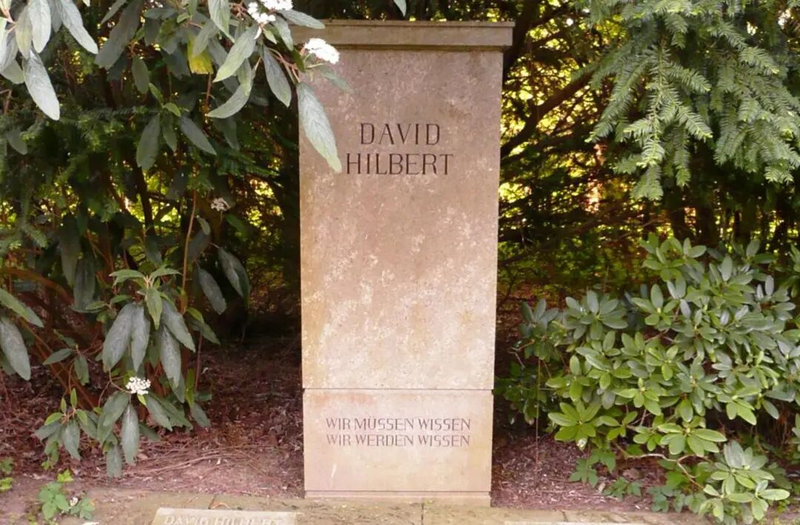

这是希尔伯特一生数学乐观主义最浓缩的一句话。

但很少有人注意到，就在他演讲的前一天，在同一座城市的一个学术会议上，一个24岁的年轻人哥德尔，轻描淡写地宣布了一个结果。

后来，它被称为“不完备定理”。

“只要一个数学体系的公理能被一条条明确地列出来，强到足以描述最基本的算术，而且自身不矛盾，那它里面就一定存在一些命题，光靠这套公理，你既证明不了它对，也证明不了它错。”

希尔伯特当年的梦想之一，就是给数学造一个坚不可摧的地基，把数学公理化，然后用严格的数学方法证明这整栋楼不会塌。

哥德尔却说，只要这栋楼足够复杂，你就不能完全站在楼里面，靠楼本身证明楼永远不会塌。

你只有出去，画一个更大的圈，造一栋更大的楼。

圈外，一定还有新东西。

**数学，用自己最严格的方法，证明了自己的边界**。

我讲这两个故事，是想说，我做数学的家人和朋友告诉我，数学，在她们的理解里，从来就不只是“为了知道答案”。

如果只是为了答案，那AI也许真的会比人做得更快、更多。

可是数学这门手艺，人类已经干了几千年，从欧几里得到费马，从高斯到黎曼，它最迷人的地方，更从来不是最后那个证毕。

是那穷尽一生，追寻和理解的过程。

英国数学家哈代说过，数学家跟画家、诗人一样，是模式的创造者。

卡帕西大神有一句话，我最近也一直在提醒我自己：

“**你可以外包思考，但你没法外包理解**。”

所以，AI 时代，人还剩下什么？

我想，大概有三样东西。

**第一，是提问。**什么问题值得问，往哪个方向走，**这背后是人的好奇心还有积累的审美**。

**第二，是理解。**机器给出一个一百页的证明，它是对的，但它到底说明了什么？和别的东西有什么联系？

**第三，是意义。**你看，有了汽车，人还在跑马拉松，有了缆车，人还在爬山。AlphaGo之后，棋手也没有消失，他们开始跟AI学棋，重新理解这门古老的游戏。很多时候，我们做一件事，从来不全是为了结果，还有，意义。

最后，用希尔伯特的那句话作为结尾吧。

**我们必须知道。**

**我们，也必将知道。**

>/ 作者：卡兹克

>/ 投稿或爆料，请联系邮箱：wzglyay@virxact.com

---

## 🖼️ 原文高清架构与图解附录

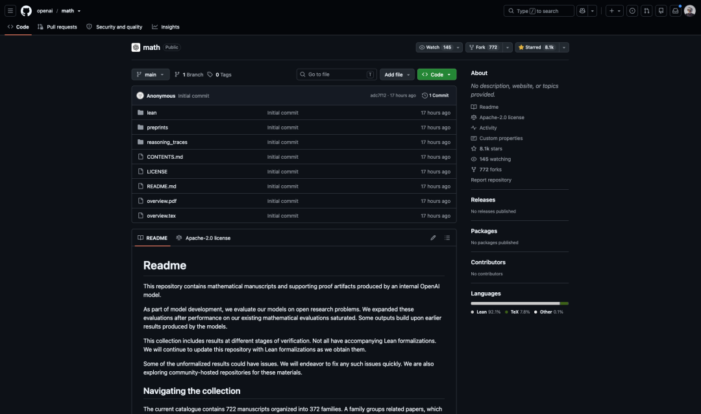

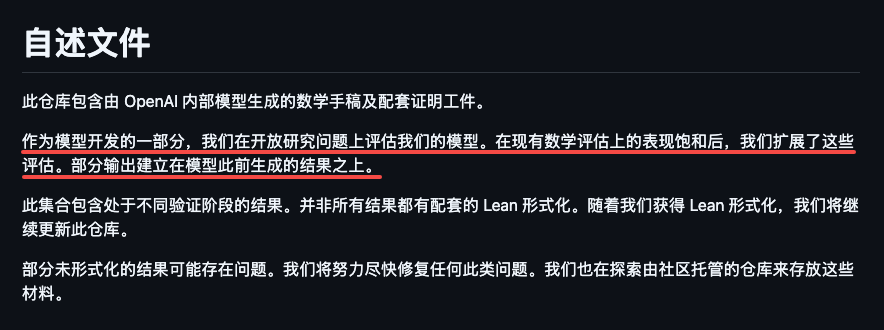

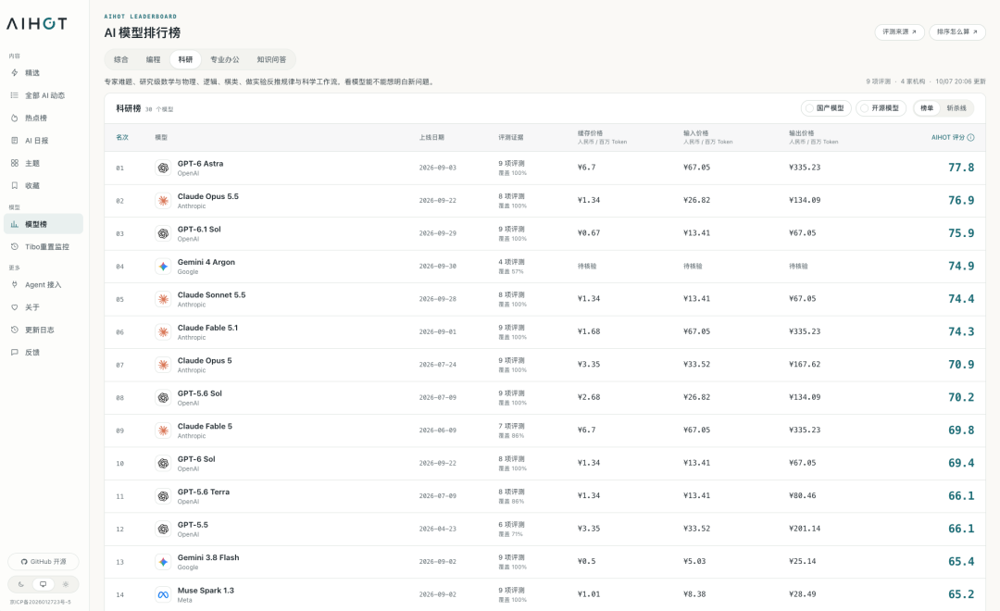

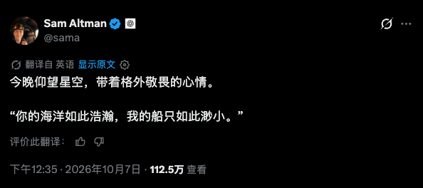

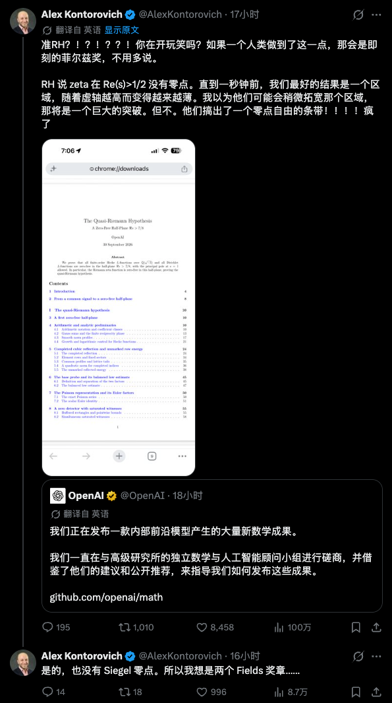

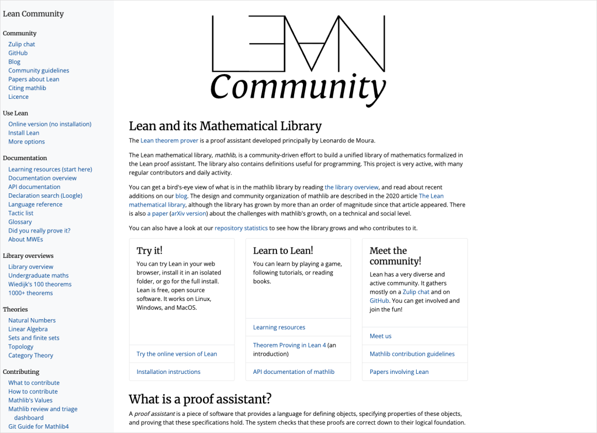

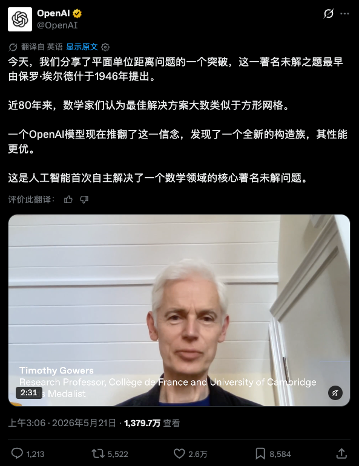

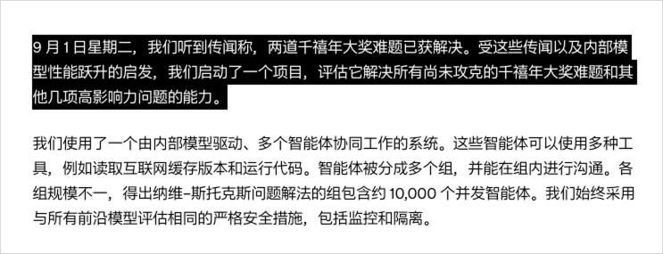

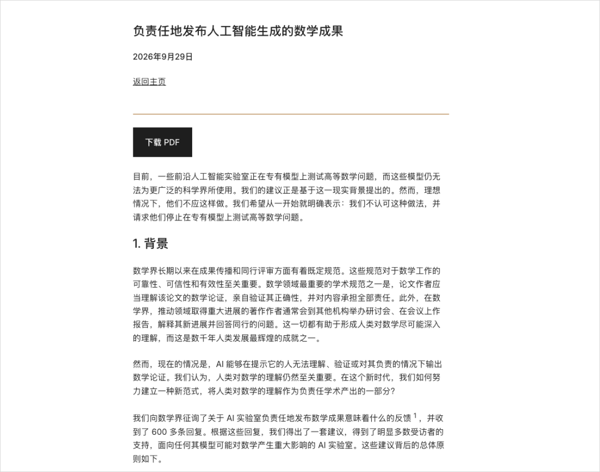

